# VerdictChain — The Complete Project Guide

A multi-agent forensics console for **insider threats** and **network intrusions**.
This guide explains the whole system page by page, card by card: what each element shows, where its value comes from, and the logic behind it.

> **How to read this guide.** English is used for the explanation (so it is faculty-friendly). At the end of each page and each concept there is a **"Kya bolna hai" (what to say)** block in Hinglish: a short talk-track you can use while demonstrating.
> Every number quoted from the running system comes from the local development database. Everything the demo shows was produced by the **offline stub**, a test harness that stands in for the LLM providers. This is stated again where it matters (Part 4 and Part 8).

---

## Table of contents

- [Part 0 — The project in one minute](#part-0--the-project-in-one-minute)
- [Part 1 — Running it and logging in](#part-1--running-it-and-logging-in)
- [Part 2 — What surrounds every page (the shell)](#part-2--what-surrounds-every-page-the-shell)
- [Part 3 — Page by page](#part-3--page-by-page)
- [Part 4 — Four investigations, step by step](#part-4--four-investigations-step-by-step)
- [Part 5 — How the engine works (concepts and formulas)](#part-5--how-the-engine-works-concepts-and-formulas)
- [Part 6 — Data model, API and security map](#part-6--data-model-api-and-security-map)
- [Part 7 — Quality evidence](#part-7--quality-evidence)
- [Part 8 — Faculty questions and honest limits](#part-8--faculty-questions-and-honest-limits)
- [Part 9 — A 15-minute demo script and cheat sheet](#part-9--a-15-minute-demo-script-and-cheat-sheet)

---

# Part 0 — The project in one minute

## 0.1 What VerdictChain is

VerdictChain takes security logs, lets **three investigator agents** (LLM-based) analyse different slices of them, makes them **debate for three rounds**, checks **every piece of evidence they cite** against the raw logs, and then produces a **verdict**. If the verdict is confident and the agents are trustworthy, a **Self-Healing agent** contains the threat, but **only inside a sandbox** (the actions are simulated and can never touch a real system). Everything is written to a **hash-chained audit trail** and shown on a **live React console**.

| Piece | Role |
|---|---|
| **Network-Traffic Investigator** | Reads CICIDS2017 network flows. Looks for DDoS, port scan, brute force, botnet C2. |
| **Access-Log Investigator** | Reads CERT r4.2 per-user-per-day file-access rows. Looks for unusual file access / exfiltration. |
| **Endpoint-Behavior Investigator** | Reads CERT r4.2 logon and device rows. Looks for off-hours logons, unusual devices, privilege misuse. |
| **Debate engine** (LangGraph) | Runs 3 rounds. Each round the active investigators answer **in parallel**. Round 1: state a theory. Round 2: CHALLENGE, SUPPORT or REVISE. Round 3: final position. |
| **Watchdog** | After every round, re-checks each cited log row in PostgreSQL. Updates each agent's **Credibility Score (CrS)**. Isolates an agent whose score falls below 0.30. |
| **Verdict aggregator** | A **deterministic function** (not an LLM) that turns the final positions into one verdict class and a confidence. |
| **Self-Healing agent** | If verdict confidence ≥ 0.80 **and** every contributing agent has CrS ≥ 0.50, runs sandboxed actions (lock account, block IP range, rate limit, audit). |
| **Audit trail** | Every state change is an entry with a SHA-256 hash chained to the previous one, so tampering is detectable. |
| **Live feed** | A simulated "network": dataset rows arrive on their own through RabbitMQ, a monitor flags unusual windows, and an investigation starts **without any click**. |
| **Console** | React + TypeScript. Every number comes from the API and has an (i) button that shows its source, sample size and formula. |

> **Kya bolna hai.** "Ye ek multi-agent SOC console hai. Teen AI investigators alag-alag logs dekhte hain, 3 round debate karte hain, aur ek Watchdog har cited log row ko database se verify karta hai. Verdict ek deterministic function se aata hai, LLM se nahi. Agar verdict confident hai aur agents trustworthy hain, to sandbox me containment hota hai, jo kabhi real system ko touch nahi kar sakta. Har cheez hash-chained audit trail me jaati hai."

## 0.2 Why a debate with a Watchdog (and not one LLM)

A single LLM answer can be confidently wrong or invent evidence. VerdictChain reduces that risk with three layers:

1. **Different data, different agents.** Each investigator reads its own slice, so a mistake in one domain is not automatically repeated by the others.
2. **Cross-examination.** In rounds 2 and 3 each agent sees the other agents' theories and must CHALLENGE, SUPPORT or REVISE. A near-identical repeat of its own previous answer is rejected and re-asked once.
3. **Grounding check (Watchdog).** Every `cited_evidence` entry (`row_id`, `field`, `value`) is looked up in `raw_logs`. A citation that does not exist or does not match lowers the agent's CrS. Repeated failures isolate the agent.

The project is careful about wording: this **reduces** the risk of a single point of failure, it does not eliminate it, and the Watchdog itself being compromised is an acknowledged, undefended limitation.

## 0.3 Architecture at a glance

```
                       ┌────────────────────────── DATA ───────────────────────────┐
  CICIDS2017 flows ──► │ ingestion (pipeline/)  ──►  PostgreSQL  raw_logs (92,716 rows) │
  CERT r4.2 per-user   │                                                              │
  per-day features ──► └──────────────────────────────────────────────────────────────┘
                                   │                         ▲
        manual "inject scenario"   │                         │ Watchdog re-reads the
        (Dashboard: POST           │                         │ cited rows here
         /investigations/simulate) │                         │
                                   ▼                         │
  ┌────────────────────────────────────────────┐             │
  │ LIVE FEED (optional, simulated network)     │             │
  │ sensor ─► RabbitMQ queue ─► monitor ─► window│             │
  │ flagged ─► investigation starts by itself    │             │
  └──────────────────────┬─────────────────────┘             │
                         ▼                                    │
              ┌── DEBATE QUEUE (up to 4 debates at once) ┐     │
              │ status: queued ─► investigating          │     │
              └──────────────────┬──────────────────────┘     │
                                 ▼                            │
   ┌──────────────── LangGraph debate (3 rounds, agents in parallel) ────────────────┐
   │ Network-Traffic  │  Access-Log  │  Endpoint-Behavior   ──►  OpenAI (LLM)      │
   └───────────────┬──────────────────────────────────────────────────────────────────┘
                   ▼ each round
        WATCHDOG ─► verify citations ─► CrS (Redis + credibility_log) ─► isolate if < 0.30
                   ▼ after round 3
        VERDICT AGGREGATOR (deterministic) ─► Self-Healing (sandbox only) ─► response_actions
                   ▼
        AUDIT TRAIL (SHA-256 hash chain)  ──►  FastAPI (REST + WebSocket)  ──►  React console
                                                         Redis pub/sub "something changed" events
```

Locked technology stack: **LangGraph** (orchestration), **OpenAI** (the one LLM provider), **FastAPI** (REST + WebSocket), **PostgreSQL** (data), **Redis** (live credibility scores, caches, event push), **RabbitMQ** (log ingestion queue), **React + TypeScript** (console), **Alembic** (migrations), **Docker + Compose**, **GitHub Actions** (CI), **Vitest** and **Playwright** (tests).

## 0.4 The four ideas to remember

| Idea | What it means | Where it is enforced |
|---|---|---|
| **Blind test** | No investigator is ever told which scenario was selected. The ground-truth label exists only for evaluation. | Agent inputs carry only `raw_fields`. An AST scan, a seeded-secret test and a prompt test fail the build if a label could reach an agent (`backend/tests/agents/test_blind_boundary.py`). |
| **No bluff** | Every value on screen is an API field or a browser calculation whose formula is shown. A missing value is "—" with a reason, never 0. | `frontend/scripts/no-bluff-check.mjs`, the backend contract test and a Playwright canary. |
| **Deterministic verdict** | The verdict is computed by code from the final positions, not by another LLM call. | `backend/debate/verdict.py` |
| **Sandbox + tamper-evident audit** | Containment is simulated (the database refuses a row with `is_simulated = false`) and every change is hash-chained. | `backend/self_healing/sandbox.py`, `backend/db/audit.py` |

## 0.5 The data

| Source | Table rows (`raw_logs`) | What a row is |
|---|---|---|
| CICIDS2017 (network) | 9,736: BENIGN 3,000 · DDoS 1,500 · FTP-Patator 1,500 · Portscan 1,500 · SSH-Patator 1,500 · Botnet 736 | One network flow with its ~55 CICFlowMeter fields (`Flow Packets/s`, `Flow Bytes/s`, flag counts, IAT, active/idle statistics...). |
| CERT r4.2 logon | 58,675 | One **user-day**: `off_hours`, `logon_count`, `distinct_pcs`, `logoff_count`. |
| CERT r4.2 device | 13,685 | One user-day: `connect_count`, `distinct_pcs_with_device_activity`. |
| CERT r4.2 file | 10,620 | One user-day: `file_access_count`, `distinct_filenames`, `user_department`. |

Total **92,716** rows. The three **insider scenarios** of CERT r4.2 are labelled only in `ground_truth_label` (used for evaluation, never shown to agents): scenario 1 (after-hours logons + removable drive + wikileaks upload), scenario 2 (job-site surfing, then heavy drive use), scenario 3 (a sysadmin logging in as someone else). The mapping of these labels to verdict classes comes from the CERT answer files and is documented in `backend/evaluation/ground_truth_map.py`.

## 0.6 Glossary

| Term | Meaning |
|---|---|
| **CrS** (credibility score) | Per-agent number in [0, 1], starts at 0.50. After each round: `CrS_new = clamp(CrS_old × (1 + η × (2 × rate − 1)), 0, 1)`, where *rate* is the share of that round's citations that verified and **η = 0.20**. |
| **Isolation / quarantine** | An agent whose CrS drops below **0.30** is quarantined: it takes no part in the rest of that debate or its verdict, and stays out of later debates until a lead restores it (restore resets CrS to 0.50, audited). |
| **Verdict class** | `ddos`, `port_scan`, `brute_force`, `botnet_c2`, `insider_file_exfiltration`, `insider_logon_anomaly`, `benign`, `ambiguous`. |
| **Stance** | The first word of a round-2/3 answer: `CHALLENGE`, `SUPPORT` or `REVISE`. |
| **Primary agent** | The investigator whose data slice contains most of the scenario's rows. It is the tie-breaker when the final votes split. |
| **Input basis** | How a non-primary agent's rows were chosen: `scenario_rows`, `same_user_window`, `time_window` or `recent_sample` (best to worst). |
| **Metric / Proof** | Every live number is a `{value, n, as_of, source, definition, reason}` envelope. The **(i) / Proof** button next to a number shows those fields. |
| **Window** | In the live feed: the newest 30 network flows or 20 CERT rows of one source, scored by a fixed rule. |
| **Stub** | The offline test harness that replaces the LLM clients with canned, schema-valid answers. Its output is labelled `stub-openai`. |

---

# Part 1 — Running it and logging in

## 1.1 Start the system (development)

Prerequisites: Docker, Python 3.12+, Node 22 with pnpm. The datasets are **not** in git (they are large); they are loaded once.

```bash
cp .env.example .env                 # then edit passwords, JWT_SECRET_KEY, BOOTSTRAP_LEAD_*, API keys
docker compose up -d                 # PostgreSQL (5433), Redis (6379), RabbitMQ (5672)
python -m venv .venv && source .venv/bin/activate
pip install -r backend/requirements.txt && pip install pandas==3.0.1
cd backend && python -m alembic upgrade head && cd ..          # creates the tables (migrations 0001 to 0010)
python -m backend.pipeline.ingestion                           # CICIDS2017 subset into raw_logs
python -m backend.pipeline.cert_ingestion                      # CERT r4.2 features into raw_logs
```

Run the API (choose one):

```bash
python -m uvicorn backend.api.main:app --reload --port 8000     # real OpenAI (spends tokens, capped by OPENAI_DAILY_TOKEN_LIMIT and by the key's own limits)
python -m backend.testing.e2e_server --port 8000                # offline stub: same pipeline, no keys, no cost
```

Run the console:

```bash
cd frontend && pnpm install && pnpm dev       # http://localhost:5173
```

Optional demo data with zero LLM calls: `python -m backend.scripts.seed_demo` (one full debate per default scenario, using the stub).
To start the simulated live feed together with the API: set `LIVE_FEED_AUTOSTART=true`.

## 1.2 Accounts and roles

There is **no default password**. Accounts come from two places:

1. **Register** on the sign-in screen (username ≥ 3 characters, password ≥ 8). New accounts are always `forensic_analyst`; the registration request cannot choose a role.
2. **The first administrator** is created from `.env`: set `BOOTSTRAP_LEAD_USERNAME` and `BOOTSTRAP_LEAD_PASSWORD`, then run `python -m backend.scripts.bootstrap_lead`. It creates (or promotes) a **secops_lead**, is idempotent and never prints the password. A lead can then change other users' roles (Access page).

Passwords are hashed with **bcrypt**. Signing in returns a **JWT** (HS256, 60 minutes) that the browser keeps in `localStorage` and sends as `Authorization: Bearer …`. The role is **re-read from the database on every request**, so a role change takes effect immediately and a deleted account is refused. Login is rate-limited (10 per minute per client address), registration 5 per minute.

### Roles and what each may do (RBAC matrix, `backend/api/rbac.py`)

| Capability | secops_lead | forensic_analyst | red_team_auditor | watchdog_supervisor |
|---|:-:|:-:|:-:|:-:|
| `inject_scenario` (start a debate from the Dashboard) | ✅ | ✅ | ✅ | ✅ |
| `sign_evidence_bundle` (audited sign-off) | ✅ |  |  | ✅ |
| `trigger_emergency_containment` (manual sandbox containment) | ✅ |  |  | ✅ |
| `override_fault_weights` (fault-injection dry run) | ✅ |  | ✅ | ✅ |
| `quarantine_agent` (quarantine / restore an investigator) | ✅ |  |  | ✅ |
| `control_live_feed` (start / stop the simulated feed) | ✅ |  |  | ✅ |
| `manage_users` (change roles) | ✅ |  |  |  |
| `edit_settings` (η, isolation threshold, verdict floor, intake pause) | ✅ |  |  |  |

Reading is open to every signed-in analyst. A request without the capability gets **403 "Missing capability: …"**; a missing or expired token gets **401**, and the console sends you back to sign-in.

> **Kya bolna hai.** "Login ke liye username aur password chahiye. Naya account register karo to hamesha 'forensic analyst' role milta hai. Admin (secops lead) .env se bootstrap script chalake banta hai. Role database se har request par padha jaata hai, isliye role badalte hi turant lagu ho jaata hai. Har control ek capability se gated hai, aur har badlaav audit trail me jaata hai."

---

# Part 2 — What surrounds every page (the shell)

Every signed-in page has the same frame. These elements appear on **all** pages, so they are explained once here.


## 2.1 Left sidebar (navigation)

The brand mark and nine links, in this order: **Overview**, **Dashboard**, **Live feed**, **Investigations**, **Live debate**, **Trust & credibility**, **Agent fleet**, **Audit trail**, **Access & system**. The active page is highlighted. Below 1024 px wide it becomes a slide-in drawer opened from the menu button. The footer line "Sandboxed forensic console" is a fixed label.

## 2.2 Top bar (status chips)

| Chip | Shows | Comes from | Notes |
|---|---|---|---|
| **API 2.4.0** | The API version, with a check icon | `GET /system/status.api_version` | Turns into "API unreachable" (red) when `GET /health` fails. |
| **Latency (e.g. 155 ms)** | Round trip of one health request | Measured **in your browser**: `performance.now()` around `GET /health`, refreshed every 30 s | The only value that is a browser measurement. |
| **Debate engine idle / running · id · N queued** (or **"3 debates running of 4"**) | Whether any debate slot is held, the running investigation (its id with a copy button when exactly one runs; the count out of the slots when several run side by side), and how many accepted debates wait | `GET /system/status.debate_slot` (`running`, `capacity`, `investigation_ids`; the slots are the Redis sorted set `verdictchain:debate:slots`) and `GET /stats.by_status.queued` | Click the id to copy it. |
| **Sandbox enforced** | `is_simulated_violations == 0` | `GET /system/status.sandbox` = rows in `response_actions` with `is_simulated = false` | Reads "Sandbox violations: N" in red if any (the database also refuses such a row). |
| **Live feed off** / **Live · N rows · OpenAI …** | Whether the simulated live feed is running, how many rows the monitor has taken in since it started, and where the model gate stands | `GET /live/status` (`state`, `consumed`, `llm.state`), refreshed every 2 s | The note reads "OpenAI after 1,500" while the feed warms up, "OpenAI on" once the gate is open, "OpenAI budget used", "OpenAI key limit" (OpenAI's own allowance is too small for a debate) or "OpenAI not set". See 3.6. |
| **Open threat verdicts (24 h)** | Count of threat verdicts in the last 24 hours | `GET /stats.threats_24h` | Counts the six attack classes with status `verdict_reached` or `contained`; `benign` and `ambiguous` are not threats. |
| **Analyst badge** | Your username, role and short id | `GET /auth/me` | The id has a copy button. |
| **Search (Ctrl K / ⌘K)** | Opens the command palette | browser + `GET /investigations?q=` | See 2.5. |
| **Sign out** | Clears the token and returns to sign-in | browser only | Nothing is sent to the server. |

## 2.3 Footer strip

| Item | Shows | Comes from |
|---|---|---|
| **Audit chain valid / broken / not verified** | Whether the hash chain checks out | `chain.valid` in `GET /audit-trail` (the server verifies the chain incrementally from its last checkpoint) |
| **η 0.20 · Isolation 0.30 · Verdict 0.80** | The three live thresholds | `GET /settings`: the same values the credibility update, the isolation rule and the containment gate use |
| **Live updates on / connecting / down, polling** | State of the push channel | Browser WebSocket state (`/ws/events`). When it is not live, pages fall back to polling, so data still refreshes. |
| **Redis 8 ms** | Redis round trip | `GET /system/status.redis.latency_ms` |

## 2.4 The conventions you will see on every card

- **(i) Proof button.** Next to every number and every control. It opens a popover with: the **source** (an API endpoint or a code location), **n** (how many records the number rests on), **as-of time**, the **definition / formula**, and, for numbers the browser calculates, the **inputs**. This is the project's answer to "where did this number come from?".
- **Em dash "—" with a reason.** If the API has no value (for example no feedback yet), the page shows "—" and the reason text. It **never** shows 0 for missing data; a real count of 0 is shown as 0.
- **"Agent-reported confidence".** A confidence number an LLM gave about itself. It is **not** accuracy. Accuracy comes only from the Evaluation numbers (labelled ground truth, n shown).
- **Timestamps.** Relative ("3 min ago") with the exact UTC time in the tooltip. Dataset times are shown exactly as written.
- **Copy buttons.** Truncated ids and hashes have a copy button next to them.
- **"How to read this page" strip.** A short, dismissible first-visit explanation at the top of the main pages. It only states true facts about the page.
- **Live updates.** The server publishes a small "something changed" event (topics: investigations, stats, audit, credibility, agents, settings, users, actions, live) over a WebSocket; each page refetches the affected endpoints after about 400 ms. You never need to reload.
- **Status colour + icon.** A status is never colour alone: each has an icon shape (check, warning, error...).
- **Toasts.** Short confirmations and errors at the bottom corner (for example "Live feed started (audited)").

## 2.5 Command palette (Ctrl K / ⌘K)

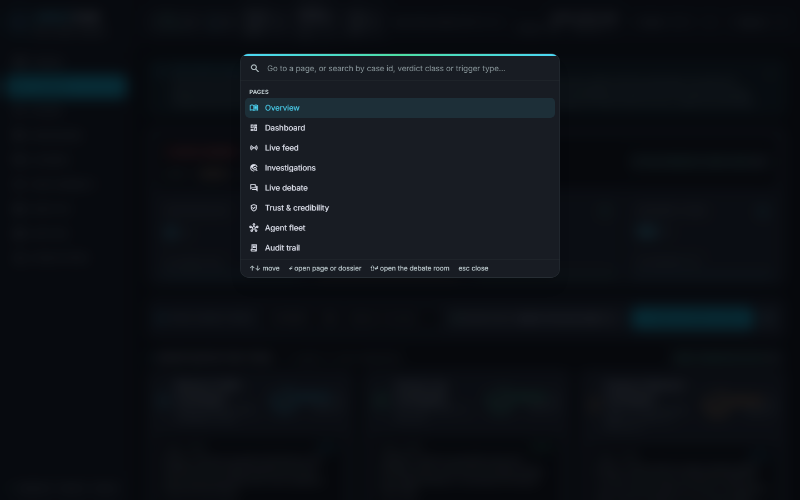

A search box that jumps to any page, opens the "inject scenario" dialog, or searches investigations. Typing asks the server (`GET /investigations?q=`), which matches the **start of the case id**, the **verdict class** or the **trigger type**; nothing is stored. Keys: **↑ ↓** move, **Enter** opens a page or dossier, **Shift+Enter** opens the debate room, **Esc** closes.

> **Kya bolna hai.** "Har page ke upar top bar me live status chips hain: API version, latency, debate engine idle ya running aur kitni debates queue me hain, sandbox enforced, aur pichle 24 ghante ke threat verdicts. Neeche footer me audit chain valid hai ya nahi, teen thresholds, aur live updates ka status. Har number ke paas ek (i) button hai jo batata hai ki number kahan se aaya, kitne records par based hai aur formula kya hai. Agar data nahi hai to 0 nahi, 'dash' dikhta hai reason ke saath."

---

# Part 3 — Page by page

Routes are hash routes (`#/overview`, `#/dashboard`, ...), so a refresh stays on the same page. Pages 3.1 and 3.2 are shown before sign-in; the rest need an account.

## 3.1 Landing page — `#/landing`

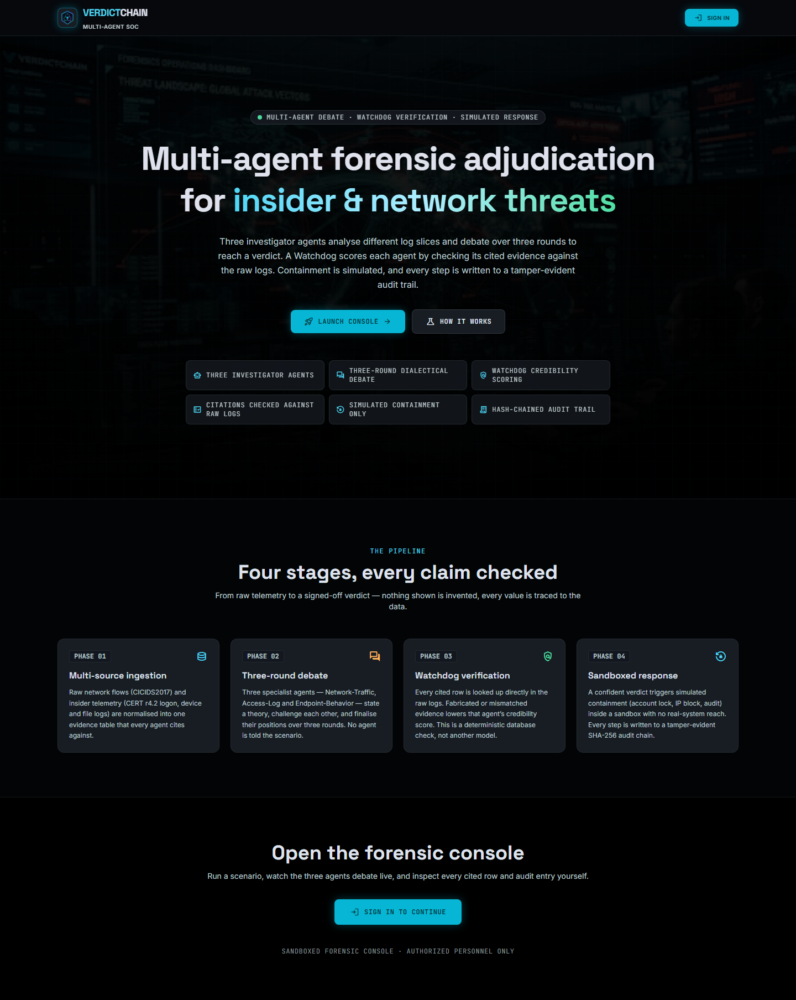

**Purpose.** The public front door. It says what the system is and has one button: **Sign in** / **Launch console**. It shows **no data** (nothing here comes from the API), only the explanation.

| Element | What it is |
|---|---|
| Header: logo, "Multi-agent SOC", **Sign in** button | Goes to the login screen. |
| Hero: "Multi-agent debate · Watchdog verification · Simulated response" and the headline | The one-sentence description of the project. The words "Simulated response" are deliberate: containment is never real. |
| **Launch console** | Opens the sign-in screen. |
| "How it works": **The pipeline, four stages, every claim checked** | A static four-step explanation: ingestion, three-round debate, Watchdog verification, sandboxed response. |
| "Open the forensic console", **Sign in to continue** | Second call to action. |
| Footer: "Sandboxed forensic console · Sign-in required" | Fixed label. It does not say "authorized personnel only": anyone can register an analyst account, so that would be a claim without a mechanism (`docs/CLAIMS_AUDIT.md`). |

> **Kya bolna hai.** "Ye landing page hai, isme koi live data nahi, sirf project ka intro: pipeline ke chaar stage. Sign in dabane par login aata hai."

## 3.2 Sign-in / register — `#/login`

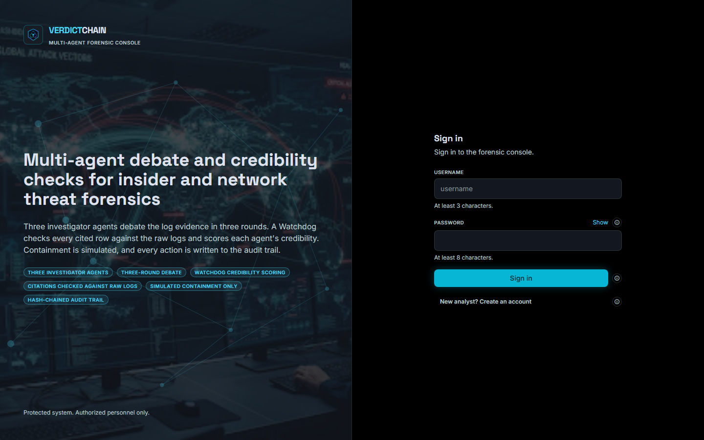

**Purpose.** Authentication. One form that switches between **Sign in** and **Create account**.

| Element | What it does | Rule / source |
|---|---|---|
| **Username** field | Your account name | At least 3 characters (checked in the browser first, then by the server). |
| **Password** field + **Show password** toggle | Your password | At least 8 characters. Never stored in the browser; only the JWT is. |
| **Switch sign-in mode** | Toggles between sign-in and registration | Registration calls `POST /auth/register`, sign-in calls `POST /auth/login`. |
| Left panel: "Multi-agent debate and credibility checks…" with the node graph | Decoration. The graph carries no numbers. | — |
| Error line under the form | The server's message in plain words ("Invalid username or password", "Rate limit exceeded…") | A wrong login never says which of the two was wrong. |

After a successful login the browser stores the token (`verdictchain_token`) and opens the **Dashboard**. Any later `401` clears the token and sends you back here with a message.

> **Kya bolna hai.** "Login me username (min 3) aur password (min 8). Register karoge to forensic analyst role milta hai. Token browser me rehta hai, expire hone par apne aap login page par wapas bhej deta hai."

## 3.3 Overview — `#/overview`

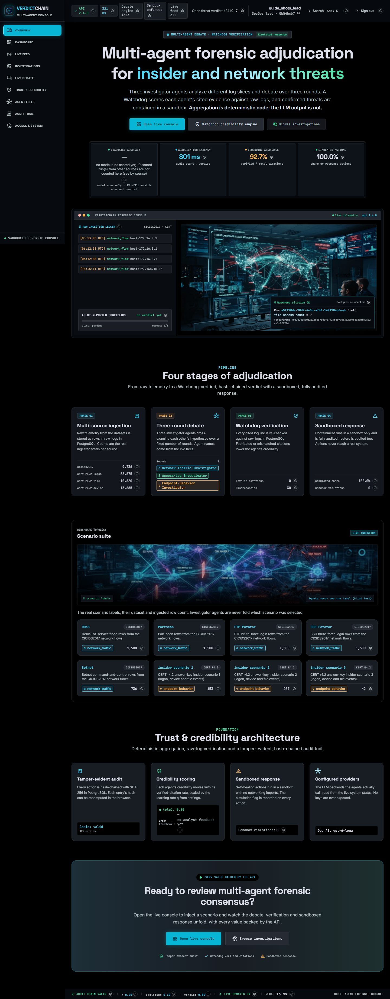

**Purpose.** The "front page" for someone who wants to understand the project and see live proof that it works. Every value comes from the API; nothing is typed in. It has five sections, top to bottom.

### Section 1 — Hero and telemetry ribbon

| Card / element | Shows | Source and logic |
|---|---|---|
| **Evaluated accuracy** ("model runs only · N offline-stub runs not counted") | Exact-match accuracy of the system against the **ground-truth labels**, over investigations whose answers came from real model providers | `GET /evaluation` (`accuracy`). Accuracy = investigations whose verdict class equals the class mapped from the scenario label ÷ scored investigations; `ambiguous` counts as wrong. With only stub runs it shows "—" and the reason ("no model runs scored yet; N scored run(s) from other sources are not counted here"). The stub's own accuracy is returned separately (`by_source.stub`), never mixed in. |
| **Adjudication latency** ("audit start → verdict") | Mean time from `investigation_started` to `verdict_reached` | Calculated **in the browser** from the loaded audit entries (`GET /audit-trail`): for each investigation, `verdict_reached.created_at − investigation_started.created_at`, averaged. Proof shows n (investigations with both entries). See the note below about queued investigations. |
| **Grounding assurance** ("verified / total citations") | Share of cited log rows that the Watchdog verified | `GET /stats` → `citations.verified_rate` = citations whose row exists and whose cited value matches **exactly** ÷ all citations (all rounds). |
| **Simulated actions** ("share of response actions") | Share of containment actions that were simulated | `GET /stats` → `self_healing.simulated_share` = `response_actions` with `is_simulated = true` ÷ all. Must be 100 %. |
| **Raw ingestion ledger** (4 newest rows) | The newest ingested log rows: time, event type, user, host | `GET /raw-logs/recent` (allow-listed fields only; **never the ground-truth label**). High/critical severity rows are tinted red. |
| **Agent-reported confidence** gauge | Confidence of the **latest** investigation's verdict | `GET /investigations?limit=1` → `verdict_confidence`. It is the average of the supporting agents' self-reported confidence; **not accuracy**. Also shows the verdict class and "rounds: 3 / 3". |
| **Watchdog citation** pin (on the picture) | One real citation from the latest investigation: row id, field = value, and "Postgres re-checked" with its status | `GET /investigations/{id}/citations`: VERIFIED, DISCREPANCY or INVALID_ROW from re-reading `raw_logs`. |
| Buttons **Open live console**, **Browse investigations** | Navigation | — |

> Note on latency: the start audit entry is written when an investigation is **accepted**. For a queued investigation the measured time therefore includes its wait in the debate queue. For a debate that starts at once (the usual case) it is the debate time.

### Section 2 — "Four stages of adjudication" (pipeline cards)

| Card | Counter shown | Source |
|---|---|---|
| **Phase 01 Multi-source ingestion** | Row count per source (`cicids2017`, `cert_r4.2_logon`, `cert_r4.2_device`, `cert_r4.2_file`) | `GET /raw-logs/counts`: `COUNT(*)` per `raw_logs.source`. |
| **Phase 02 Three-round debate** | "Rounds 3" and the three agent chips | `GET /settings.debate_rounds` (a constant of the engine) and `GET /agents/fleet` (display names). |
| **Phase 03 Watchdog verification** | **Invalid citations** and **Discrepancies** | `GET /stats`: `citations.invalid_row` (row id malformed or not in `raw_logs`) and `watchdog.discrepancies` (cited value does not match the row). |
| **Phase 04 Sandboxed response** | **Simulated share** and **Sandbox violations** | `GET /stats.self_healing.simulated_share` and `GET /system/status.sandbox.is_simulated_violations` (must be 0). |

### Section 3 — "Benchmark topology: Scenario suite"

Eight scenario cards: the real labels **DDoS, Portscan, FTP-Patator, SSH-Patator, Botnet** (CICIDS2017) and **insider_scenario_1, 2, 3** (CERT r4.2). Each shows its dataset, a short description, its **primary agent** and its **row count**. Source: `GET /scenarios` (row counts are `COUNT(*)` of rows with that ground-truth label; the label is read **server-side only to count and to pick rows**, and is never sent to an agent). The badge "Agents never see the label (blind test)" has a Proof that names the test that proves it (`backend/tests/agents/test_blind_boundary.py`). The corner badge reads "COUNTED IN raw_logs", not "live ingestion": the datasets are loaded once, and only the counts are read live (the simulated live feed is a separate page, 3.6).

### Section 4 — "Trust & credibility architecture"

| Card | Shows | Source |
|---|---|---|
| **Tamper-evident audit** | "Chain: valid" and the number of entries | `GET /audit-trail` → `chain.valid`, `chain.total`. |
| **Credibility scoring** | **η (eta)** and **Brier (feedback)** | `GET /settings.eta`; `GET /stats.brier` = mean of (agent-reported confidence − outcome)², outcome 1 if an analyst confirmed the verdict, 0 if marked false positive. It is "—" until analysts give feedback. |
| **Sandboxed response** | **Sandbox violations** | `GET /system/status.sandbox`. |
| **Configured provider** | The model the agents really call (OpenAI is the only provider) | `GET /system/status.providers` (model name only; **the key is never exposed**). |

### Section 5 — closing call to action

"Ready to review multi-agent forensic consensus?" with **Open live console** and **Browse investigations**.

> **Kya bolna hai.** "Overview me sab kuch live API se aata hai. Upar ribbon me chaar numbers: accuracy (sirf real model runs ginta hai, stub alag), latency, citation verification rate, aur simulated actions ka share jo hamesha 100% hona chahiye. Neeche pipeline ke chaar stage, 8 scenarios aur trust architecture. Har number ke (i) button me source aur formula milta hai."

---

## 3.4 Dashboard — `#/dashboard`

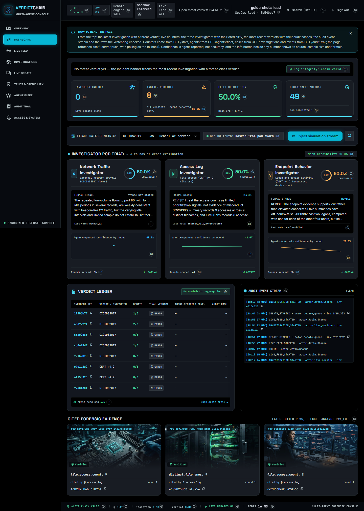

**Purpose.** The operations screen. It answers "what is happening right now?": the latest threat, live counters, how the three investigators are doing, the newest verdicts, the audit event stream, and the log rows the Watchdog checked. It is also where an analyst **starts a debate**. It opens after sign-in. Everything refreshes by push (no reload).

### Section 1 — Incident banner and four live counters

| Card / element | Shows | Source and logic |
|---|---|---|
| **Latest threat verdict** strip | The newest investigation whose verdict is a **threat class** (any of the six attack classes): dataset, short case id (copy button), verdict class pill. It is called "latest", not "active", because the case may long be contained | `GET /investigations` (the newest 8, the same list as the ledger); the first one with a threat class is chosen. "No threat verdict yet" if none. |
| **SUBJECT / HOST** | The user and host most cited in that investigation | Calculated from `GET /investigations/{id}/citations`: the most frequent `user_id` / `host_id` among the **verified** citations only (a value an agent merely claimed is ignored). A tie goes to the lexicographically smallest value. "—" when no verified citation names that field (and the banner only has citations for the *latest* investigation). |
| **domain …** | The primary agent of that case | `primary_agent` of the investigation, name from `GET /agents/fleet`. |
| **Log integrity: chain valid** | Whether the audit hash chain is intact | `GET /audit-trail` → `chain.valid` (n = total entries). Turns red "chain broken" if any entry does not match its hash. |
| **Investigating now** | Debates running right now | `GET /stats.active` = investigations with status `investigating` created in the last 30 minutes. (Queued ones are counted separately in `by_status.queued`.) |
| **Insider verdicts** and "all verdicts · agent-reported conf." | Number of insider verdicts (all time) and the mean agent-reported confidence over **all** verdicts | `GET /stats.insider_count` (verdict class `insider_file_exfiltration` or `insider_logon_anomaly`, status verdict_reached or contained) and `mean_agent_confidence` (self-reported, not calibrated). |
| **Fleet credibility** ("Mean CrS · n = 3") | Average credibility of the three investigators | `GET /stats.mean_crs`, read from Redis (live CrS), n = number of investigators. |
| **Containment actions** and "non-simulated" | Total sandbox actions and how many were **not** simulated | `GET /stats.self_healing.actions_total` and `.non_simulated` (must be 0; the database refuses `is_simulated = false`). |

### Section 2 — Scenario bar (start a debate)

| Element | What it does |
|---|---|
| **Attack dataset matrix** (drop-down) | Lists the 8 real scenarios (CICIDS2017: DDoS, Portscan, FTP-Patator, SSH-Patator, Botnet; CERT r4.2: insider_scenario_1, 2, 3) with their description. Source `GET /scenarios`. |
| **Ground-truth: masked from pod swarm** (green pill + Proof) | The blind-test statement. The Proof points to `backend/tests/agents/test_blind_boundary.py`, the test that proves the label cannot reach an agent. |
| **Inject simulation stream** (button) | Opens the scenario dialog (3.5) with the selected scenario. Disabled without the `inject_scenario` capability (every role has it). |
| **Configure scenario** (gear) | Opens the same dialog. |

### Section 3 — Investigator pod triad (one card per investigator)

Each card merges `GET /agents/fleet` (agent facts) with the **latest** investigation's debate (`GET /investigations/{id}`).

| Element | Shows | Source and logic |
|---|---|---|
| Name, domain, glyph (α, β, γ) | Network-Traffic Investigator α, Access-Log Investigator β, Endpoint-Behavior Investigator γ | `GET /agents/fleet`: `display_name`, `domain`. The glyph and colour are only visual identity. |
| **Credibility ring and %** | The agent's current CrS | `GET /agents/fleet` → `crs` (Redis). 100 % = 1.0. Red/"Isolated" when quarantined. |
| **FORMAL STANCE** | The stance word (SUPPORT / CHALLENGE / REVISE) of its latest theory, the theory text, and **Last vote** | The latest turn of this agent in the latest investigation; the stance is the one the agent states (`stance`, stored with the turn), else the first word of its theory; "Last vote" = `fleet.last_vote`, the class this agent's latest answer votes for (the class it stated, else the server's keyword reading of the theory). "stance not stated" in round 1 (no stance yet). |
| **Agent-reported confidence by round** (sparkline) | Self-reported confidence in round 1, 2, 3 | `rounds[].agents[].confidence` of the latest investigation. Self-reported, **not** accuracy. |
| **Rounds scored** | How many rounds the Watchdog has scored for this agent, ever | `GET /agents/fleet.rounds_scored` (count of `credibility_log` rows). |
| **Active / Isolated** | Whether the agent currently takes part in debates | `GET /agents/fleet.isolated` (active row in `agent_quarantine`). |
| "Mean credibility" pill (top right) | Average CrS of the three | `GET /stats.mean_crs`. |

### Section 4 — Verdict ledger and audit event stream

| Card | Shows | Source and logic |
|---|---|---|
| **Verdict ledger** ("Deterministic aggregation") | Table of the 8 most recent investigations: **Incident ref** (short id + copy), **Vector / ingestion** (dataset and, if applicable, the *Offline stub* badge), **Debate** (rounds completed, "3/3"), **Final verdict** (class), **Agent-reported conf.**, and the **audit hash** of the verdict | `GET /investigations` plus `GET /audit-trail?action=verdict_reached`: the hash is the `entry_hash` of the investigation's `verdict_reached` audit entry. Clicking a row opens its debate room. Footer: "Audit head seq N" (`chain.head_seq`) and a link to the Audit trail. |
| **Audit event stream** (terminal) | The newest 60 audit entries, newest last: `[time UTC] ACTION · actor … · inv …` | `GET /audit-trail?limit=60` refreshed by push. **CLEAR** hides the view only (a refresh brings it back); nothing is deleted. |

### Section 5 — Cited forensic evidence

Three cards: the latest cited rows of the latest investigation, each with **row id**, **field: value** (for example `user_id: BTL0226`), the Watchdog status (**Verified**), "cited by γ endpoint_behavior", the round, and a **fingerprint** (SHA-256 of the canonical raw row). Source `GET /investigations/{id}/citations`. The background photographs are decorative; every caption is a real cited value.

> **Kya bolna hai.** "Dashboard operations screen hai. Upar incident banner: latest threat verdict, uska subject user aur host jo verified citations se nikalte hain, aur audit chain valid hai ya nahi. Uske neeche chaar live counters. Beech me teen investigator cards: credibility, stance, confidence trajectory, active ya isolated. Neeche verdict ledger me har verdict ka audit hash hai, aur right side me live audit stream. Sabse neeche wo log rows jo agents ne cite kiye aur Watchdog ne verify kiye."

## 3.5 Inject scenario dialog (opened from the Dashboard)

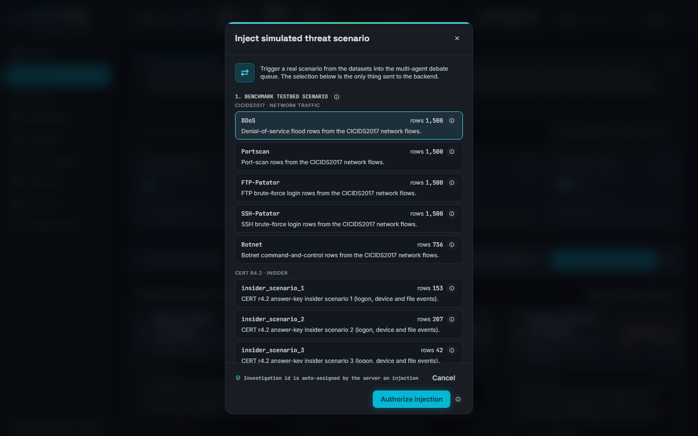

**Purpose.** Start a debate on a chosen scenario. Only the **selection** (and two numbers) is sent to the server; the label never goes to an agent.

| Element | Meaning | What happens in the backend |
|---|---|---|
| **1. Benchmark testbed scenario** (radio list, grouped by dataset, each with its row count) | Pick one of the 8 scenarios | `POST /investigations/simulate { scenario_label }`. The server uses the label **only to select rows**. |
| **2. Noise · benign-row dilution** (0 / 15 / 30 %) | Replace k = round(n × pct / 100) scenario rows with ordinary rows **of the same source** (at least one scenario row stays) | Tests how robust the verdict is when the evidence is buried in normal traffic. The *effective* percentage is returned and stored. |
| **Max rows per agent** (1 to 15, default 5) | How many log rows each investigator is given | Keeps each LLM prompt small enough for free-tier token limits. |
| **Authorize injection** | Starts the debate | The server checks, in order: capability, rate limit (5 per minute), idempotency key, intake not paused (**423**), the key's own OpenAI allowance (**429** with the sentence, see 3.8-C), rows exist (404), a primary agent exists (422), active investigators ≥ 2 (409), queue capacity, daily caps (429); then creates the investigation (status `queued`), the worker runs it and the browser opens the **Debate Room** by the returned id. A duplicate click carries the same `Idempotency-Key`, so it cannot start two debates. |
| Blind-test note + Proof | "The chosen scenario label is never placed in any investigator's input. This is checked, not promised." | Points at the blind-boundary tests. |

If another debate is running, the dialog still succeeds and shows "queued · place N of M": one debate runs at a time because the credibility scores are shared state and the LLM quota is global.

> **Kya bolna hai.** "Yahan se scenario inject hota hai. Sirf scenario ka naam server ko jaata hai, aur server use sirf rows chunne ke liye use karta hai, agent ko kabhi nahi batata. Noise slider se hum asli rows me normal rows milate hain taaki dekhein verdict kitna robust hai. Agar pehle se koi debate chal rahi hai to ye queue me lag jaati hai aur place number dikhta hai."

---

## 3.6 Live feed — `#/live`

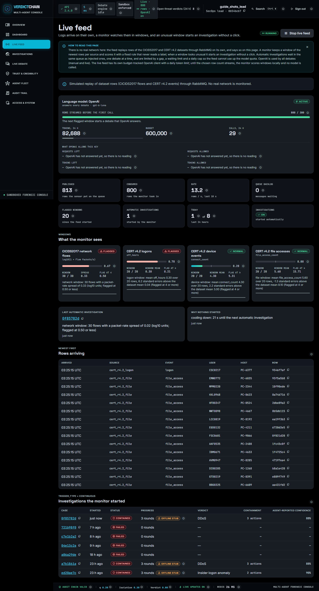

**Purpose.** There is no real network behind this console, so this page runs a **simulated** one: dataset rows arrive on their own, a monitor watches them, and an unusual window **starts an investigation without anybody clicking**. It exists to show the system working like a SOC: logs come in, get analysed, debates happen, containment follows.

**How it works (left to right).**

1. The **sensor** (`backend/pipeline/live_feed.py`) replays dataset rows into a **RabbitMQ** queue at a constant rate. It sends short **segments**: mostly ordinary traffic (24 to 48 random ordinary rows from one source) and, with probability 0.2, a slice of one labelled scenario (40 to 70 consecutive rows). Each message is a **pointer only**: row id, time, source, event type. No fields, **no label**.
2. The **monitor** (`live_monitor.py`) takes the pointers off the queue, reads the row's own fields from PostgreSQL (never the label) and keeps a **window** per source: the newest **30 network flows** or **20 CERT rows**. Every 5 new rows a full window is scored.
3. The **rule** (`live_detector.py`) is fixed and reads no label (see "The rule" below). A flagged window becomes an **investigation** (`trigger_type = continuous`, started by `live_monitor`) in the same **debate queue** as manual injections.
4. Guards stop the feed from using up the model quota (see "Why nothing started").

**Who can do what.** Everyone can watch. Only roles with `control_live_feed` (lead, watchdog supervisor) see the Start / Stop controls. Starting and stopping are **audited** (`live_feed_started`, `live_feed_stopped`).

| Element | Shows | Source and logic |
|---|---|---|
| State pill **Running / Stopped** | Whether the feed threads are alive | `GET /live/status.state` (also `GET /system/status.continuous_mode`). |
| **Replay speed** (1, 2, 4, 10, 25 rows/s), **Call OpenAI after** (300, 1,500, 3,000 or 5,000 rows), **Start investigations automatically** toggle, **Start live feed** | Start controls (when stopped) | `POST /live/start { events_per_second, auto_investigate, llm_after_rows }`. With the toggle off, windows are still scored but nothing starts. *Call OpenAI after* is the model gate described below (the API accepts 50 to 20,000). |
| **Stop live feed** | Stop control (when running) | `POST /live/stop`. |
| Notice **"Simulated replay of dataset rows … No real network is monitored."** | The honest statement of what this is | `GET /live/status.notice`. |
| **Published** | Rows the sensor put on the queue since the feed started | `live/status.published` (counter in Redis). |
| **Consumed** | Rows the monitor took in | `live/status.consumed`. Should track *Published*. |
| **Rate** (rows/s, last 10 s) | Measured throughput | One sample of the consumed counter per second; rate = (newest − oldest) ÷ elapsed over the last 10 s. "—" until two samples exist. |
| **Queue backlog** | Messages waiting in RabbitMQ | Read by the sensor every 2 s (`queue_declare passive`). The sensor pauses if it exceeds 500. |
| **Flagged windows** | Windows the rule flagged since start | Counter. Many flags can belong to one attack segment. |
| **Automatic investigations** | Flags that actually became investigations | Counter. |
| **Today: N of cap** | Automatic investigations in the last 24 h versus the daily cap (default 8) | Redis counter with a 24 h window; they also count in the global debate cap. |
| **Investigations: On/Off** | Whether automatic start is enabled | `auto_investigate`. |
| Card **Language model: OpenAI** (pill: Off, Not configured, Warming up, Active, Budget reached, Key limit reached) | The model gate and what the model has used | `GET /live/status.llm`: `state`, `rows_seen / activation_rows` (a progress bar), `tokens_24h`, `token_limit` (= `OPENAI_DAILY_TOKEN_LIMIT`), `calls_24h`, `model`. See "The model gate" below. |
| → **What OpenAI allows this key** (Requests left / allowed, Tokens left / allowed) | The key's own limits, as OpenAI reports them in its answer headers (`x-ratelimit-*`) | `llm.allowance`: four Metrics that show "—" with the reason until OpenAI has answered once. When OpenAI asked for a wait the card says "OpenAI asked for a wait: nothing is sent to it until <time>". |
| Four **window cards** | Per source: the rows in the window, the number the rule looks at, the threshold, a **suspicion meter** (the mark at the middle is the flag) and the rule's sentence | See "The rule". State pill: **Filling** (window not yet full), **Normal**, **Flagged**. |
| **Last automatic investigation** | Link to the case, why it started, when | `last_trigger`. The reason is the rule's own sentence with its numbers, for example "logon window: mean off_hours 0.80 over 20 rows, 18.1 standard errors above the dataset mean 0.04 (flagged at 4 or more)". |
| **Why nothing started** | The reason the newest flag was refused | `blocked`. The guards are checked in this order and the first one that fails is shown: OpenAI not configured → "warming up: 120 of 300 rows seen; OpenAI is not called before that" → the 24-hour token budget is used up → the key's own allowance is too small for a debate (see "The model gate") → "intake is paused" → "fewer than 2 investigators are active" → "cooling down: 12 s until the next automatic investigation from the logon window" (a gap of 20 s, kept **per source window**, so the logon window never holds back the network window) → "the last automatic investigation failed … waiting N s before trying again" (5 × the gap) → "an automatic investigation is already waiting for a free debate slot" or "3 automatic investigations are already waiting …" (up to 4 may wait) → "the debate queue is full" (10) → "the daily limit for automatic investigations is reached (80)" → "the daily debate limit across all analysts is reached" (120). |
| **Parallel lanes** (on this page and on Investigations) | One card per debate slot: the case it is running (id, who started it, the dataset, round progress, time running) or "Idle · ready for the next flagged window"; below them the cases waiting for a free slot | The slot holders from `GET /system/status` → `debate_slot` (`capacity`, `investigation_ids`) matched to `GET /investigations?status=investigating`; waiting = `?status=queued`. Up to `DEBATE_MAX_CONCURRENT` (default 4) debates run side by side, so several automatic investigations are in flight at once as logs arrive. |
| **Rows arriving** (newest first, 15) | Time of arrival, source, event type, user, host, row id | `GET /live/arrivals` (the last 100 are kept). Only the allow-listed fields: no label, no raw field. |
| **Investigations the monitor started** | Table of the newest `trigger_type = continuous` investigations | `GET /investigations?trigger_type=continuous`. |

### The model gate (why the feed does not spend money at once)

Scoring a window is plain code and costs nothing, so the monitor does it from the **first row**. A debate costs model tokens, so a second gate sits in front of the first OpenAI call: the feed must first have streamed **N rows**, chosen when it is started (**Call OpenAI after**: 300 rows for a quick test, or 1,500, 3,000, 5,000; the count restarts from zero at every start). Until then the card says **Warming up** and shows the rows still missing and the time that takes at the current rate. After N rows a flagged window may open an investigation, and that debate is answered by OpenAI. The gate also closes again by itself in two cases, each with its own pill and a sentence:

| Pill | Meaning | Where the number comes from |
|---|---|---|
| **Budget reached** | The tokens used in the last 24 hours reached the budget the code is allowed to spend (`OPENAI_DAILY_TOKEN_LIMIT`, 2,000,000 by default). New automatic investigations wait until older calls leave the 24-hour window. | `llm.tokens_24h` and `llm.token_limit`: the sum of input + output tokens that the API reported for each call, kept in Redis for 24 hours. |
| **Key limit reached** | **OpenAI itself** says the key cannot cover a debate: its latest answer headers show fewer requests or tokens left than one debate needs (9 requests, about 30,000 tokens), or it asked for a wait. Nothing is sent until that frees up. | `llm.allowance` (the four Metrics) and `held_until`. |

> **Why two limits?** The first is *our* spending cap and we control it. The second is *the provider's* cap on this key, which we can only read. During development the key turned out to allow only about 50 requests a day and a 100,000-token bucket that refills very slowly; one debate needs 9 requests, so the system now checks before it starts a debate that is bound to fail, and says so in words instead of failing half-way. See Part 5.10.

### The rule (what "unusual" means)

| Source (window) | The number | Flagged when |
|---|---|---|
| **CICIDS2017 network flows** (30) | **Spread** = standard deviation of `log10(1 + Flow Packets/s)` over the window | spread **≤ 0.50**: the flows are near-identical in packet rate, as in a flood, a scan, repeated login attempts or a beacon. Suspicion = clamp(1 − spread ÷ 1.0, 0, 1). |
| **CERT logons** (20) | Window mean of `off_hours` (1 if the user logged on outside working hours that day) | **z ≥ 4**, where z = (window mean − dataset mean) ÷ (dataset std ÷ √rows). Suspicion = clamp(z ÷ 8, 0, 1). |
| **CERT device events** (20) | Window mean of `connect_count` | z ≥ 4 (same formula). |
| **CERT file accesses** (20) | Window mean of `file_access_count` | z ≥ 4 (same formula). |

The dataset mean and standard deviation come from **every row of that source** in `raw_logs` (computed once when the feed starts, no label read). Every gauge has a Proof with this formula and the current inputs. On this machine's dataset the rule flagged **none** of 300 random ordinary windows in any group and every window cut from the five network scenarios and from insider scenarios 1 (logons), 2 (devices) and 3 (logons). Insider scenario 1's device rows alone are not flagged (0 of 158), and scenario 3 has too few device and file rows to fill a window (`python -m backend.scripts.measure_live_detector` reproduces this). The segments are contiguous slices of one scenario, which is easier than real traffic, so read this as a check that the rule does what it says, not as a detection rate.

### How an automatic investigation is created

When a window is flagged the runner (`backend/api/live_runner.py`) checks the guards, picks the **primary agent** from the window's source (logon and device rows → Endpoint-Behavior, file rows → Access-Log, flows → Network-Traffic), chooses the **5 rows that carry the signal** (for flows the ones closest to the window median packet rate; otherwise the highest field values), and creates the investigation. The whole window is the context from which the other agents' rows are chosen. The window's **evaluation label** (the label most of its rows carry in the dataset) is attached **afterwards on the server** so that `/evaluation` can score the run; it is stored on the investigation row only and never reaches an agent, a queue message, the audit detail or an API response.

> **Kya bolna hai.** "Kyunki hamare paas asli network nahi hai, ye page ek simulated network chalata hai. Sensor dataset ke rows RabbitMQ me daalta rehta hai, sirf pointer, label nahi. Monitor har source ki window dekhta hai: network me flows ka packet-rate spread bahut chhota ho to unusual, CERT me window ka mean dataset ke mean se chaar standard error upar ho to unusual. Window flag hote hi investigation apne aap queue me jaati hai, debate chalti hai aur containment tak jaati hai, kisi ne click nahi kiya. Quota bachane ke liye gap, daily cap aur queue limit lagi hain, aur jo reason se refuse hua wo 'Why nothing started' me dikhta hai. Ye simulation hai aur page par saaf likha hai."

---

## 3.7 Investigations — `#/investigations` (and `#/investigations/<id>`)


**Purpose.** The case registry. One **investigation** = one run of the three-round debate (from a manual injection or from the live feed). The left side lists the cases, newest first; the right side opens the **dossier** of the selected case: the verdict, a fingerprint of the evidence, what the Watchdog checked, what the sandbox did, and the buttons an analyst uses to judge the case. A link such as `#/investigations/<full id>` opens the page with that case already selected.

### The operations board (above the search box)

Added on 2026-10-11 so the page shows the automation itself, not only its results. Every number is read from the API; none is typed in.

| Element | Shows | Source and logic |
|---|---|---|
| **Started by the monitor** | The share of the last 24 hours' investigations that the live monitor started, with "x of y cases, 24 h" | `GET /stats` → `automation.auto_share`, `auto_started`, `cases` (n = investigations accepted in the window). "—" with its reason when there were none. |
| **Contained hands-free** | Cases the monitor started that ended contained with no analyst emergency containment or release on them | `automation.hands_free_contained`: `trigger_type = continuous`, `status = contained`, and no `emergency_containment` or `containment_released` audit entry on the case. |
| **Median detect → verdict** | The middle time from acceptance to verdict, queue wait included | `automation.median_seconds_to_verdict`: the median over cases of the `verdict_reached` audit time minus the `investigation_started` audit time; n = cases with both. |
| **Median verdict → contain** | The middle time from the verdict to the first sandbox action | `automation.median_seconds_verdict_to_action`; n = cases that have both. |
| **Debates running** | Debates holding a slot now, out of the slots there are | `GET /system/status` → `debate_slot.running` and `capacity` (`DEBATE_MAX_CONCURRENT`). |
| **Parallel lanes** | One lane per debate slot with the running case's id (a link to its live Debate Room, with a copy button), who started it, the dataset, three round pips, "round 2 of 3" and the time running; idle lanes say so; the cases waiting for a free slot are listed under them | As on the Live page (3.6). The pips are the case's `rounds_complete` out of `GET /settings` → `debate_rounds`; the time running is the browser clock minus `created_at`. |

### Part A — the list (left side)

| Element | Shows | Source and logic |
|---|---|---|
| Eyebrow **"Forensic Dossiers & Cases • Deterministic Consensus Registry"** (pulsing dot) | The page label | Fixed label. "Deterministic" refers to the verdict step, which is plain code (a count of the classes the agents state, with a keyword reading as fallback), not an LLM. |
| Title **Active & Closed Investigations** | Page title | Fixed. |
| **Inject Scenario** + Proof | Opens the scenario dialog (3.5) | Needs capability `inject_scenario` (from `GET /auth/me`); disabled with a tooltip without it. |
| **Open Replay** | Opens the Debate Room of the selected case | Disabled until a case is selected. Navigation only: replay reads stored transcripts and makes **no model call**. |
| **Hint strip** (three sentences) | How to use the page | Fixed text. The × hides it; the choice is remembered in this browser only (`localStorage`, key `vc-hint-dismissed:investigations`). |
| **Search box** | Free-text search (waits 300 ms after the last keystroke) | `GET /investigations?q=`. The server matches the **start of the case id** (the UUID as text, case-insensitive) **or** text **contained in** the verdict class **or** in the trigger type. `%` and `_` typed by the user are escaped, so they are literal characters. |
| **Filters** menu | **Status** (queued, investigating, verdict reached, contained, ambiguous, failed), **Verdict class** (the 8 classes), **Primary agent** (the three investigators; shows "Reads: <domain>") | Each choice is a query parameter (`status`, `verdict_class`, `primary_agent`), so the **server** filters; nothing is filtered in the browser. The dataset a case reads follows from its primary agent. Changing any filter returns to the first page. |
| **Showing N dossiers** + Proof, "filtered by …", **Clear search and filters** | How many rows this page holds and which filters are on | n = rows returned for the current search, filters and page. The list endpoint returns no total count, so no total is shown. |
| Loading skeletons / empty states | "No investigations yet" (with a run-scenario button) or "No investigations match" (with a clear button) | Shown by the page according to the answer. |

**One case card** (click anywhere on it to select it):

| Element | Shows | Source and logic |
|---|---|---|
| Coloured strip on the left | Mood of the case | Colour of the verdict (insider verdicts red, external-attack verdicts amber, benign green, ambiguous grey); before a verdict, colour of the status (cyan investigating, grey queued, green verdict reached, red contained or failed). Selected card: cyan outline. |
| **Case id** (first 8 characters, copy button) | Short id of the investigation | `GET /investigations[].investigation_id`; the copy button copies the full UUID. |
| **Dataset badge** | `CICIDS2017` or `CERT r4.2` | Derived on the server from the **primary agent** (Network-Traffic reads CICIDS2017; Access-Log and Endpoint-Behavior read CERT r4.2). |
| **Offline stub / Stub + model** badge | Present only when the answers came from the offline stub (in whole or in part) | `data_source`, derived on the server from the provider stored with each transcript (labels starting with `stub-`). Nothing is shown for runs that used real providers. |
| **Time** | "3 min ago" (hover: the absolute UTC time) | `created_at`. |
| **Heading (trigger type)** | `manual` (started with the dialog) or `continuous` (started by the live monitor) | `trigger_type`, stored when the case is created. |
| **Agent** | The case's primary agent (glyph + name) | `primary_agent`; the display name comes from `GET /agents/fleet`. The primary agent is the one whose data slice matched the injected rows (ties: network, then access, then endpoint). |
| **Noise** | The dilution asked for (0, 15, 30 %) | `noise_pct` (see 3.5). |
| **Verdict pill** | The verdict class, or the status while there is no verdict | `verdict_class` / `status`. |
| **"NN.N % conf."** + Proof | The verdict confidence | `verdict_confidence` = mean of the **self-reported** confidences of the agents that voted for the winning class. **Not accuracy** (accuracy exists only on the Trust page, from labelled runs). "—" before a verdict. |
| **Pipeline strip** (Detect → Debate → Verdict → Contain) + Proof | Where the automation has got to for this case, in four stages | Worked out in the browser from the card's own fields. **Detect**: who started it (the live monitor for `continuous`, an analyst for `manual`). **Debate**: rounds done out of the debate length (`GET /settings` → `debate_rounds`; "queued" while it waits; red if it failed). **Verdict**: the class once the debate ends ("none" when it failed). **Contain**: the number of `response_actions` rows ("no action" when the verdict plans none). Rounds done = the `round_completed` entries the engine wrote to the audit trail for the case, one after every active agent has answered a round. |
| **Stopped: <reason>** (red line, only on a failed case) | Why the debate ended in error | `error_reason`, the sentence the engine stored (and the audit trail holds as `investigation_failed`). A case that failed before reasons were stored says "no reason was recorded (it failed before reasons were stored)" instead of guessing a cause. |

**Pager.** 20 cases per page, newest first (`created_at` descending). *Previous* / *Next* and "rows a–b". *Next* is enabled when a full page came back, because the endpoint reports no total. The list refreshes itself when the server announces a change (push topic `investigations`).

### Part B — the dossier (right side)

Selecting a case runs **four requests in parallel**, so one failure never blanks the panel (that panel shows "— <reason>"): `GET /investigations/{id}` (detail), `GET /investigations/{id}/evidence-bundle`, `GET /investigations/{id}/citations` and `GET /audit-trail?investigation_id={id}&limit=100`; the page also reads `GET /settings` once (the debate length and the containment floors), and the evidence storyline re-reads up to 12 of the cited rows with `GET /raw-logs/{row_id}`. The dossier reloads when you select another case and after you give feedback or release containment. On a wide screen it scrolls inside its own column, so every panel is reachable while the list stays in view.

| Element | Shows | Source and logic |
|---|---|---|
| **Case id** + copy | Short id | As on the card. |
| **Audit chain valid / Chain broken / Chain not verified** + Proof | Whether the audit trail is intact | `GET /audit-trail` → `chain.valid`. It is the **global** SHA-256 chain check (every entry's hash against the previous one), **not** a proof about this case alone, and the Proof says so. |
| **Heading + verdict badge** | Trigger type; the verdict class or "No verdict yet" | Detail fields. |
| **Agent-reported verdict confidence** (large number) + Proof | The server's verdict confidence | `verdict_confidence`. The Proof lists the number of supporters. |
| **"recompute matches" / "recompute mismatch"** | A check done by the browser | The browser takes the votes in the detail (`votes[]`), averages the confidence of those that voted for the verdict class and compares with the server number (tolerance 0.000001). A mismatch would show in red. Not shown when it cannot be checked (no verdict). |
| Panel **Cryptographic fingerprint & provenance** → **SHA-256 digest** (copy) | The fingerprint of the evidence bundle | `GET /investigations/{id}/evidence-bundle` → `bundle_sha256`: SHA-256 of the canonical JSON of the bundle (verdict, transcripts, credibility rows, actions, the Watchdog's re-check of every citation; sorted keys; **no labels**). The Debate Room's export recomputes it in the browser and shows whether it matches (3.8). |
| → **Attributed subject** | The user the evidence points at | The most frequent value of `user_id` (also `user`, `username`, `actor`) among the case's **verified** citations only; a tie goes to the lexicographically smallest value. "— no user field cited" when there is none. |
| → **Trigger event**, **Dataset shard** (+ stub badge), **Debate status** | Stored fields | `trigger_type`, `dataset` (from the primary agent), `status`. |
| → **Why it stopped** (only when the status is *error*) | The stored failure sentence | `error_reason`; see 3.8-C for what the Debate Room shows for the same case. |
| → Proof "Fingerprint and provenance" | The inputs of the above | Subject count, host count and the earliest cited timestamp (computed the same way from the verified citations). |
| Panel **Automation timeline** + Proof | The case's steps in time: the queue, each round, the verdict and the containment | Computed in the browser from the case's audit entries (`GET /audit-trail?investigation_id=`): `investigation_started` → `debate_started` (the queue wait) → one `round_completed` per round → `verdict_reached` → the sandbox action entries. A duration is the difference of two stored `created_at` values; the bar is proportional (a short step gets a minimum width). **Hands-free · no analyst action** appears when the live monitor started the case and no person is among the actors of the entries up to the last step (feedback or a sign-off afterwards does not count against it); for a manual case the analyst's name is shown instead. |
| Panel **Self-Healing agent** (Σ) with a status pill + Proof | Everything the agent did, or why it did not act | The pill is one of *Contained in the sandbox*, *Contained by an analyst*, *Held by the gate*, *No action needed* (benign and ambiguous verdicts plan none), *Waiting for a verdict*, *No verdict* or *Released*, with one sentence. **Gate**: the four checks of `should_respond()` with the case's real values: a verdict, a class that has actions, confidence at or above the containment floor (`GET /settings`), every supporting agent's CrS at or above the starting CrS. **Playbook**: the case's `response_actions` oldest first (lock account, block IP range, apply rate limiting, open an audit) with the target, the one-sentence reason, a **Simulated** pill and the time after the `verdict_reached` entry. **Sandbox boundary**: "N of N actions simulated"; its Proof names the test (`test_module_has_no_networking_imports`) that fails the build if the sandbox module ever imports networking code. The database refuses a row with `is_simulated = false`. |
| Panel **Evidence storyline** + Proof | The rows the investigators cited, in the order they happened | The distinct cited rows (at most 12) re-read with `GET /raw-logs/{row_id}` and ordered by each row's own timestamp. Each dot is the Watchdog's worst finding for that row (verified, discrepancy, invalid); the chips are the users and hosts with how many rows each has; "N of activity" is the last time minus the first. A row that cannot be read is counted, not drawn. |
| Panel **Case audit chain** (see the image below the table) | The audit entries written for this case, and two checks your browser makes for itself | `GET /investigations/{id}/audit-chain`. It says "17 of the 458 entries of the global chain belong to this case" and that they are **not a separate chain**: each entry still points at the entry before it in the one global chain, and its line says how (*first entry of the whole chain*, *follows this case's previous entry*, or *follows an entry of another case or of the system*). **Every entry's SHA-256 recomputed here: 17 of 17 match** = the browser hashed each entry's `hash_input` (WebCrypto) and compared it with `entry_hash`. **Case digest recomputed here equals the server's** = the browser hashed the case's entry hashes (oldest first, joined by a newline, the rule published as `digest_rule`) and compared it with the digest Python computed on the server: two independent implementations must agree. **Global chain valid (458 entries, checked by the server)** repeats the whole-chain check. A changed entry would show "does not match: entry #14" in red. The entry list (collapsed) shows seq, action, actor, time and a copyable hash. |
| Panel **Watchdog citation check** | "x/y verified" and the match rate | `GET /investigations/{id}/citations` → `summary.verified / summary.total` and `match_rate` (n = total citations). The Watchdog re-reads every cited row from `raw_logs` and compares the cited value (3.8 and Part 5). |
| Panel **Raw evidence asset link** | A picture with a caption | The picture is **decorative** (a USB-chip photo for CERT cases, a topology-grid photo for network cases) and the page says so. The caption is a real citation: the first verified one, `row-id · field=value`. |
| **Report PDF** + Proof | Opens the printable case report (Part C below) | Navigation to `#/report/<id>`. Enabled once the case is complete (a verdict, or a debate that ended in error); a queued or running case keeps it disabled with the tooltip "Opens when the investigation is complete". |
| **Custody PDF** + Proof | Opens the printable chain-of-custody record (Part C below) | Navigation to `#/custody/<id>`, enabled under the same rule. |
| **Custody JSON** + Proof | Downloads `<id8>.chain-of-custody.json` | Built **in the browser** from data already loaded: `{evidence_bundle, bundle_sha256, audit_entries[]}`. Nothing is sent to the server. |
| **Open replay** + Proof | Opens the Debate Room in replay mode | Navigation only; no model call. |
| **Analyst feedback**: **Confirm verdict** / **False positive** + Proof | The analyst's judgement of the verdict | `POST /investigations/{id}/feedback { verdict_was_correct }`. Enabled only once there is a verdict and the case is not running or failed ("Feedback locked" otherwise). Any signed-in role may use it. Three effects: a row in `analyst_feedback`; an **`analyst_feedback` audit entry** (actor = the signed-in user, detail only `verdict_was_correct`); and the number feeds the **Brier score**, the "analyst-confirmed" counts and the **adaptive verdict threshold** on the Trust page (3.9). |
| **Release containment** + Proof (inside the Self-Healing panel, only when the status is *Contained*) | Undo the sandbox actions | `POST /investigations/{id}/release-containment`: runs the inverse sandbox functions (written as `release:<action>` rows), status goes back to *Verdict reached*, audited. Server-gated by capability `trigger_emergency_containment` (lead, watchdog supervisor); other roles get a 403 toast. |

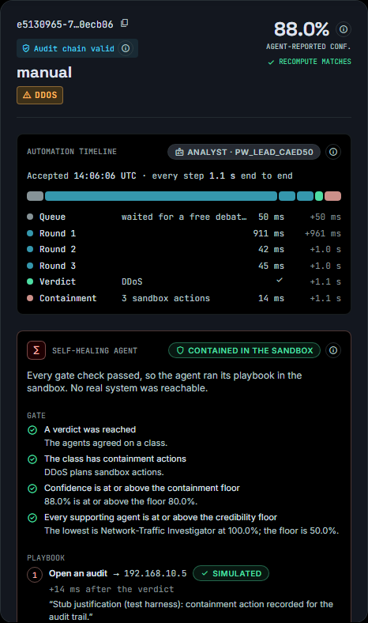

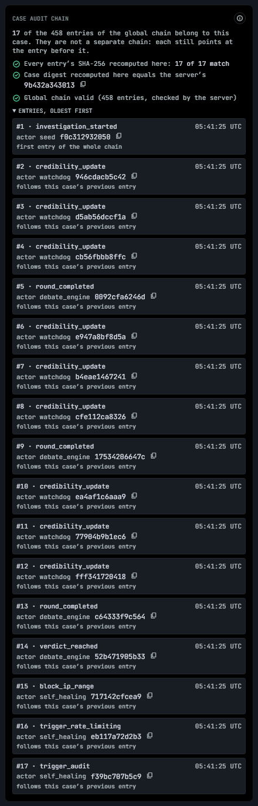

### Part C — the printable documents (`#/report/<id>` and `#/custody/<id>`)

Added on 2026-10-11 at the owner's request: a finished investigation can be taken out of the console as a designed document. Each one opens on a page of its own, without the sidebar, top bar or footer: a toolbar (a back link and **Download PDF**) above an A4 sheet. **Download PDF** opens the browser's own print dialog with the file name already set (`VerdictChain-report-<id8>` or `VerdictChain-custody-<id8>`); choose **Save as PDF** as the destination, and untick "Headers and footers" for a clean page. No PDF library is used, so the text in the file stays selectable. The button says "Preparing the document…" until the page has read its data and recomputed the digests.

**The case report** (about three pages) is written only from the case's own fields:

| Section | Shows | Source and logic |
|---|---|---|
| **Cover** (dark band) | The verdict in large type, status, dataset, who started it, the full case id, and the agent-reported confidence ring | The detail fields; the ring is labelled "agent-reported", not accuracy. |
| **Summary** | Six plain sentences and four tiles (rounds, citations verified, acceptance to verdict, sandbox actions) | Each sentence is a template over fields: who opened the case and when, how many investigators debated and the final votes, the verdict with its confidence, what the Watchdog re-checked, what Self-Healing ran, and the end-to-end time. It is not written by a model, and a sentence whose part is missing is left out. When no class had a majority (one vote each), the verdict sentence adds that the primary investigator's class decided it: the tie-break rule of `backend/debate/verdict.py`, worked out by the same function the Debate Room uses (`quorumFromVotes`). |
| **How the automation handled it** | The timeline bar and a table of the steps with how long each took | The same audit-entry derivation as the dossier's Automation timeline. |
| **The investigators** | One row each: stance, the vote class and whether it was stated or read from the text, confidence, citations verified, CrS before and after, and the last theory (clipped) | `GET /investigations/{id}`, `GET /agents/fleet` for the names. |
| **The debate, round by round** | Stance and confidence of every answer in a grid | `rounds[]`. |
| **Aggregation** | The votes, and the mean of the supporters' confidence recomputed in the page against the server's value | Plain code, not a model; a mismatch would say so in red. |
| **Evidence the Watchdog re-checked** | The first 20 citations: row id, field, cited value, the value the row holds, result, who and which round | `GET /investigations/{id}/citations`; the full list is in the evidence bundle. |
| **Evidence storyline** | The cited rows in time order with users and hosts | As in the dossier. |
| **Self-Healing response** | The gate, the playbook and the sandbox boundary | As in the dossier. |
| **Integrity** | The evidence bundle's SHA-256, the case digest, and four checks the browser recomputes: the bundle hash, every audit entry's hash, the case digest, and the server's global chain flag | `verifyEvidenceBundleHash`, `recomputeCaseChain`. It says plainly that the audit trail is tamper-evident, not a digital signature, and that the blind-test property is checked by a test. |

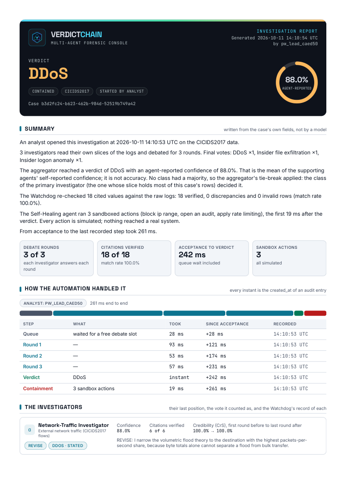

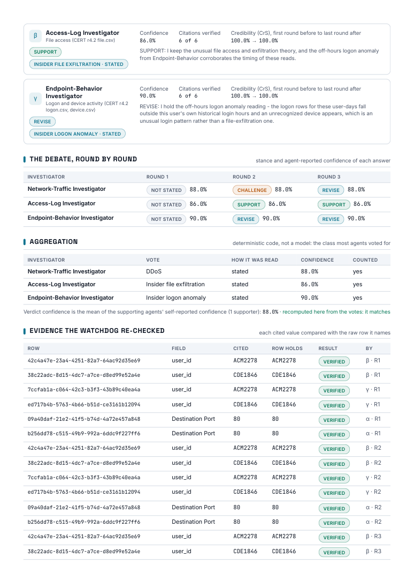

**The chain of custody** (about two pages):

| Section | Shows | Source and logic |
|---|---|---|
| **Custody summary** | How many of the global chain's entries belong to the case, the time span, the evidence bundle's SHA-256, the case digest and its rule, and four checks recomputed in the browser | `GET /investigations/{id}/audit-chain`, `GET /investigations/{id}/evidence-bundle`. |
| **Custody events** | Every entry of the case, oldest first: number, time (UTC), actor, action, whether its hash recomputed here matches, then on a second line the **full 64-character SHA-256** and the entry it follows | The same data as the dossier's Case audit chain panel, in full. An entry whose text was changed after it was written shows "no, differs" in red. |
| **Recorded acknowledgements** | Sign-offs analysts recorded in the console, with the bundle hash at that time and whether it is still the same bundle | `bundle.signatures[]` (`POST /investigations/{id}/sign`). A sign-off is an audited acknowledgement, not a digital signature. |
| **Hand-over record** | Blank lines for a person to fill in by hand: handed over by, received by, role, signature, date and time | A form to sign on paper when the case changes hands. |

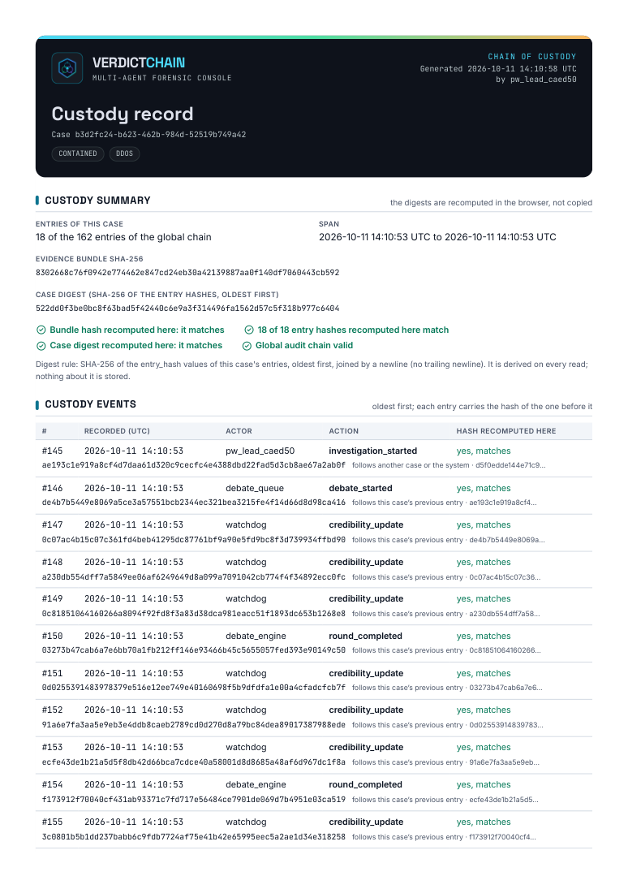

The tests behind this: Vitest for the sentences and every section (`report.test.tsx`, `custody.test.tsx`, `summary.test.ts`) and a Playwright spec (`report-pdf.spec.ts`) that opens both documents from the dossier, checks the recomputed hashes on screen and prints each to a real PDF with Chromium (the same engine as Save as PDF).


> **Kya bolna hai.** "Ye case registry hai. Har debate ek investigation hai. Left me newest pehle ki list, search aur filters server par chalte hain, browser me kuch filter nahi hota. Har card me case id, dataset, trigger manual ya continuous, primary agent, noise, verdict, agent-reported confidence, kitni containment actions aur kitne rounds complete hue. Right me dossier: verdict aur uski confidence, jise browser dobara compute karke server se match karta hai. Evidence bundle ka SHA-256 digest. Attributed subject sirf verified citations se aata hai, matlab jo agent ne bola par raw log me nahi tha wo ginta hi nahi. Sandbox actions aur verdict se pehli action tak ka measured time. Watchdog ka citation match rate. Chain-of-custody download browser me hi banta hai. Analyst feedback se Brier score aur adaptive threshold chalte hain, aur ye audit chain me bhi likha jaata hai."

---

## 3.8 Live debate and the Debate Room — `#/debate` and `#/debate/<id>`

### Part A — the Live debate list (`#/debate`)

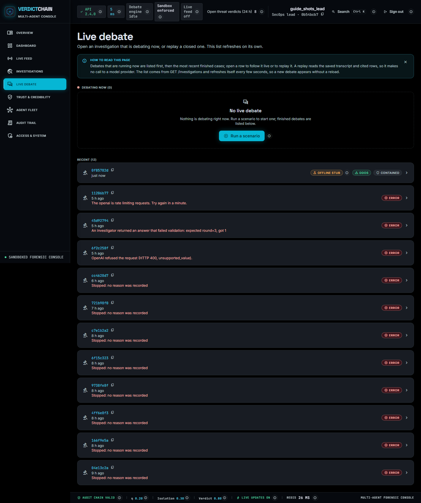

**Purpose.** The doorway to the Debate Room: which debates are running now, which are waiting, and which finished recently. Source: `GET /investigations?limit=50`, refreshed every 4 seconds and whenever the server announces a change.

| Element | Shows | Source and logic |
|---|---|---|
| Title **Live debate** + hint strip | What the page is for | Fixed text (the strip can be hidden; remembered in this browser only). |
| Section **Debating now (N)** with a pulsing red dot | Cases whose status is `investigating` | Filtered from the list. "No live debate" empty state with a **Run a scenario** button when none. |
| Section **Waiting in the queue (N)** + Proof "Queue place" | Cases with status `queued`, oldest first, each with "queued · place k" | The queue is first in, first out; place = rank among `queued` cases by `created_at`. The section appears only when something waits. |
| Section **Recent (N)** | Up to the 12 newest cases that are neither running nor waiting | Filtered from the list. |
| **A row** | Icon (forum = running, gavel = finished), copyable short id, time, *Offline stub* badge, the verdict class code, and a status pill (`investigating` in red, `queued · place k`, or the finished status) | `GET /investigations`. The whole row is a link to the Debate Room of that case; the copy button still works above it. |

### Part B — the Debate Room (`#/debate/<id>`)

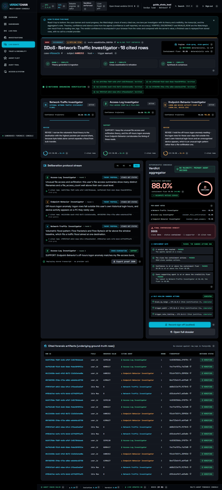


**Purpose.** The heart of the product: one page that shows the whole debate of one case, **live while it runs and as a replay once it is finished**. Top to bottom: case banner and round progress → what the Watchdog checked → one lane per investigator → the transcript and the aggregator's vote → every cited log row. A replay reads only the saved rows (transcripts, citations, evidence bundle) and **never opens a socket or calls a model**; only a running case opens the live connection.

**How it loads.** Three requests in parallel: `GET /investigations/{id}`, `GET /investigations/{id}/citations`, `GET /investigations/{id}/evidence-bundle`; plus `GET /agents/fleet`, `GET /settings`, `GET /system/status` and `GET /auth/me` for context. While the status is `investigating` the page also asks `POST /auth/ws-ticket` (a single-use ticket valid for 30 seconds, so the login token never travels in a URL) and connects `WS /ws/investigations/{id}?ticket=…`. The first frame is a **snapshot** from the database; then `round_completed`, `agent_isolated`, `verdict` and `error` frames arrive. The `verdict` frame makes the page reload its three requests so the full action rows, votes and hash appear. The socket is the fast path, not the only one: if the ticket is refused or the socket drops, a running case is read again from the stored data every 4 seconds until a socket is open, so the room never freezes on a debate that has already ended. The footer of the transcript shows the socket state.

**Waiting banner (only while the case is queued).** "Waiting in the debate queue · place k of N", a sentence saying that several debates run side by side, one per debate slot, that every slot is busy and that this case starts by itself when one frees up, a link to the debate that has held a slot the longest, and how long this case has waited. Source `GET /investigations/{id}/progress` (polled every 2 s): `queue_position` = cases accepted before this one + 1, `queue_length`, `waiting_for` = the debate that has held a slot the longest (every slot is busy while this case waits), `elapsed_seconds`. When the worker takes the case the room reloads by itself.

#### Section 1 — Case banner

| Element | Shows | Source and logic |
|---|---|---|
| **Verdict pill** | The verdict class, or "Adjudication in progress" | `verdict_class`. Red for every threat class, green for benign, amber for ambiguous. |
| **Dataset pill**, **Offline stub** badge | `CICIDS2017` / `CERT r4.2`; stub marker | `dataset` (from the primary agent); `data_source`. |
| **bundle `<sha256>`** (copy) | Digest of the evidence bundle | `bundle_sha256` from `GET …/evidence-bundle`. |
| **Blind test enforced** + Proof | The statement that the scenario label never reaches an agent | The Proof names `backend/tests/agents/test_blind_boundary.py`: an AST scan of the agent code, a seeded-secret test (secret labels placed in the database must not appear in any prompt) and a prompt test. |
| **Title** "DDoS · Network-Traffic Investigator · 12 cited rows" | Verdict · name of the primary agent · number of cited rows | `verdict_class`, `primary_agent` (name from the fleet), `citations.summary.total`. No case number is invented. |
| **case `<id8>` • subject • host • trigger** + Proof "Case attribution" | Who/what the evidence points at | Subject and host = the most frequent `user_id` / `host_id` among **verified** citations (ties: smallest value). Trigger = `trigger_type` and the earliest verified cited timestamp. "—" when the evidence names none. |
| **Engine** + Proof | The model providers used | Distinct `provider` values stored with the transcript turns (for example `openai`, or `stub-openai` for the offline stub); else the configured model names from `GET /system/status`. No speed figure is shown. |
| **Watchdog — deterministic, no LLM** | What the Watchdog is | The core check is a database lookup (Part 5). |
| **Containment floor** + Proof | The verdict-confidence threshold | `GET /settings` → `verdict_confidence_threshold` (starts at 80 %; the adaptive rule on the Trust page may move it). It is the confidence the Self-Healing agent needs before it contains a case (together with every contributing agent having CrS ≥ 50 %). It does **not** decide the class: the vote does. A verdict below the floor still stands, it is just not contained. |
| **Round stepper** (3 tiles) + Proof "Round progress" | "Round 1 : complete / active / pending / stopped" with the round's title | Titles are fixed labels (Theory generation & ingestion · Cross-examination & refutation · Synthesis & consensus). A round is *complete* when every active agent has a turn in it, or a later round exists, or the debate finished; the first incomplete round of a running debate is *active*. When the debate **ended in error**, the round that was cut off is *stopped* (red cross, and it says how many agents had answered, for example "Round 3 : stopped · 2 of 3 answered") and the rounds after it stay *pending*: a stopped debate is never drawn as finished. The number of rounds comes from `GET /settings` (`debate_rounds` = 3). |

#### Section 2 — Watchdog grounding verification

A strip of up to five chips, "row 10492: Verified", from `GET /investigations/{id}/citations`. Each cited row was **re-read from `raw_logs`** and compared with what the agent wrote: **Verified** (row and value match), **Discrepancy** (row exists, value differs; the table below shows the expected value) or **Invalid row** (no such row, or a malformed id). "No citations checked yet." when none. The full list is in Section 5.

#### Section 3 — Investigator lanes (one per agent)

| Element | Shows | Source and logic |
|---|---|---|
| Glyph, **name**, **domain**, tag **active / isolated** | Identity and whether the agent is quarantined *now* | `GET /agents/fleet`. |
| Note "Quarantined: did not take part in this debate" / "Did not take part … no transcript turns were recorded" | Shown instead of the lane when the agent has no turns | An agent that was quarantined before the debate is left out of it; the second text covers an agent restored since. |
| **Data slice: <basis> · N rows** + Proof | Which rows this agent was given and how they were chosen | `input_basis` of the detail: **scenario rows** (the case's own rows of this domain), **same user · time window** (rows of the same user(s) within ±24 h of the scenario), **time window** (rows of this domain within ±24 h, other users), **recent sample** (the datasets do not overlap in time, so the newest rows of the domain were used; unrelated to the case, and the Proof says so). This is how the blind test stays honest: a domain without matching rows gets context, not the answer. |
| **Confidence trajectory** "first → latest" + Proof, and a small line chart | Self-reported confidence of the first and the latest round, and per round | `rounds[].agents[].confidence`. **Self-reported, not accuracy.** |
| **Stance** (SUPPORT / CHALLENGE / REVISE / "stance not stated") | What the agent did in its latest round | Parsed on the server from the **first word** of the theory; round 1 has no stance. |
| **Theory** text | The agent's latest theory (one or two sentences) | `rounds[].agents[].theory`, as the agent wrote it (the page renders it as text, never as HTML). |
| **Ring + "CrS a → b"** + Proof | The agent's credibility before its first scored round of this case and after its latest | `GET /investigations/{id}` → `credibility[]` (`crs_before`, `crs_after`); the ring shows the live value from the fleet. CrS is explained in Part 5. |
| **"N cited rows"** | Rows cited in the agent's latest turn | `cited_evidence` of the latest turn. |

#### Section 4a — Transcript ("Deliberation protocol stream")

| Element | Shows | Source and logic |
|---|---|---|
| Round filter **R1 R2 R3 All** | Which round to read | Browser filter over the loaded rounds. |
| **A turn** | Agent glyph and name · "round k" · badge **Theory proposal / Cross-examination / Synthesis** · stance pill · the theory · "N cited rows: #id, #id · provider" | `rounds[].agents[]`. The badge is the round's fixed label; the provider is the one that served the call and is stored with the turn (`openai`, or `stub-openai` for the offline stub). OpenAI is the only provider, so there is nothing to fall back to: a failure that can pass (a short rate limit, a timeout, a dropped connection, a server error) is retried up to four times with growing waits (5, 10 and 20 seconds, never more than 60, or the provider's own hint if that is longer); any other failure ends the debate at once with its own sentence (3.8-C). |
| Footer **"Live debate in progress · socket open"** or **"Replaying stored transcript · no provider call"** | Whether this is live or replay | Status of the case and of the socket. |
| **Export proof JSON** + Proof | Downloads `<id8>.evidence-bundle.json` | Built in the browser from the loaded bundle. Before saving, the browser **recomputes the SHA-256** of the canonical bundle and a toast says "browser SHA-256 matches the server" (or reports a mismatch in red). |

#### Section 4b — Verdict aggregator

| Element | Shows | Source and logic |
|---|---|---|
| Pill **"2/3 agree"**, "no majority: primary agent decided", "tie → ambiguous", "no class matched", "no votes yet", or (red) **"no quorum: the debate stopped"** | The quorum | Computed in the browser from the votes with the same rule as the server (`backend/debate/verdict.py`): the class with the most votes wins; with no majority the **primary agent's** class decides if it voted; otherwise the verdict stays *ambiguous*. A debate that stopped in error never reached a vote, so it never claims a quorum. |
| **Calculated confidence** (big number) + Proof | The verdict confidence | The browser averages the self-reported confidence of the agents that voted for the winning class. It must equal the server's `verdict_confidence`: **"recompute matches server"** (green) or **"recompute mismatch"** (red). |
| "containment floor 80.0 % (+9.2 %)" | Distance to the containment floor | confidence − `verdict_confidence_threshold` (green when at or above the floor, red below). |
| **Ring** | The same confidence as a ring; the status in the middle | Status word (`verdict_reached`, `contained`, `ambiguous` …). |
| **Per-agent votes** + Proof | One line per agent: the class it votes for, its confidence, and whether the class was **stated** by the agent or **read from text** | `votes[]` (`vote_class`, `class_source`): the class the agent stated in its round-3 answer; if it stated none (older answers), the server's keyword classifier `classify_theory` reads its theory; "no class" when the agent stated `ambiguous` or no keyword matched. An agent the Watchdog **isolated during the case** is listed struck through as "not counted · isolated". **There are no vote weights anywhere in the system.** On a stopped debate the heading reads **"Latest answers, classified (no vote was taken)"**: the list is then each agent's latest stored answer, classified the same way, and it is not a verdict. |
| **Final synthesised verdict** | Label, class code, status, supporters, cited rows | The stored verdict. On a stopped debate the card is headed "Verdict" with a red cross and reads **"No verdict: the debate stopped"**. |
| **Containment gate** (card) | The four conditions Self-Healing checks before it contains a case on its own, each **with the numbers it was judged on**, and one outcome word | Calculated in the browser from the case and `GET /settings`, mirroring `should_respond` in `backend/self_healing/actions.py`: (1) a verdict was reached, (2) the class has containment actions, (3) confidence ≥ the containment floor, (4) every supporting agent's CrS after its last round ≥ the starting CrS (0.50). Outcome: **passed: the sandbox actions ran**, **refused: nothing was contained** (the failing check says why, for example "Confidence 70.0% is below the floor 80.0%."), **contained by hand: an analyst ran it** (the manual route skips this gate), **waiting for a verdict**, or **no verdict: the debate stopped**. A check whose number is not loaded shows "Not known yet", never a guess. It answers "why was this case not contained?" without reading code. |
| **Self-healing sandbox actions** ("executed" / "none") | Each action: type → target (reason) and "simulated" | `actions[]`. The reason sentence is generated by a model for the audit trail only; the action itself is rule-based code. The database refuses a row that is not simulated. |
| **Record sign-off (audited)** + Proof | Writes an `evidence_bundle_signed` audit entry containing the bundle hash | `POST /investigations/{id}/sign`, capability `sign_evidence_bundle` (lead, watchdog supervisor), only once there is a verdict. The notice says it is **an audited acknowledgement, not a cryptographic digital signature**. Without the capability the button is disabled and a line says so. |
| **Open full dossier** | Link to `#/investigations/<id>` | Navigation. |

#### Section 5 — Cited forensic artifacts

A table of **every** row an agent cited: **Row ID** (`#10492`), **Field**, **Observed value** (with "expected …" in amber for a discrepancy), **Citing agent**, **Round**, **Fingerprint** (copy; SHA-256 of the canonical raw row, so anyone can recompute it from the database row) and the **Watchdog status**. Source `GET /investigations/{id}/citations`. The caption "Re-checked against raw_logs in PostgreSQL" is the mechanism.

> **Kya bolna hai.** "Ye sabse important page hai. Upar banner me verdict, dataset aur evidence bundle ka hash, aur 'Blind test enforced', jiska Proof us test file ko point karta hai jo prove karti hai ki scenario ka label kisi agent tak nahi pahunchta. Subject aur host sirf verified citations se nikalte hain. Neeche teen round ke tiles. Phir Watchdog strip: har cited row ko raw_logs se dobara padha gaya, Verified, Discrepancy ya Invalid. Phir teen investigators ki lanes: unhe kaunse rows diye gaye the, confidence kaise badli, stance kya tha, aur credibility pehle aur baad me. Transcript me teeno rounds ki poori baat: round 1 theory, round 2 cross-examination, round 3 synthesis. Aggregator me votes, browser me recompute hui confidence jo server se match karti hai, quorum, aur sandbox actions. Sabse neeche har cited row ka table with fingerprint. Jab debate chal rahi hoti hai to ye live socket se update hota hai; khatam hone ke baad replay hota hai jisme koi model call nahi hoti."

### Part C — A debate that stopped (`#/debate/<id>` of a failed case)

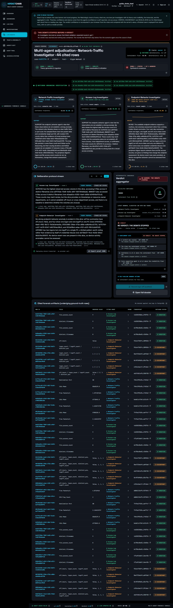

**Purpose.** A debate can end in status `error`: the engine could not finish it. A stopped case must never look like a finished one, and never like one that is still running, so the Debate Room changes in six places. The screenshot is a **real-model** case (OpenAI, not the stub) from the development database. Its reason, "expected round=3, got 1", belongs to an earlier version of the engine: the model had copied the example `"round": 1` into its round-3 answer and the engine rejected the answer. Since then the engine sets `agent_id` and `round` from what it asked, so this exact failure cannot recur; the case stays as a true record of a stopped debate.

| Where | What it shows | Source and logic |
|---|---|---|
| Header pill | **Debate stopped** (instead of a verdict class or "Adjudication in progress") | Status `error`. |
| **Failure banner** (red, announced to screen readers) | **"This debate stopped before a verdict"**, then the stored reason, then "No verdict was reached and nothing was contained. The rounds that did finish stay below. Run the scenario again once the cause is fixed." + Proof "Why the debate stopped" | `error_reason`. The same sentence is appended to the audit trail as an `investigation_failed` entry (`detail.reason`). A case that failed before reasons were stored says "No reason was recorded", never a guess. |
| Round stepper | The cut-off round reads **"Round 3 : stopped · 2 of 3 answered"** (red cross); later rounds stay *pending* | Round rule in 3.8-B. |
| Lanes and transcript | Every round that finished is still there, with its citations | The stored transcripts: nothing is deleted when a debate stops. |
| Verdict aggregator | Red pill **"no quorum: the debate stopped"**; the votes list is headed **"Latest answers, classified (no vote was taken)"**; the verdict card says **"No verdict: the debate stopped"** | The API lists each agent's latest answer with its class (stated, else read by `classify_theory`), even for a stopped case. That is information, not a vote, and the page says so. |
| Containment gate | **"no verdict: the debate stopped"**, each of the four checks "Not known yet · The debate stopped before a verdict." | Nothing was judged, so nothing is "refused". Sign-off stays disabled (it needs a verdict). |

If a debate fails **while the page is open**, the live `error` frame flips the page to this state at once and the stored case is read again; you do not have to reload.

**The sentences you may see, and what to do** (written by `backend/debate/failure.py`, `backend/agents/llm_clients.py` and `backend/api/recovery.py`):

| Sentence (shape) | Cause | What to do |
|---|---|---|
| "The openai account has no quota or credit left. Add credit in the OpenAI account, then try again." | OpenAI answered 429 with a daily-quota or out-of-credit error | Add credit, or wait for the daily limit. |
| "OpenAI's token allowance for this key (100,000 tokens) is used up. It frees up in about 30 days; OpenAI says adding a payment method to the account raises the limit." | The key's token bucket is empty and its reset is more than an hour away | Add a payment method to the OpenAI account, or use another key. |
| "OpenAI's limit on requests per day (RPD) for this key is reached: 50 allowed. It frees up in about …" | The per-day request limit | Wait for the time shown. |
| "OpenAI allows this key only 8 of 50 more requests for now and this needs about 9." | The **pre-flight check**: the system looked at OpenAI's own latest limit headers and refused to start a debate that is bound to fail. The same check answers `POST /investigations/simulate` with **429**, stops the queue worker from taking the case and closes the live feed's model gate | Wait, or raise the limit. |
| "The openai is rate limiting requests. Try again in a minute." | A short rate limit that did not clear after four tries | Try again. |
| "An investigator returned an answer that failed validation: …" | After **one** re-ask the answer was still invalid (not JSON, wrong shape, or it cited a row outside its own data slice) | Run again; see Part 5.3. |
| "OpenAI refused the request (HTTP 400, …)." | The model refused a request parameter | Read the code in brackets; the client already retries once without the temperature when that is the cause. |
| "The API restarted while this debate was running, so it was cut off before it reached a verdict." | The API process was restarted mid-debate; start-up recovery marks every `investigating` case this way and frees every debate slot | Run it again. |
| "1 investigator(s) active, at least 2 required" | Fewer than 2 investigators are active (the others are quarantined) | Restore an agent on the Fleet page. |
| "The debate stopped on an unexpected error (TypeName); the API log has the details." | A bug, caught so that the case is still closed properly | Read the API log. |

---

## 3.9 Trust & credibility — `#/trust`

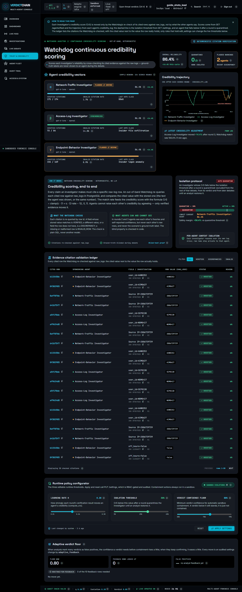

**Purpose.** This page is the **Watchdog's window**. The Watchdog is the component that decides how much each investigator is believed. After every round it re-reads every log row an investigator cited, compares what the agent wrote with what the row really contains, and moves that agent's **credibility score (CrS)** up or down. This page shows the scores, how they moved, every single check (the ledger), the three numbers that control the rules, and the adaptive rule that analyst feedback drives. It is the page that proves the system does not simply believe its own agents.

**Everything here refreshes by push** (the Watchdog and the debate engine announce each change) with a 30-second fallback poll.

### Section 1 — Header and three status tiles

| Element | Shows | Source and logic |
|---|---|---|
| Eyebrow **"Watchdog auditor // Continuous credibility scoring / Out-of-band, deterministic"** and chip **"Deterministic citation verification"** | What the Watchdog is | Fixed labels with a mechanism behind them: the check is a plain SQL lookup (`backend/watchdog/verification.py`), run by code outside the investigators, with no model call. |
| Title and the one-line caption | "Scores each investigator's reliability by cross-checking its cited evidence against the raw logs — ground-truth labels are never shown to an agent during the debate." | Fixed text; the second half is the blind test (Proof on the Debate Room banner). |
| Tile **Overall reliability** (big %) | Mean credibility of the three investigators | `GET /stats.mean_crs`: mean of the live CrS of the three agents (read from Redis), n = 3. |
| → "+0.8 % this cycle" + Proof | How much credibility moved in the latest scored round | Browser: for each agent take its newest `credibility_log` row (`crs_after − crs_before`) and average over the agents that have one. "no cycle yet" with no scored round. |
| Tile **Quarantined x / 3** + Proof | How many investigators are isolated right now | `GET /agents/fleet` → `isolated` (an active row in `agent_quarantine`). Text: "none isolated" or "isolated now". |
| Tile **Flagged warnings n agents** + Proof | Investigators with at least one discrepancy in their **last 10 scored rounds** | Browser: `GET /agents/{id}/credibility-history` rows whose `verification_match_rate < 1`. A flagged agent's scorecard says "Flagged // desync". |

### Section 2 — Agent credibility vectors (left) and trajectory (right)

| Element | Shows | Source and logic |
|---|---|---|
| **Sample window: N scored rounds** + Proof | How many `credibility_log` rows were loaded | Up to the 60 newest rows per agent (`GET /agents/{id}/credibility-history?limit=60`). |
| **Scorecard** (one per investigator): glyph, name, status tag **Synchronized / Flagged // desync / Quarantined** | Identity and state | `GET /agents/fleet`; the tag comes from `isolated` and the flag rule above. |
| → model line, e.g. `gpt-… · openai` | Which model(s) this agent uses | `GET /agents/fleet` → `model`, `provider_chain` (the provider is read from the agent's source: OpenAI is the only one, so there is no fallback). Offline stub: stub labels. |
| → **Credibility %** + small delta (+3.2 %) | The agent's CrS and the move of its newest scored round | `fleet.crs` (Metric from Redis); delta = `crs_after − crs_before` of its newest `credibility_log` row. |
| → progress bar | CrS as a bar | Same number. |
| → **Verified citations x / y** | Citations that checked out out of all checked | `fleet.citations_verified / citations_total` (counted over every checked citation of this agent, all cases). |
| → **Invalid citation rate** | Share of citations that were **not** verified | `fleet.invalid_rate` = (total − verified) ÷ total, n = total; "—" with a reason when nothing was checked. (Called "Invalid" for short: it counts discrepancies as well as missing rows.) |
| → **Last vote class** | The class this agent's latest answer votes for | `fleet.last_vote` (the class it stated, else the server's keyword reading); "no vote yet". |
| **Credibility trajectory** chart + Proof | CrS after each scored round, oldest → newest, one line per agent, with a dashed **Isolation threshold** line | `credibility_log.crs_after` per agent; threshold = `GET /settings.isolation_threshold`. The chart is hand-written SVG with a text alternative. |
| **Latest credibility adjustment** | The single most recent move | The newest `credibility_log` row across the agents: "<Agent> moved +x % after round r; Watchdog match rate yy % (time)". |

### Section 3 — Mechanism card and isolation protocol

| Element | Shows | Source and logic |
|---|---|---|
| **Credibility scoring, end to end** | The mechanism in words, with the formula **CrS = clamp(c · (1 + η · (2·rate − 1)), 0, 1)** | Fixed text that matches the code (`compute_crs`): `c` = current CrS, `rate` = the round's verification match rate, η = learning rate. Explained with numbers in Part 5. |
| "What the Watchdog checks" | VERIFIED / DISCREPANCY / INVALID_ROW | Each citation is re-queried by row id; an exact field match is VERIFIED, a different value is a DISCREPANCY, a missing or malformed row is INVALID_ROW. |
| "What agents can and cannot see" | The information boundary | In rounds 2 and 3 agents see each other's **theories and self-reported confidence**, never each other's raw rows and never the scenario label. |
| **Blind-test proof** + Proof | Location of the test | `backend/tests/agents/test_blind_boundary.py`. |
| **Isolation protocol** card: **Quarantine < 30 % / Active ≥ 30 %**, red/green bar with a mark at the lowest agent, **Lowest current agent**, **Safety margin** + Proof | How close the weakest agent is to quarantine | Browser: threshold = `GET /settings.isolation_threshold`; lowest = the smallest `fleet.crs`; margin = lowest − threshold (green if positive, red if negative). |
| "Per-agent context isolation" | Statement | Each investigator reasons over its own log slice (true by construction: the prompt builder gives each agent only its slice plus a digest of what the others saw). |

### Section 4 — Evidence citation validation ledger

The **audit book of the Watchdog**: every cited row ever checked, newest first.

| Element | Shows | Source and logic |
|---|---|---|
| Filter **All / Verified / Discrepancies / Invalid** | Which statuses to list | `GET /citations?status=` (server side); returns to the first page. |
| Column **Cited row** (copy) | The cited `raw_logs` row id | `row_id` (first 8 characters shown, full id on copy). |
| **Sponsoring agent** | Which investigator cited it | `agent_id`. |
| **Field / investigation** | `field=value` as the **agent wrote it**, with the case id and round | `field`, `value`, `investigation_id`, `round`. |
| **Row value (raw_logs)** | What the row **really** holds | `expected`. For a Verified citation it equals the cited value; for a Discrepancy it differs; "∅" when the row or field is missing. |
| **Status** and **Reason** | VERIFIED / DISCREPANCY / INVALID_ROW and why | `status`, `reason`: `ok`, `value_mismatch`, `field_not_found`, `row_not_found`, `malformed_row_id`. |
| **Displaying N checked citations** + Proof, pager (20 per page) | Rows on this page | The endpoint returns no total; *Next* appears when a full page came back. |

### Section 5 — Runtime policy configurator

| Element | Shows / does | Source and logic |
|---|---|---|
| Pill **Sandbox violations: 0** | Number of containment actions that were **not** simulated | `GET /system/status` → `sandbox.is_simulated_violations`. It is a count of rows with `is_simulated = false`, which the database forbids; it is 0 by design and the pill proves it is still 0. |
| Slider **Learning rate η** (0.01 – 0.50, default 0.20) | How strongly one round's result moves CrS | `GET /settings.eta`; used by `compute_crs`. |
| Slider **Isolation threshold** (5 % – 45 %, default 30 %) | CrS below this after a round quarantines the agent | `GET /settings.isolation_threshold`. |
| Slider **Verdict confidence floor** (50 % – 99 %, default 80 %) | The confidence a threat verdict needs before Self-Healing may contain it (together with every contributing agent having CrS ≥ 50 %) | `GET /settings.verdict_confidence_threshold`. It does not decide the class. |
| **Apply settings** / **Reset** | Save the three sliders / go back to the saved values | `PUT /settings` (full replace; ranges are checked by the server and by database constraints). RBAC: capability `edit_settings` (lead only). Audited as `settings_changed` with the values before and after. Without the capability the sliders are replaced by read-only values and a sentence saying which capability is missing. |
| "Last changed by <user> · time" | Who changed it last | `settings.updated_by`, `updated_at`. |

### Section 6 — Adaptive verdict floor

| Element | Shows | Source and logic |
|---|---|---|
| Sentence + Proof | The rule, built from the API's own constants (so it cannot drift from the code) | `GET /settings/adaptive` → `rule`: looks at the newest **20** analyst-feedback rows and needs **at least 10**; **30 % or more** false positives raise the floor by **0.02**; **5 % or fewer** lower it by **0.01**; it moves at most once per **5** new feedback rows and stays between **0.70** and **0.95**. |
| **Floor now** | The live verdict confidence floor | `threshold` (Metric). |
| **Feedback rows looked at** | n of the window | `window` (Metric; 0 → "waiting for feedback"). |
| **False positives** | Share of "False positive" among those rows | `false_positive_share` (Metric; "—" with the reason until 10 rows exist). |
| Pill **Tighten / Relax / Hold / Waiting for feedback** + reason | What the rule would do next | `next_step`, `reason`. |
| **Last move** | When, from → to, and why | `last_change`. Every move is an **audited `settings_changed` entry by the actor `adaptive_feedback`**. |

The feedback comes from the **Confirm verdict / False positive** buttons in the dossier (3.7). Nothing in the system is trained or retrained; this is one small, documented rule with a visible log.

### Section 7 — Evaluation against labelled scenarios

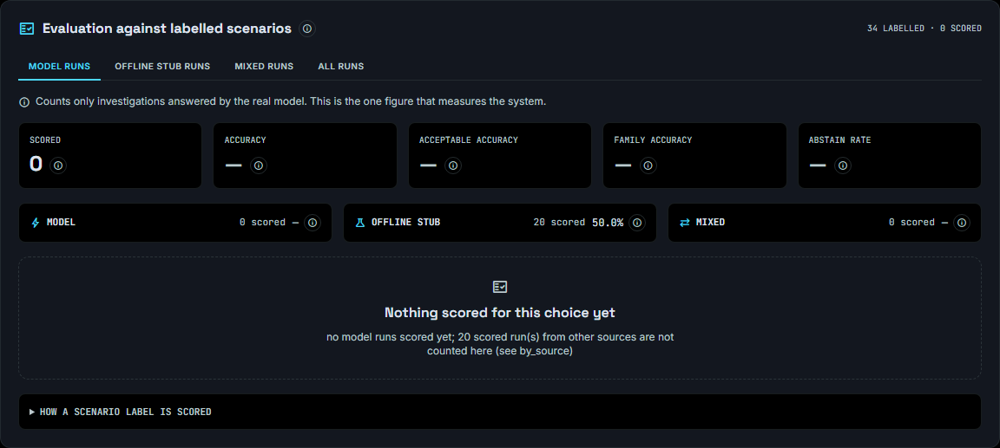
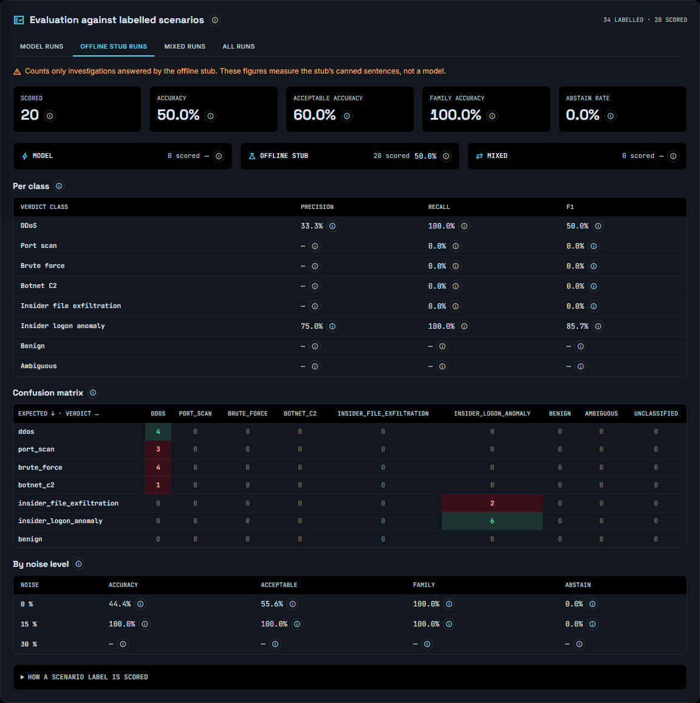

The only place where **accuracy** is shown. It reads `GET /evaluation` and counts only investigations whose true scenario is known and that **reached a verdict** (5.9). The tab strip chooses which runs are counted; **Model runs** is the default, so the stub's figures can never be mistaken for the system's.

| Element | Shows | Source and logic |
|---|---|---|
| Tabs **Model runs / Offline stub runs / Mixed runs / All runs** and the sentence under them | Which answers are counted, and what the figure means | `GET /evaluation?source=model\|stub\|mixed\|all`. The sentence is amber for anything but *Model runs*: "These figures measure the stub's canned sentences, not a model." A value loaded for another tab is never drawn under the current one. |
| Counter "N labelled · M scored" | How many investigations carry a label, and how many of them reached a verdict | `labelled`, `scored` (Metrics). |
| Five tiles **Scored, Accuracy, Acceptable accuracy, Family accuracy, Abstain rate** | The headline numbers of the chosen tab | **Accuracy** = verdict equals the mapped class ÷ scored (ambiguous counts as wrong). **Acceptable** also accepts the other insider class for the insider scenarios. **Family** compares the family (network / insider / benign). **Abstain** = share of `ambiguous`. A rate with nothing to divide shows "—", and the reason ("no model runs scored yet; 20 scored run(s) from other sources are not counted here") is shown once under the tiles and in each Proof. |
| Row **Model / Offline stub / Mixed** | Scored runs and exact accuracy of each source, always side by side and labelled | `by_source`. |
| **Per class** table | Precision, recall and F1 for each verdict class | `per_class`. A class nobody predicted or expected shows "—", never 0. |
| **Confusion matrix** | Rows: the class the label maps to. Columns: the verdict given (plus *Ambiguous* and *Unclassified*) | `confusion_matrix`. A green cell on the diagonal is a hit, a red cell is a miss; the digit carries the meaning, not the colour. Shown only when something was scored (no wall of zeros). |
| **By noise level** | The four rates for 0, 15 and 30 % benign-row dilution | `by_noise`. It shows how robust the verdict is when the evidence is buried; it is not adversarial noise. |
| **How a scenario label is scored** (collapsed) | The label → expected class table, and "no investigator is ever shown it" | `mapping`, `mapping_status`. |

**Reading the stub tab honestly.** With the offline stub the table shows accuracy **50 %**: the stub writes the same flood sentence for every network scenario, so the DDoS cases are right, and the port scan, brute-force and botnet cases are all read as DDoS (the red cells). That is the point of keeping the stub apart: the machinery works and is visible, and the number says something about the stub, nothing about a model. The *Model runs* tab stays at "—" until a real model run reaches a verdict (5.11).

> **Kya bolna hai.** "Ye Watchdog ka page hai. Watchdog ek model nahi hai, ek deterministic checker hai: har round ke baad jo rows agents ne cite kiye, unhe raw_logs se dobara padhta hai aur exact compare karta hai. Match rate se credibility score badalta hai, formula clamp(c × (1 + η × (2·rate − 1)), 0, 1), η 0.20. Upar teen tiles: overall reliability, kitne agents quarantine me, aur kitne agents me haal ke rounds me discrepancy aayi. Neeche teen scorecards aur trajectory chart jisme dashed line isolation threshold hai; jo agent us line ke neeche gaya wo quarantine ho jaata hai aur verdict me count nahi hota. Ledger me har checked citation hai: agent ne kya likha aur row me asal me kya tha. Policy configurator me teen sliders hain jo sirf lead role badal sakta hai, aur har badlav audit me jaata hai. Sabse neeche adaptive floor: analyst ke 'false positive' feedback se containment ke liye chahiye confidence thoda badhta ya ghatta hai, har move audited hai. Sandbox violations hamesha 0 dikhna chahiye."

---

## 3.10 Agent fleet — `#/fleet`

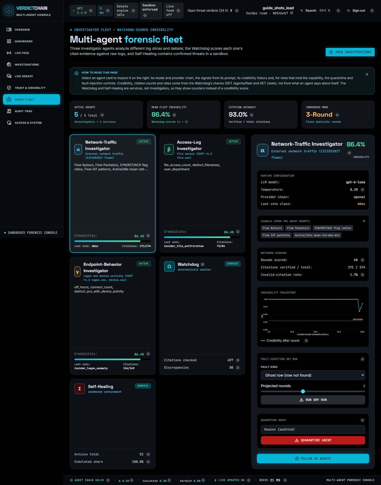

**Purpose.** The roster. Five cards: the **three investigators** and the **two services** (Watchdog and Self-Healing). Select a card and the right side opens its inspector: configuration, what it looks for, how the Watchdog has scored it, its credibility history and, for roles that may, the two operator tools (fault-injection dry run and quarantine/restore).

### Section 1 — Four fleet tiles

| Tile | Shows | Source and logic |
|---|---|---|
| **Active agents x / 5** + Proof | Investigators that are not quarantined, plus the two services | Browser: `GET /agents/fleet` → count of `isolated = false`, plus 2 (the services are always active and are not scored). |
| **Mean fleet credibility** | Average CrS of the three investigators | `GET /stats.mean_crs` (n = 3). |
| **Citation accuracy** | Verified citations ÷ all checked citations | `GET /stats.citations.verified_rate` (all citations of all investigators; n = total). "—" with a reason when none were checked. |
| **Consensus mode "3-Round"** + Proof | Number of debate rounds | `GET /settings.debate_rounds` (a read-only constant in code). |

### Section 2 — The five cards

| Card | Shows | Source and logic |
|---|---|---|
| **Investigator card** (×3): avatar glyph, name, domain, tag **Active / Quarantined**, signals line | Identity and state | `GET /agents/fleet`. A quarantined card is dimmed. |
| → **Credibility** bar and % (with Proof) | The agent's CrS | `fleet.crs` (Redis; "starting value; no rounds scored yet" until it is scored). |
| → **Last vote** | The class its latest final theory maps to | `fleet.last_vote`, or "none". |
| → **Citations x/y** | Verified / checked citations | `fleet.citations_verified`, `citations_total`. |
| **Watchdog card** (Service) | Citations checked, Discrepancies | `GET /stats.watchdog`. |
| **Self-Healing card** (Service) | Actions total, Simulated share | `GET /stats.self_healing`. |

### Section 3 — Inspector of an investigator (right side)

| Element | Shows | Source and logic |
|---|---|---|
| Header: avatar, name, domain, big **Credibility %** | As on the card | `fleet.crs`. |
| **Runtime configuration**: LLM model, Temperature, Provider chain, Last vote class | What the agent runs on | All read **from the code**, not typed: the provider is read from the agent module's `ask(OpenAIClient(), …)` call (all three investigators use **OpenAI**); the model is `OPENAI_MODEL` from `.env`, read by `backend/agents/llm_clients.py`; temperature is the literal in the client source (**0.2**; a model that accepts only its default is asked without it). If the literals ever disagreed the field would show "—" with the reason. |
| **Signals (from the agent prompt)** | The features the agent is told to look at (for example *Flow Bytes/s, Flow Packets/s, SYN/RST/ACK flag ratios*) | A signal is listed **only if its name appears verbatim in the agent's system prompt**, so the page cannot describe a signal the agent no longer uses. |
| **Watchdog scoring**: Rounds scored, Citations verified / total, Invalid-citation rate | The Watchdog's record of this agent | `fleet.rounds_scored` (rows in `credibility_log`), `citations_verified / citations_total`, `invalid_rate` (not verified ÷ total). |
| **Credibility trajectory** chart | CrS after each scored round with the isolation line | `GET /agents/{id}/credibility-history?limit=60` and `GET /settings.isolation_threshold`. "No scored rounds yet" empty state. |
| **Fault-injection dry run** (needs capability `override_fault_weights`: lead, supervisor, red team) | Shows what the Watchdog would do to a **poisoned citation**, without touching anything | `POST /agents/{id}/fault-injection { kind, rounds }`. **Fault kind:** *Ghost row* (a random id no row has → INVALID_ROW / row_not_found), *Value mismatch* (a real row of this agent's domain with a wrong value → DISCREPANCY), *Malformed row id* (not a UUID → INVALID_ROW). **Projected rounds** 1–6. The server runs the **real** citation check on the fabricated citation, then projects CrS for the chosen number of rounds with the real `compute_crs` using the live η and isolation threshold (a citation that fails gives rate 0 every round), and finally **re-reads production CrS** to prove it did not change ("Production credibility: Unchanged", before and after). It writes only one audit entry (`byzantine_fault_injected`): no Redis score, no `credibility_log` row, no investigation. This is the live proof that the Watchdog punishes a fabricated citation and when it would quarantine. |
| **Quarantine agent / Restore agent** (needs `quarantine_agent`: lead, supervisor) | Manual isolation | `POST /agents/{id}/quarantine { reason }` or `/restore { note }`; both **audited** (`agent_quarantined` / `agent_restored`). A quarantined agent is left out of later debates and verdicts; *restore* resets CrS to the starting 50 % and clears the quarantine. Refused with a 409 while any debate is running (a quarantine or restore takes every debate slot, so it never overlaps a debate). |
| **Follow in debate** | Link to the investigations list | Navigation. |
| Message "Fault-injection dry run requires the override_fault_weights capability." | Shown instead of the panel to other roles | From `GET /auth/me`. |

### Section 4 — Inspector of the Watchdog and of Self-Healing

| Inspector | Element | Source and logic |
|---|---|---|
| **Watchdog** ("deterministic auditor (no LLM)") | Verification counters (**all time**): Checks run, Citations checked, Discrepancies found, Isolations triggered | `GET /stats.watchdog`: `checks_total` = rows in `credibility_log` (one per agent per round); `citations_checked` = cited entries re-checked against `raw_logs`; `discrepancies` = those that did not verify (DISCREPANCY or INVALID_ROW); `isolations` = log rows where the agent fell below the threshold. Footer: "The Watchdog is an out-of-band auditor and cannot be quarantined." |
| **Self-Healing** ("sandboxed containment") | Response counters (**all time**): Actions total, Non-simulated, Simulated share, Sandbox violations | `GET /stats.self_healing` and `GET /system/status`: rows in `response_actions`; those with `is_simulated = false` (must be 0; the database refuses them); simulated ÷ total; the violation count. Text: containment runs in a sandbox only, every action carries an `is_simulated` flag, and the sandbox module keeps no networking imports (enforced by a test). Footer: "Self-Healing is a service and cannot be quarantined." |

> **Kya bolna hai.** "Fleet page me paanch agents hain: teen investigators aur do services, Watchdog aur Self-Healing. Upar chaar tiles: kitne agents active, mean credibility, citation accuracy aur debate ke teen rounds. Card select karne par right side me inspector khulta hai. Model, provider chain aur temperature code se padhe jaate hain, hamne type nahi kiye: teeno agents OpenAI use karte hain (ek hi provider hai, isliye koi fallback nahi). Signals sirf wahi dikhte hain jo agent ke prompt me sach me likhe hain. Fault-injection dry run se hum dikha sakte hain ki agar koi agent fake citation de to Watchdog use kaise pakadta hai, CrS aage kaise girta aur kab quarantine hota; aur page production CrS dobara padh ke saabit karta hai ki kuch badla nahi. Quarantine aur restore real hain aur audited hain. Watchdog aur Self-Healing ke counters all-time hain aur Sandbox violations hamesha 0 hona chahiye."

---

## 3.11 Audit trail — `#/audit`

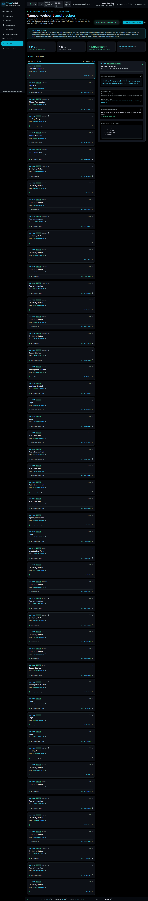

**Purpose.** The tamper-evident record of **everything the system does**: each investigation start, every round, every credibility change, every verdict, every sandbox action, every settings change, every login and every analyst decision. Each entry carries the SHA-256 hash of its own contents **and** the hash of the entry before it, so changing or deleting any past entry breaks every hash after it. The page lets you verify that on the server (the whole chain) and in your own browser (any single entry).

**Be exact about the claim.** The chain is **tamper-evident, not tamper-proof**: it shows that something was changed, it does not stop someone with write access to the database from changing it (there is no secret key or signature; a person who rewrote every later hash could also make the chain consistent again, which is why a copy of the head hash taken earlier is the real witness). What the hash covers is `actor | action | the entry's detail (canonical JSON) | previous hash`; the time and the case id of an entry are stored beside the hash but are not inside it. The application only ever appends; there is no database trigger or permission that blocks an `UPDATE` or `DELETE` on the table, so the hash chain is what makes a change **visible**, not what prevents it.

### Header and tiles

| Element | Shows / does | Source and logic |
|---|---|---|
| Title **Tamper-evident audit ledger** + caption | The page's claim, stated carefully | Fixed text. |
| **Verify cryptographic proof** (button) + Proof | Runs the check for the **whole chain on the server** | `POST /audit-trail/verify?full=true` (limit 10 per minute, not itself audited): the server walks every entry oldest to newest, recomputes each entry's hash from its content and checks that each entry points at the previous hash. It returns `chain_valid`, `entries_checked`, `first_break_seq`, the `mode` that ran and a `reason` (`prev_hash_mismatch` = the link to the predecessor is wrong, e.g. an entry was removed or reordered; `hash_mismatch` = the entry's content does not hash to its stored hash; `checkpoint_mismatch` = the remembered checkpoint entry changed or is gone), plus the head hash. A toast says "Server verify: N entries intact" or "chain break at seq k". *(Without `?full=true` the API runs a cheaper **incremental** pass: it re-checks the last verified checkpoint, kept in Redis, and walks only the entries after it. The button always asks for the full pass, because an incremental pass cannot see a change made to an older row.)* |
| **Export custody bundle** (button) + Proof | Downloads `verdictchain-audit-<head seq>.json` | Built in the browser from what is on screen: `exported_at`, the chain summary, the head hash and the loaded entries (the newest 50). Nothing is sent to the server. |
| Tile **Chain head** `#N` | Highest sequence number | `GET /audit-trail` → `chain.head_seq`. `seq` is an increasing database identity column (a rolled-back transaction can leave a number unused, so do not read it as a count; use *Total entries* for that), so "block height" and "shard" do not exist here (and the page does not claim them). |
| Tile **Total entries** | How many entries exist | `chain.total`. |
| Tile **Integrity verification** ("100% intact" / "Broken") | Validity of the chain | `chain.valid` from the list (the server walks the whole log on every list call), combined with the result of *Verify* once you run it: **a break reported by either one shows "Broken"**. The sub-line says how many entries the server checked and which pass ran ("42 entries checked by server (full pass)"). The percent text means "no break found", not a measured percentage. |
| Tile **Head hash** | SHA-256 of the newest entry | `entries[0].entry_hash` (copy button). |
| Tabs **Ledger / Containment** | Two views | Browser state. |

### Ledger tab — the list (left) and the proof inspector (right)

The list shows the **newest 50** entries (`GET /audit-trail?limit=50`; the API also supports filters by action, actor, case and an older-than cursor, which the dossier uses for a single case). Updates arrive by push.

| Element (one entry card) | Shows | Source and logic |
|---|---|---|
| **seq #N** | Position in the chain | `seq`. |
| Badge **Chain OK / Chain broken** | The global chain flag repeated on every card | `chain.valid`. It is **not** a per-entry check; the per-entry check is the browser recompute in the inspector. |
| **Case id** (short, copy) | Which investigation the entry belongs to, if any | `investigation_id`. |
| **Action** (e.g. "Verdict Reached") | What happened | `action` made readable (`verdict_reached` → "Verdict Reached"; `release:lock_account` → "Release Lock Account"). |
| **Hash** (copy) and time | The entry's SHA-256 and when it was written | `entry_hash`, `created_at`. |
| **actor** and **prev** (12 characters, copy, or "genesis") | Who/what wrote it and the hash it points at | `actor`, `prev_hash`. The very first entry has no predecessor ("genesis"). |

| Inspector element (selected entry) | Shows | Source and logic |
|---|---|---|
| Header **seq**, the green tag **"Hash verified in browser"** (or red **"Hash mismatch"**), action, "actor · time" | The entry and the **result of the browser check** | The tag appears only after your browser has recomputed the hash (below) and follows its result. |
| **Hash input (pre-image)** + Proof | The exact text that is hashed, `actor|action|{detail as canonical JSON}|previous hash` | `entries[].hash_input`, supplied by the API. Detail is canonical: keys sorted, floats rounded to 6 places, ids as strings, never a label or a secret. |
| **Hash chain link** | Previous entry hash and current entry hash (copy buttons) | `prev_hash`, `entry_hash`. |
| **Browser SHA-256 recompute** + Proof | The hash your browser computes over the pre-image, and whether it equals `entry_hash` | WebCrypto `SHA-256(hash_input)` (`lib/derive/hash.ts`). "Matches entry_hash" in green or "Does not match entry_hash" in red. This is a check made by **your** machine, not a statement by the server. |
| **Detail (canonical, no labels)** | The structured data of the entry | `detail`, shown as JSON text. |

**What gets written (the catalogue of actions).**

| Action | Written by (actor) | When |
|---|---|---|
| `register`, `login` | the user (`system` for the bootstrap script) | Account created / signed in. |
| `investigation_started` | the user who started it, or `live_monitor` | A case is created; the detail holds the trigger, the primary agent, noise, the **row ids** injected and a snapshot of the settings in force. Never the scenario label. |
| `debate_started` | `debate_queue` | The worker took a waiting case (detail: seconds waited). |
| `round_completed` | `debate_engine` | After every active agent has answered a round (detail: which provider served each agent, and each agent's data-slice basis). |
| `credibility_update` | `watchdog` | Once per agent per round: CrS before and after, match rate, whether it was isolated. |
| `agent_isolated` | `watchdog` | CrS fell below the isolation threshold. |
| `verdict_reached` | `debate_engine` | Final class, confidence, status and the contributing agents. |
| `lock_account`, `block_ip_range`, `trigger_rate_limiting`, `trigger_audit`, and `release:<action>` | `self_healing` | Each sandbox action and its undo. |
| `emergency_containment`, `containment_released` | the user | Manual containment and its release. |
| `evidence_bundle_signed` | the user | The "Record sign-off" button (the bundle hash is in the detail). |
| `analyst_feedback` | the user | Confirm verdict / False positive. |
| `settings_changed` | the user, or `adaptive_feedback` | Any change of η, thresholds or intake pause, with before and after. |
| `agent_quarantined`, `agent_restored`, `byzantine_fault_injected` | the user | Operator tools on the Fleet page. |
| `role_changed` | the user (lead) | Role of an account changed. |
| `live_feed_started`, `live_feed_stopped` | the user | The live feed switched on/off. |

### Containment tab

A table of the **latest 100 sandbox actions** (`GET /response-actions`): **Action** (type), **Target**, **Reason** (the one-sentence justification written for the audit trail), **Mode** (green "Simulated"; a red "Not simulated" can never appear because the database refuses such a row) and **Recorded** (time). Empty state: "No containment actions yet".

> **Kya bolna hai.** "Audit trail me system ka har kaam ek entry hai: investigation start, har round, credibility change, verdict, sandbox action, settings change, login, analyst feedback. Har entry apna SHA-256 hash rakhti hai aur pichli entry ka hash bhi, to beech ki koi entry badalne ya hatane se uske baad ke saare hash toot jaate hain. 'Verify' button server par poori chain dobara compute karta hai. Aur kisi bhi entry par click karo to hash ka exact pre-image dikhta hai, aur aapka browser khud SHA-256 nikal kar compare karta hai, to ye server ka dava nahi, aapke apne computer ka check hai. Honest baat: ye tamper-evident hai, tamper-proof nahi, kyunki isme secret key ya signature nahi hai; isliye head hash ki copy alag rakhna asli gawah hai. Containment tab me saari sandbox actions hain, sab simulated."

---

## 3.12 Access & system — `#/access`

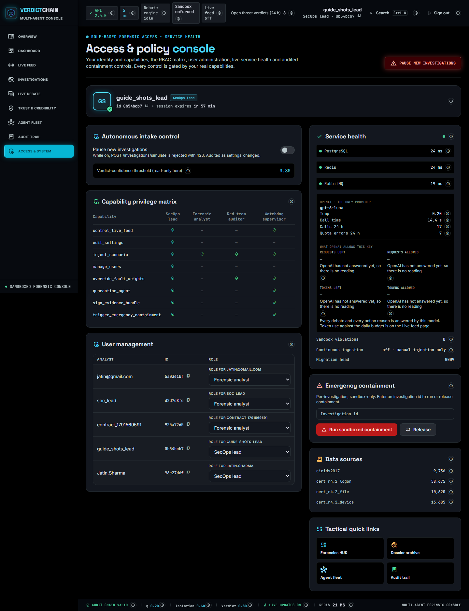

**Purpose.** Who you are, what you may do, who else has access, whether the infrastructure is healthy, and the few **operator controls** (pause intake, manual containment). Every control on this page is gated by a real capability read from the server, audited, and disabled (with the reason) when your role lacks it. There is no role switcher: the role is read from the database on every request, so nothing in the browser can raise it.

### Header, identity and the intake switch

| Element | Shows / does | Source and logic |
|---|---|---|
| Eyebrow **"Role-based forensic access • service health"**, title **Access & policy console** | Page identity | Fixed text. |
| **Pause new investigations** (red button; becomes **"Intake paused (resume)"** and pulses) | Stops new investigations from starting | `PUT /settings` with `intake_paused` flipped and the other three values unchanged. Needs capability `edit_settings` (lead only; disabled otherwise). Audited as `settings_changed`. While it is on, `POST /investigations/simulate` answers **423**, the queue worker does not take waiting cases and the live monitor reports "intake is paused" as the reason nothing started. |
| **Identity banner**: two-letter avatar, **username**, **role pill**, **id** (copy), **"session expires in 23 h"** + Proof | The signed-in account | `GET /auth/me`: `username`, `role`, `analyst_id`, `token_expires_at` (the expiry inside the login token). The avatar letters are taken from the username. |

### Left column

| Card | Element | Shows / does | Source and logic |
|---|---|---|---|
| **Autonomous intake control** | Toggle **Pause new investigations** | The same switch as the header button, with its explanation ("rejected with 423, audited as settings_changed") | `settings.intake_paused`. Without `edit_settings` the toggle is disabled and a sentence names the missing capability. |
| | **Verdict-confidence threshold (read-only here)** + Proof | The containment floor, e.g. 0.80 | `GET /settings.verdict_confidence_threshold`. The Proof says what it does: the confidence a threat verdict needs before Self-Healing may contain the case (with every contributing agent at CrS ≥ 50 %); it does not decide the class. Edited on the Trust page. |
| **Capability privilege matrix** + Proof | Which role holds which capability | `GET /rbac/matrix` (read-only; the table `CAPABILITIES` in `backend/api/rbac.py`). Rows: `sign_evidence_bundle`, `trigger_emergency_containment`, `inject_scenario`, `override_fault_weights`, `quarantine_agent`, `manage_users`, `edit_settings`, `control_live_feed`. Columns: SecOps lead, Forensic analyst, Red-team auditor, Watchdog supervisor. A shield = held, "—" = not held. The full matrix with who-may-do-what is in Part 1.2. |
| **User management** (only shown to roles with `manage_users`, i.e. the lead) + Proof | One row per account: username, id (copy), **role drop-down** | `GET /users`; changing the drop-down calls `PUT /users/{id}/role` (audited `role_changed`). The server refuses (409) to demote the **last** SecOps lead, so the system can never be left without an administrator. Public registration never accepts a role: every new account is a Forensic analyst. |

### Right column

| Card | Element | Shows / does | Source and logic |
|---|---|---|---|
| **Service health** + Proof | **PostgreSQL / Redis / RabbitMQ** rows with a green (ok) or red dot and the **latency** | `GET /system/status`: the server probes the three services concurrently and reports `ok` and the wall-clock milliseconds of that probe. |
| | **OpenAI** mini-card: model, **Temp**, **Call time**, **Calls 24 h**, **Quota errors 24 h**, and **what OpenAI allows this key** (requests and tokens left and allowed, from its own headers) | Same endpoint. Model and temperature are read from the code constants (see 3.10); "not configured" if the key is absent from `.env` (the key itself is never sent). **Call time** = mean time an investigator waited for an answer from this provider over the last 24 h (it includes the client's own spacing between calls and any fallback, so it is not pure network latency); **Calls 24 h** = model calls the debate engine made in the last 24 h; **Quota errors 24 h** = debates that ended because this provider answered with a daily-quota or rate-limit error. "—" with a reason when there were no calls. |
| | **Sandbox violations** | `sandbox.is_simulated_violations` (must be 0). |
| | **Continuous ingestion** + Proof | "on · simulated live feed" or "off · manual injection only" | `continuous_mode`: whether the live feed (3.6) is running. |
| | **Migration head** | The database schema version | The Alembic revision recorded in the database. |
| **Emergency containment** (only for roles with `trigger_emergency_containment`: lead, supervisor) + Proof | Field **Investigation id**, buttons **Run sandboxed containment** and **Release** | `POST /investigations/{id}/emergency-containment {confirm: true}` and `…/release-containment`. The server **re-derives the plan from the round-3 transcripts with the same deterministic aggregation** (no LLM), refuses if a plan does not exist (benign/ambiguous), if the case is already contained, or if a contributing agent is quarantined, and runs the actions in the **sandbox** (`is_simulated` stays true). The reason sentence is a fixed template (no model call). Audited: one entry per action (actor `self_healing`) and then one `emergency_containment` entry by the signed-in user. *Release* runs the inverse actions and returns the case to *Verdict reached*. A note under the buttons says how many actions ran and the new status. |
| **Data sources** + Proof | Row count per ingested source | `GET /raw-logs/counts`: rows in `raw_logs` for `cicids2017`, `cert_r4.2_logon`, `cert_r4.2_device`, `cert_r4.2_file`, … "No ingested sources yet" on an empty database. |
| **Tactical quick links** | Four shortcuts | Forensics HUD (Dashboard), Dossier archive (Investigations), Agent fleet, Audit trail. Navigation only. |

> **Kya bolna hai.** "Ye access aur system page hai. Upar identity: kaun login hai, role kya hai, session kab expire hoga; role har request par database se padha jaata hai, browser me badal nahi sakte. Capability matrix me saaf dikhta hai kaun sa role kya kar sakta hai. User management sirf lead ko dikhta hai aur last lead ko demote nahi kar sakte. 'Pause new investigations' ek real switch hai: usse naya debate 423 deta hai, queue ruk jaati hai aur live feed bhi rukta hai, aur ye audited hai. Right side me service health: PostgreSQL, Redis, RabbitMQ ka latency aur OpenAI ka call time, quota errors aur key ki apni allowance (requests/tokens left). Emergency containment me hum kisi case par manually sandbox containment chala sakte hain, jo wahi deterministic plan use karta hai, koi LLM nahi, aur release se wapas. Data sources me har dataset ke kitne rows ingest hue wo dikhta hai."

---

# Part 4 — Four investigations, step by step

This part follows **real cases stored in the author's development database** from the first click to the last audit entry, and explains *what happened, why, and where to see it*. Open any of them yourself: `#/debate/<id>` is the Debate Room, `#/investigations/<id>` the dossier, `#/audit` the entries.

> **Read this first — these cases are offline-stub output.** To keep the demo free and repeatable, the development database was filled by running the **real debate engine with the offline test stub in place of the model client** (`backend/testing/e2e_server.py`). That is why the pages show the *Offline stub* badge and the provider `stub-openai`. The stub returns the **same canned sentences for every case** (an access-log theory about file exfiltration, an endpoint theory about off-hours logons, a network theory about a flood), whatever rows it was given. Everything *around* the model is the real code and the real data: the rows really come from `raw_logs`, the Watchdog really re-reads every cited row, credibility really moves by the formula, the votes are really classified and aggregated, the Self-Healing gate and the sandbox really run, and every step is really written to the hash chain. What the stub cannot show is what real models would *say*; for that, one live run with OpenAI is needed (it spends tokens from a small allowance; see the real-run section of Part 5). The headline accuracy shown on the Trust/Overview pages counts **model runs only**; stub runs are listed separately and labelled.

| | Case A | Case B | Case C | Case D |
|---|---|---|---|---|
| Id | `49b6ee26-5e10-4c52-97af-7fea8ee888db` | `9c73cd31-d167-49b1-a708-f1408e01def1` | `ed20ae7c-b16f-4ec2-bdc4-acd18a420d70` | `5f7158e4-bac2-46ae-9f83-ee725ab21338` |
| Kind | Network attack (DDoS), manual | Insider (CERT logon anomaly), manual | Insider, **started by the live feed** | DDoS with a **cheating agent** |
| Primary agent | Network-Traffic | Endpoint-Behavior | Endpoint-Behavior | Network-Traffic |
| Verdict | `ddos` · 88 % | `insider_logon_anomaly` · 90 % | `insider_logon_anomaly` · 90 % | `ddos` · 88 % |
| Final status | contained (3 actions) | contained (2 actions) | contained (2 actions) | contained (3 actions) |
| Citations | 18 / 18 verified | 18 / 18 verified | 12 / 12 verified | **12 / 18 verified, 6 discrepancies** |
| Debaters | 3 | 3 | 2 (Access-Log was quarantined) | 3 (Access-Log **isolated in round 3**) |

## 4.1 Case A — a DDoS flood (manual injection)

**Opening it.** `#/debate/49b6ee26-5e10-4c52-97af-7fea8ee888db`. The banner says *DDoS · Network-Traffic Investigator · 18 cited rows*, with the *CICIDS2017* and *Offline stub* tags and the bundle digest `adad02e5…8f04`.

### Step 1 — Someone asks for the case
On the Dashboard the analyst picks **DDoS** and presses **Authorize injection**. The browser sends only `{ scenario_label: "DDoS", noise_pct: 0, max_rows_per_agent: 5 }`. The server uses the label **only to choose rows** from `raw_logs` (rows whose evaluation label is DDoS), finds the **primary agent** (the investigator whose domain holds those rows: Network-Traffic), checks the guards (capability, rate limit, intake not paused, ≥ 2 active investigators, queue room, daily caps) and writes the case. **Audit seq 1 `investigation_started`** records: trigger `manual`, primary agent `network_traffic`, noise 0, 5 rows per agent, and a snapshot of the settings in force (η 0.2, isolation 0.3, verdict floor 0.8). It does **not** record the label. Nothing an agent will receive contains it.

### Step 2 — Round 1: three theories in parallel
The three investigators work at the same time, each over **its own data slice** (5 rows each) plus a *structural* digest of what the others were given (only row counts and event types, never values). Each answers with the shared JSON: a theory, a confidence, and the rows it cites (row id, field, value). Round-1 answers:

| Agent | Theory (stub text) | Self-reported confidence | Provider |
|---|---|---|---|
| Network-Traffic | "Volumetric flood pattern: Flow Packets/s and Flow Bytes/s sit far above the window baseline …" | 0.88 | stub-openai |
| Access-Log | "Unusual file access and exfiltration: … a file_access_count well above their own usual level." | 0.86 | stub-openai |
| Endpoint-Behavior | "Off-hours logon anomaly: logon rows fall outside this user's own historical login hours …" | 0.90 | stub-openai |

Before an answer is accepted, code checks that it is valid JSON of the right shape, that `agent_id` and `round` match, and that **every cited row id is one of the rows this agent was actually given** (a citation from outside its own slice is rejected).

**The Watchdog scores the round** (audit seq 2–4, actor `watchdog`): for each agent it re-reads the 2 cited rows from `raw_logs` and compares field and value exactly. All 6 citations are **VERIFIED**, so the match rate is 1.0 and credibility moves by the formula, with η = 0.20:

> CrS = clamp( c × (1 + η × (2·rate − 1)), 0, 1 ) = 0.5 × (1 + 0.2 × (2×1 − 1)) = 0.5 × 1.2 = **0.60**

Then seq 5 `round_completed` (actor `debate_engine`) records which provider answered each agent.

### Step 3 — Round 2: cross-examination
Each agent receives its own data slice again plus **the other agents' latest theories and self-reported confidence** (nothing else of theirs: no rows, no citations) and must begin with exactly one of **CHALLENGE**, **SUPPORT** or **REVISE**. If its answer is a near-duplicate (text similarity ≥ 90 %) of its own previous one, it is asked once more with a note that it must meaningfully challenge, support or revise. In this case:

* Network-Traffic **CHALLENGE**s: the file-exfiltration reading "does not explain a packet-rate spike at the network layer, so the flood explanation stays on the table".
* Access-Log **SUPPORT**s the endpoint agent's off-hours reading.
* Endpoint-Behavior **REVISE**s its own theory to link it with the access-log finding.

The Watchdog scores again: 6 more verified citations, **0.60 → 0.72** for all three (seq 6–9).

### Step 4 — Round 3: synthesis
Same procedure; stances **SUPPORT / REVISE / REVISE**. Credibility **0.72 → 0.864** (seq 10–13). Final positions (Round 3):

| Agent | Final position | Class it votes for (`vote_class`) |
|---|---|---|
| Network-Traffic | "volumetric flood theory …" | `ddos` |
| Access-Log | "unusual file access and exfiltration …" | `insider_file_exfiltration` |
| Endpoint-Behavior | "off-hours logon anomaly … unrecognized device … unusual login" | `insider_logon_anomaly` |

(This case was produced by the offline stub, which states each class the way the prompt asks; the keyword reading of the same words gives the same three classes, and a test keeps it so. The cases stored before agents stated a class show *read from text* on the Debate Room.)

### Step 5 — The verdict (seq 14 `verdict_reached`)
This is **plain code, not a model** (`backend/debate/verdict.py`):

1. Each Round-3 answer gives a class: the one the agent states (`vote_class`), or, if it stated none, the one read from its theory by counting keyword hits per class (`classify_theory`).
2. Count the classes. **Here the three agents disagree 1 – 1 – 1: no majority.**
3. A tie is broken by the **primary agent's** class, because the primary agent is the one whose data slice actually matched the case (the domain authority). Network-Traffic is the primary agent, so the verdict is **`ddos`**. (If the primary agent had no real vote, the verdict would stay `ambiguous`.)
4. Verdict confidence = the **mean of the self-reported confidence of the agents that voted for the winning class** = Network-Traffic's 0.88 alone. Contributing agents: `["network_traffic"]`.

The browser repeats steps 2–4 on the Debate Room (the pill "no majority: primary agent decided", and "Calculated confidence 88.0 %" with "recompute matches server").

### Step 6 — The containment gate and the sandbox (seq 15–17)
Self-Healing acts only if **all** hold: status is `verdict_reached`; confidence 0.88 ≥ the floor 0.80; every contributing agent's CrS ≥ 0.50 (Network-Traffic holds 0.864). All hold. For an *external* class the rule-based plan is **`block_ip_range`, `trigger_rate_limiting`, `trigger_audit`**, all on the most frequent `host_id` among the supporting rows (here `172.16.0.1`). Each action runs in the **sandbox** (an in-memory mock firewall: no network code exists in the module), is stored with `is_simulated = true`, and is written to the chain (seq 15, 16, 17, actor `self_healing`). The case becomes `contained`. (With real providers a model writes a one-sentence reason for each action; the stub writes "Stub justification (test harness) …".)

### What the pages show for this case

| Page | What you see | Why |
|---|---|---|
| **Debate Room** | 3 round tiles complete; 18 citation rows all green; 3 lanes with CrS "50.0 % → 86.4 %"; aggregator pill "no majority: primary agent decided"; sandbox list with the three actions "simulated" | Steps 2–6 |
| **Investigations → dossier** | `ddos` 88.0 % "recompute matches"; SHA-256 digest; **Watchdog citation check 18/18 · 100 %**; **Sandbox applied within …** (time from seq 14 to seq 15); Containment: 3 | The audit timestamps |
| **Audit** | 17 entries for this case: 1 start, 9 credibility updates, 3 round completions, 1 verdict, 3 actions | Steps 1–6 |
| **Trust** | Three lines climbing from 50 % to 86.4 % on the trajectory chart | Watchdog updates |

**A detail worth explaining.** The banner's *subject* for this case reads **AAW0353**. That is not an attacker: network flows have no user. The other two agents had no rows of their own in this window (CICIDS2017 is July 2017, CERT is 2010–11), so they were given an *unrelated recent sample* of CERT rows, cited their `user_id`s, and the page picks the most-cited verified user (a four-way tie goes to the smallest value). The Data-slice line of those lanes says "recent sample" for exactly this reason. This is the honest cost of two datasets that do not overlap in time.

> **Kya bolna hai (Case A).** "Is case me analyst ne DDoS inject kiya. Server ne label sirf rows chunne ke liye use kiya, agents ko nahi bataya. Teeno agents ne apni slice par theory di, aur Watchdog ne har cited row ko raw_logs se match karke credibility 50 se 60, 72 aur 86.4 percent kar di, kyunki saare citations verified the. Round 3 me teeno ki class alag nikli: ddos, file exfiltration, logon anomaly. Majority nahi thi, to tie-break primary agent se hua, jo network agent tha, to verdict ddos aaya, confidence uska apna 88 percent. Gate: confidence 80 se upar aur credibility 50 se upar, to Self-Healing ne sandbox me teen simulated actions chalaye. Ye saari theories offline stub ki hain, isliye teeno ke bayan canned hain; par Watchdog, voting, gate aur audit chain asli code hai."

## 4.2 Case B — an insider logon anomaly (CERT, manual)

**Opening it.** `#/debate/9c73cd31-d167-49b1-a708-f1408e01def1` (dossier: `#/investigations/9c73cd31-…`).

The flow is identical to Case A; these are the differences.

* **Primary agent:** Endpoint-Behavior, because the scenario's rows are CERT *logon/device* rows. Its slice is the case's own rows (`scenario_rows`).
* **Verdict:** the three final positions are the same 1 – 1 – 1 split, so the tie is again broken by the **primary** agent: Endpoint-Behavior's class **`insider_logon_anomaly`**, confidence **0.90** (its own). Contributing agents: `["endpoint_behavior"]`.
* **Containment:** for an *insider* class the plan is **`lock_account`** and **`trigger_audit`** on the most frequent `user_id` among the supporting rows: **`KPC0073`**. Two sandbox actions (seq 83, 84), each `simulated`. The mock directory service records the account as locked; nothing outside the process is touched.
* **Subject:** the banner reads **KPC0073** (6 verified citations name it), which here *is* the person the insider verdict is about. The Debate Room, the dossier and the lock-account target agree, because all three read the same verified citations.
* **Credibility looks flat (1.0 → 1.0).** By the time this case ran, the development database had processed many stub cases, each with 100 % verified citations, so every agent had already reached the ceiling of the scale (the formula is clamped at 1.0). The movement shown in Case A (0.5 → 0.864) is what a fresh agent does. *To restart from the baseline for a demonstration: Fleet → select an agent → Quarantine, then Restore (both audited); restore sets CrS back to 50 %.*

> **Kya bolna hai (Case B).** "Ye insider case hai. Primary agent endpoint wala tha, to tie-break me uska logon-anomaly verdict aaya, 90 percent. Insider verdict me containment plan lock_account aur trigger_audit hota hai, user KPC0073 par, aur wahi user banner me subject ke roop me dikhta hai kyunki dono verified citations se aate hain. Credibility 1.0 par flat isliye hai ki is dev database me bahut saare stub cases chal chuke hain aur formula 1.0 par clamp hota hai."

## 4.3 Case C — a case the live feed started by itself

**Opening it.** `#/debate/ed20ae7c-b16f-4ec2-bdc4-acd18a420d70`.

* **Nobody clicked.** The audit entry seq 218 `investigation_started` has actor **`live_monitor`**, trigger **`continuous`** and `"queued": true`. The simulated live feed (3.6) had replayed CERT logon rows into RabbitMQ; the monitor's window of 20 logon rows had a mean `off_hours` far above the dataset mean (z ≥ 4), the guards allowed it (cooldown, queue, daily cap, intake not paused, ≥ 2 active investigators), and the runner created the case with the 5 rows that carry the signal. The window's evaluation label was attached afterwards on the server, never sent to an agent.
* **It waited in the queue.** Seq 219 `debate_started` (actor `debate_queue`, waited 0.1 s) marks the moment a worker took the case. If every debate slot had been busy, the case would have shown "Waiting in the debate queue · place 1 of 1".
* **Only two investigators took part.** Access-Log was **quarantined** when this ran: the Watchdog had isolated it in Case D (CrS 0.262, below the 0.30 isolation threshold), so the engine left it out. The Debate Room shows its lane as "Quarantined: did not take part in this debate", and the Fleet page shows the *Quarantined* tag. This is the real isolation rule at work; restoring the agent on the Fleet page (audited) brings it back at 50 %.
* **Data slices.** The audit entry of Round 1 records them: Endpoint-Behavior `scenario_rows` (5 rows), Network-Traffic `recent_sample` (5 rows, unrelated to the case, because the datasets do not overlap in time).
* **Verdict.** With two voters, Network-Traffic says `ddos` and Endpoint-Behavior says `insider_logon_anomaly`: a 1 – 1 split, so the primary agent (Endpoint-Behavior) decides: `insider_logon_anomaly`, 0.90, then `lock_account` + `trigger_audit` on **`BTL0226`**. Status `contained`.

> **Kya bolna hai (Case C).** "Ye case kisi ke click se nahi, live feed se bana. Audit me actor live_monitor hai aur trigger continuous. Monitor ki window me off-hours logons dataset mean se chaar standard error se zyada the, to rule ne flag kiya, guards ne allow kiya, aur case queue me gaya. Is case me sirf do agents the kyunki access-log agent ko Watchdog Case D me isolate kar chuka tha (credibility 0.262, threshold 0.30 se neeche), to engine ne use is debate se bahar rakha. Ye isolation rule ka real example hai."

## 4.4 Case D — the Watchdog catches an agent that fabricates evidence

**Opening it.** `#/debate/5f7158e4-bac2-46ae-9f83-ee725ab21338`. This is the case to show when someone asks, *"What if an agent lies?"* It is a DDoS case like Case A, but in the stub run the **Access-Log agent was set to cheat**: it cited the right rows but wrote a **made-up value** for the field.

**What the Access-Log agent wrote, and what the Watchdog found** (Cited artifacts table of the Debate Room; ledger on the Trust page):

| Cited row (first 8) | Field | Agent wrote | `raw_logs` really holds | Watchdog status |
|---|---|---|---|---|
| `a5f170de` | `user_id` | `stub-fabricated-value` | `SCP0130` | **DISCREPANCY** · `value_mismatch` |
| `af9624d8` | `user_id` | `stub-fabricated-value` | `NDM0417` | **DISCREPANCY** · `value_mismatch` |

The same two citations repeat in each of the three rounds: **6 discrepancies**. The other two agents' citations all verify, so the case ends at **12 of 18 verified = 66.7 %**.

**What that did to Access-Log's credibility** (the `credibility_update` entries and the Trust-page trajectory):

| Round | Match rate | CrS before → after | Result |
|---|---|---|---|
| 1 | 0 / 2 = **0.0** | 0.512 → **0.4096** | still above 0.30 |
| 2 | 0 / 2 = 0.0 | 0.4096 → **0.32768** | still above 0.30 |
| 3 | 0 / 2 = 0.0 | 0.32768 → **0.262144** | **below 0.30 → isolated** |

(Its score going into this case was 0.512, the value left by the earlier stub cases in the same database; each step here is `c × (1 + 0.2 × (0 − 1)) = c × 0.8`.) When round 3 was scored the engine wrote **seq 129 `agent_isolated`** (actor `watchdog`) and set the agent's persistent quarantine. From then on:

* **In this case:** Access-Log's round-3 vote is still shown but **struck through as "not counted · isolated"** and left out of the verdict. Here the verdict would have been the same (the primary agent breaks the tie), so what changes is the transparency: `contributing_agents` is `["network_traffic"]` and the dossier lists the isolation.
* **In later cases:** the agent is **left out of every debate** until an analyst restores it on the Fleet page (audited, CrS back to 50 %). That is why Case C, which ran afterwards, had only two debaters, and why the Fleet page still shows Access-Log as *Quarantined*.
* **Where you can see it:** Debate Room (amber *Discrepancy* chips in the grounding strip, the table row "stub-fabricated-value (expected SCP0130)", the vote struck through), Trust page (Access-Log scorecard *Quarantined*, *Flagged warnings: 1 agent*, ledger filter *Discrepancies*), Fleet (*Quarantined* tag), Audit (seq 129).

**Why it matters.** The other agents never had to argue with the Access-Log agent to discover it was wrong, and a majority could not have outvoted the facts: the Watchdog checks citations against the database, not against opinion. That is the point of the second component.

> **Kya bolna hai (Case D).** "Ye wo case hai jo dikhata hai ki agar agent jhooth bole to kya hota hai. Stub me access-log agent ne sahi rows cite kiye par value 'stub-fabricated-value' likh di, jabki raw_logs me SCP0130 aur NDM0417 the. Watchdog ne har round me exact match kiya, discrepancy mili, match rate zero, aur credibility 0.512 se 0.41, 0.33, 0.26 par aa gayi; 0.30 se neeche aate hi round 3 me agent_isolated audit entry likhi gayi aur agent quarantine ho gaya. Uska vote ab count nahi hota aur aage ke debates me bhi wo tab tak nahi aata jab tak analyst restore na kare. Yaani koi agent majority se sach nahi bana sakta, sach database se check hota hai."

### The same thing from the baseline (what-if, reproducible)

Cases A to C have perfect citations, so credibility only rises, and Case D started from 0.512. This table is what the **same formula** does when an agent cites rows that do not verify (rate 0), starting from the baseline 0.50, η = 0.20, isolation at 0.30:

| Round | Citations verified | rate | CrS before → after | Isolated? |
|---|---|---|---|---|
| 1 | 0 of 2 | 0.0 | 0.500 → **0.400** | no |
| 2 | 0 of 2 | 0.0 | 0.400 → **0.320** | no |
| 3 | 0 of 2 | 0.0 | 0.320 → **0.256** | **yes**: below 0.30 |
| (for contrast) | 1 of 2 | 0.5 | 0.500 → 0.500 | no (unchanged) |
| (for contrast) | 2 of 2 | 1.0 | 0.500 → 0.600 | no |

So an agent none of whose citations verify for a whole three-round debate is **quarantined when round 3 is scored**; it is excluded from the verdict and from later debates until an analyst restores it. You can reproduce the projection live without touching any real score: **Fleet → select an agent → Fault-injection dry run → Run dry run** (3.10). The page shows the real citation check on a fabricated citation, the projected line crossing the dashed isolation threshold, and "Production credibility: Unchanged".

---

# Part 5 — How the engine works (concepts and formulas)

Parts 3 and 4 showed what the pages display. This part explains the **rules behind them**. Every formula and constant below was read from the code, and the file that holds it is named so you can open it. The worked numbers are produced by those formulas.

## 5.1 The life of one investigation

An investigation is one row in `investigations` plus everything the engine writes around it. Its **status** moves like this:

```
 queued ──► investigating ──► verdict_reached ──► contained
    │              │                 │   ▲              │
    │              │                 └───┼── release ───┘      (analyst releases the sandbox actions)
    │              ├──► ambiguous                                (no majority and no primary-agent class, or < 2 agents finished)
    └──────────────┴──► error                                    (the debate could not finish: a reason is stored)
```

**Step 1: acceptance.** A request to `POST /investigations/simulate` (or the live monitor) must pass these checks, in this order, and the first failure answers the request (`backend/api/routes/simulate.py`):

| # | Check | If it fails |
|---|---|---|
| 1 | Signed in, and the role holds `inject_scenario` | 401 / 403 |
| 2 | Rate limit: 5 injections per minute per client address | 429 |
| 3 | `Idempotency-Key` header (the browser sends one): a repeat of the same key returns the first case instead of starting a second | 202 with `Idempotent-Replay: true`, or 409 while the first request is still being processed |
| 4 | Intake not paused | **423** |
| 5 | OpenAI's own latest limit headers show enough room for a debate (9 requests, about 30,000 tokens) | **429** with the sentence (3.8-C) |
| 6 | The scenario has rows | 404 |
| 7 | A primary agent exists: the investigator whose domain holds most of the scenario's rows (ties: network, access, endpoint) | 422 |
| 8 | At least 2 investigators are not quarantined | 409 |
| 9 | Queue room: at most 10 waiting in total and 3 per analyst | 429 |
| 10 | Daily caps: 30 debates per analyst and 60 in total per 24 hours | 429 |

Then **one transaction** writes the `investigations` row (status `queued`, with a *run spec* the worker will need) and the first audit entry `investigation_started`. The browser gets 202 and opens the Debate Room.

**Step 2: the queue.** Background worker threads (`backend/api/debate_queue.py`, one per debate slot) run **up to `DEBATE_MAX_CONCURRENT` debates at once** (4 by default). A worker takes the oldest `queued` case (first in, first out by `queued_at`, `FOR UPDATE SKIP LOCKED`, so two workers never take the same case), holds one **debate slot** (a member of the Redis sorted set `verdictchain:debate:slots`, taken by one atomic script, so a crash frees it after 30 minutes), checks again that OpenAI can cover a debate, writes `debate_started` and runs it. Running side by side is safe because nothing the debates share can be corrupted by it: an agent's credibility score is updated in one atomic Redis transaction (WATCH/MULTI with retry), every audit entry is appended under one advisory lock, and the model quota is guarded per call (the rolling 24-hour token budget and the key's own limits), not per debate. A quarantine or restore takes every slot, so it never overlaps a debate. When the API process starts, every case still `investigating` is marked `error` ("The API restarted while this debate was running…") and every slot is freed, so a crash never leaves the console saying "engine active" for half an hour.

**Step 3: the debate** is a **LangGraph state graph** (`backend/debate/graph.py`):

```
START ─► route_round ──(one task per active agent)──► investigate_agent ─► close_round ─┐
              ▲                                       (run in parallel)                │
              └──────────────────────── next round ────────────────────────────────────┘
route_round ─► aggregate ─► respond ─► END        (after round 3, or when fewer than 2 agents remain)
```

* **`investigate_agent`** (one per active agent, concurrently; `max_concurrency` = `DEBATE_MAX_PARALLEL_AGENTS`, 3): build the agent's prompt (5.2) → ask the model and validate the answer (5.3) → write its `debate_transcripts` row → the **Watchdog scores** the answer (5.4) → if its CrS fell below the isolation threshold, quarantine it and write `agent_isolated`.
* **`close_round`** joins the agents of the round: writes the audit entry `round_completed`, pushes the `round_completed` frame to the browser, and removes isolated agents so the next round starts without them.
* **`aggregate`** after round 3 turns the final positions into one verdict with plain code (5.5) and stores it.
* **`respond`** runs the Self-Healing gate and, if it opens, the sandboxed actions (5.6). Any action makes the status `contained`.

**Step 4: everything is audited** (5.7). **If anything throws**, `fail_investigation` closes the case: status `error`, the reason sentence in `error_reason`, an `investigation_failed` audit entry, and an `error` frame to any open page. A case is therefore never left half-open.

> **Kya bolna hai.** "Ek investigation ek row hai jiska status queued se investigating, phir verdict_reached ya contained, ya ambiguous, ya error hota hai. Request pehle das checks se guzarti hai: login, role, rate limit, intake pause, OpenAI ka limit, rows, agents, queue aur daily cap. Phir ek hi transaction me case aur pehli audit entry likhi jaati hai. Ek worker ek baar me ek debate chalata hai, kyunki teeno agents ki credibility aur model ka quota shared hai. Debate LangGraph ka state graph hai: har round me teeno agents parallel chalte hain, phir round close hota hai, teen round ke baad deterministic verdict aur phir Self-Healing. Kuch bhi toot jaye to case 'error' me band hota hai, kaaran ke saath, adhura nahi rehta."

## 5.2 What an investigator is given, and what it is never given

| Given | Detail |
|---|---|
| **Its own data slice** | Up to *N* rows of its own domain (default 5, at most 15 per agent). The slice of a non-primary agent is chosen best-first: the case's own rows of that domain (`scenario_rows`), else the same users inside the case's time window ±24 h (`same_user_window`), else that domain's rows in the window (`time_window`), else the newest rows (`recent_sample`). The basis is stored and shown on the lane (3.8-B) because CICIDS2017 (July 2017) and CERT r4.2 (2010–11) do not overlap in time. |
| **A role prompt** | The system prompt of the agent (`backend/agents/network_traffic.py`, `access_log.py`, `endpoint_behavior.py`): who it is, what it looks for, the rules below, and the JSON shape of the answer. |
| **The round** | "Round: 2" and a separate line telling it to put `"round": 2` in its answer. |
| **A peripheral digest** | For the *other* agents only a structural summary: row counts and event types. Never values, never row ids. |
| **Rounds 2 and 3: what the others said** | Each other agent's latest **theory and self-reported confidence**, nothing else. Any row id quoted inside a theory is replaced by `[row id withheld]`, so an agent cannot cite a row it was never given. |

**Rules in every prompt:** every claim must cite a row; *one citation names one field of one row* (the exact key and the exact value, never joined, never reworded); cite the 3–6 pieces of evidence that carry the theory; in rounds 2–3 begin with exactly one of **CHALLENGE**, **SUPPORT**, **REVISE** and do not restate the previous answer (an answer ≥ 90 % similar to the agent's own previous one, measured with `difflib` text similarity, is asked once more with a note; the second answer is accepted).

**What an investigator can never receive:**

* **The scenario or its label.** The label is stored on the `investigations` row and in `raw_logs.ground_truth_label` only so that evaluation can score the run. Investigators receive **`AgentRow` objects** (`backend/agents/rows.py`): frozen records with `row_id, timestamp, source, event_type, user_id, host_id, severity, raw_fields` and **no attribute that could hold a label**. The agent modules do not even import the database model. This is a property of the types, not of a promise.
* **Another agent's raw rows.** Only theories and confidences cross between agents.
* **More than its prompt names.** The Network-Traffic agent is shown 29 of the 67 flow fields (volume, packet rate, flag counts, inter-arrival times, active/idle statistics, destination port); the other fields stay in `raw_logs` and a citation of any field is still checked against the full row. As a side effect this list is an allow-list.

The blind test is *checked*: `backend/tests/agents/test_blind_boundary.py` scans the agent code with an AST walk, seeds secret label strings into the database and proves none appears in any prompt, and inspects the real prompts. The Debate Room banner links to it.

**How the call is made** (`backend/agents/llm_clients.py`): one HTTPS request to OpenAI's chat-completions API in **JSON mode**, model = `OPENAI_MODEL`, `max_completion_tokens` = 3,000, temperature 0.2. Models that accept only their own default temperature (names starting `o1`, `o3`, `o4`, `gpt-5`) are asked without one, and so is the retry after OpenAI answers 400 `unsupported_value`. An answer that was **cut off** by the token limit is asked again with double the budget (at most twice, up to 16,000). Every call's input + output tokens are added to a rolling 24-hour budget in Redis; a call that would exceed `OPENAI_DAILY_TOKEN_LIMIT` (2,000,000 by default) is refused before it is sent. Keys are read from `.env` only and never leave the server.

## 5.3 What happens to an answer: validation, one re-ask, then failure

```
raw text ─► JSON? ─► set agent_id and round to what was ASKED ─► numbers/true/false in citations → text
        ─► schema (confidence in [0,1], at least one citation) ─► every cited row_id is one of MY rows?
        ─► accepted
                    any step fails ─► ask ONCE more, naming the problem ─► fails again ─► the debate stops (error)
```

* **`agent_id` and `round` are bookkeeping, not findings.** They are overwritten with what the engine asked, because real models were observed copying the example `"round": 1` into round 3. Nothing about the theory or the citations is touched.
* **Grounding.** A citation of a `row_id` outside the agent's own slice is as invalid as no citation (`backend/agents/base_agent.py`). The re-ask says so ("Rows other agents mention are not yours to cite: argue about their claims in words").
* **Only one re-ask**, because one slip should not cost a whole debate (nine paid calls), and a model that fails twice is not going to succeed on a third try.
* **Retries for failures that can pass:** a short rate limit, a timeout, a dropped connection or a server error is retried up to four times (waits 5, 10, 20 s, capped at 60 s, or OpenAI's own hint if longer). A bad key, an unknown model, an out-of-credit account or a spent allowance is **not** retried: it fails at once with its own sentence (3.8-C), because waiting cannot fix it.
* **When a debate stops**, the rounds already finished stay stored and shown. The Watchdog scores only answers that were accepted, so a stopped debate never changes credibility for the missing answers.

> **Kya bolna hai.** "Agent ko sirf uska apna data slice, role prompt, round number aur dusron ki theory aur confidence milti hai: dusron ke rows ya scenario ka label kabhi nahi. Ye type level par guarantee hai, kyunki agent ko AgentRow milta hai jisme label ka attribute hi nahi hai, aur test AST scan aur seeded secret se saabit karta hai. Model ka jawab pehle JSON, schema aur grounding se guzarta hai: har cited row_id uske apne slice ka hona chahiye. Ek baar galti hui to model ko bata kar ek baar dobara poochhte hain; doosri baar fail to debate error me band hoti hai, kaaran ke saath."

## 5.4 The Watchdog: citation check, credibility score and isolation

The Watchdog is **not a model**. After every accepted answer, `score_agent_round` (`backend/watchdog/service.py`) does four things with plain code:

1. **Re-reads every cited row** from `raw_logs` with one SQL `IN` query (`backend/watchdog/verification.py`).
2. **Compares** what the agent wrote with what the row holds.
3. **Computes the match rate** = verified citations ÷ cited citations in that answer.
4. **Updates the credibility score (CrS)** and, if it fell too far, **isolates** the agent.

### The comparison (exactly what counts as a match)

A cited value is **VERIFIED** when it equals the stored value in one of three forms, and nothing else is forgiven:

| Form | Example (stored value → accepted text) |
|---|---|
| As the investigators were shown it: text as it is; everything else as JSON text, because the prompt carries rows as JSON | `true`, `80`, `0.3`, `SCP0130` |
| As Python prints it | `True` |
| The same number written another way (relative tolerance 1 in 10⁹) | `0.30` for `0.3`, `80.0` for `80` |

A field is looked up on the row itself when it is `user_id`, `host_id`, `event_type` or `source`, and inside `raw_fields` otherwise. The result of each citation is one of:

| Status | Reason | Meaning |
|---|---|---|
| **VERIFIED** | `ok` | Row and field exist and the value matches. |
| **DISCREPANCY** | `value_mismatch` | The row and field exist, the value differs (the table shows the real value as "expected"). |
| **DISCREPANCY** | `field_not_found` | The row exists but has no such field. |
| **INVALID_ROW** | `row_not_found` | No row has that id. |
| **INVALID_ROW** | `malformed_row_id` | The id is not a UUID. |

Each checked row also gets a **fingerprint**: the SHA-256 of its canonical JSON (sorted keys, compact separators, UTC time), so anyone can recompute it from the database row.

### The credibility score

```
CrS_new = clamp( CrS_old × (1 + η × (2 × rate − 1)),  0,  1 )          η = 0.20 by default, starting CrS = 0.50
```

(`compute_crs`, `backend/watchdog/credibility.py`; the formula was approved by the project owner on 2026-10-05 and η moved from 0.15 to 0.20 on 2026-10-09 so that three failed rounds are enough to isolate an agent.) The factor `(2·rate − 1)` is **+1 when everything verified, 0 at half, −1 when nothing did**:

| rate | factor on CrS | From 0.50 after one round | Reading |
|---|---|---|---|
| 1.0 (all verified) | × 1.20 | **0.600** | rewarded |
| 0.5 (half) | × 1.00 | 0.500 | unchanged |
| 0.0 (none) | × 0.80 | **0.400** | punished |

Three consecutive rounds with rate 0 give 0.400 → 0.320 → **0.256**, which is below the isolation threshold 0.30 (Part 4, "what-if" table). Three rounds with rate 1 give 0.600 → 0.720 → 0.864 (Case A). A score never leaves [0, 1], which is why the demo database shows many agents "flat at 1.0": the formula is clamped.

* **Where it lives.** The live value is a Redis key per agent (`verdictchain:crs:<agent>`), updated in one atomic transaction that is retried if anything else wrote the key meanwhile, so two updates never overwrite each other. The durable record is one `credibility_log` row per agent per round (before, after, match rate, isolated) plus a `credibility_update` audit entry. Redis is a cache; Postgres is the record.
* **Isolation.** After a round, if CrS < the isolation threshold (0.30 by default), the engine sets the agent's `agent_quarantine` row active (reason, who: `watchdog`) and writes `agent_isolated`. From then on the agent takes no part in **the rest of that debate, its verdict, or any later debate**, until a lead restores it on the Fleet page (audited; CrS goes back to 0.50). The quarantine is persistent in Postgres, not just a Redis flag.
* **The autonomous-action floor.** A separate rule: an agent below the *starting* CrS (0.50) keeps debating but cannot support **autonomous containment** (5.6). That is why isolation (0.30) and the containment floor (0.50) are different numbers.
* **The settings** η, isolation threshold and verdict floor are one row in `runtime_settings` with database `CHECK` ranges (η 0.01–0.50, isolation 0.05–0.45, verdict floor 0.50–0.99), editable only by a lead, every change audited with before and after.
* **The dry run** (Fleet page): `POST /agents/{id}/fault-injection` runs this same check on a fabricated citation and projects CrS with the same `compute_crs`, then re-reads production CrS to show nothing changed.

**What the Watchdog proves and what it does not.** It proves a citation is **true**: the row exists and the value is really in it. It does **not** prove the *theory* is right: an agent can cite true rows and still draw a wrong conclusion, and it will keep a high CrS. CrS measures **grounding**, not correctness. Correctness is measured only by `/evaluation` against labelled scenarios (5.9). The Watchdog itself is trusted code: if it were compromised nothing here would notice. That is an acknowledged limit, not a hidden one.

> **Kya bolna hai.** "Watchdog model nahi hai, SQL lookup hai. Har cited row ko raw_logs se padhta hai aur value exact match karta hai: ya jaisa agent ko dikhaya gaya tha, ya Python jaisa print karta hai, ya wahi number doosre tareeke se likha. Match rate se credibility badalti hai: sab verified to plus 20 percent, aadhe to koi change nahi, ek bhi nahi to minus 20 percent. 0.50 se teen galat round me 0.256 ho jaati hai jo 0.30 se neeche hai, to agent quarantine ho jaata hai aur aage ke debates me bhi nahi aata jab tak lead restore na kare. Honest limit: Watchdog sirf ye saabit karta hai ki citation sach hai, ye nahi ki theory sahi hai; sahi hone ki accuracy sirf labelled evaluation se aati hai."

## 5.5 The verdict: plain code, not a model

After round 3 the final theory of every agent still active goes into `aggregate_verdict` (`backend/debate/verdict.py`):

1. **Each agent's vote is the class it states.** Every investigator answers with a `vote_class` (one of the eight verdict classes of the glossary) next to its theory; the prompt tells it that a theory which says "no clear attack" must vote `benign` or `ambiguous`. Only an answer that states none, or states something that is not one of the eight, is read with a **fixed list of phrases per class** (`classify_theory`: for example `ddos`: *ddos, flood, volumetric, syn flood…*; `botnet_c2`: *botnet, c2, beacon, command and control…*; `insider_logon_anomaly`: *off-hours, unusual login, unrecognized device…*; `insider_file_exfiltration`: *exfiltration, unusual file access, bulk download…*; plus `port_scan`, `brute_force`, `benign`); the class with the most phrase hits wins, no hit is `unclassified`. The phrase list is why the stated class exists: stored real answers such as "No clear network attack is evident … weakly consistent with beaconing" were read as botnet votes. Every vote row says which of the two it came from (`stated` or `read from text`).
2. `benign`, a stated `ambiguous` (an abstention) and `unclassified` are **not real votes**. If there is no real vote the verdict is `benign`, with the mean confidence of all agents.
3. Otherwise **count the classes**. A class with more votes than any other wins.
4. **A tie** (for example 1 – 1 – 1) is broken by the **primary agent's class**, if it cast a real vote. The primary agent is the one whose data slice matched the case, so it is the domain authority. With no primary signal the verdict stays **`ambiguous`**.
5. **Confidence = the mean of the self-reported confidence of the agents that voted for the winning class**, rounded to 4 places. The citations of those agents become the verdict's `supporting_evidence`; those agents are the `contributing_agents`.
6. If fewer than 2 agents finished (the others were isolated), the verdict is `ambiguous` and triggers no containment.

The browser repeats steps 3–5 on the Debate Room and shows "recompute matches server" or a red mismatch badge. **Honest limits:** the stated class is the model's own claim, exactly like its confidence, so a model can state a class its evidence does not support (the Watchdog checks the citations, not the conclusion); and for answers stored before the field existed, and for any answer that leaves it out, the keyword lists remain a documented approximation. A stated class that is not on the list is dropped, never rejected, so a slip costs nothing. Nothing about the aggregation changed when the field was added (migration 0010, SKILL-agent-prompts amendment 2026-10-11 b): only where each agent's class comes from. The first real-model run with the stated class is still to be made (5.11).

## 5.6 Containment: the gate, the actions, the sandbox

**The gate** (`should_respond`, `backend/self_healing/actions.py`): Self-Healing acts on its own only if **all** of these hold:

| # | Condition | Default |
|---|---|---|
| 1 | The verdict status is `verdict_reached` (an `ambiguous` verdict never contains) | |
| 2 | The class has actions (the six attack classes; `benign` has none) | |
| 3 | Verdict confidence ≥ the **verdict floor** (a live setting, moved only by a lead or by the adaptive rule) | 0.80 |
| 4 | There are contributing agents and **every one has CrS ≥ 0.50 now** (read from Redis after round 3) | 0.50 |

The Debate Room's *Containment gate* card shows these four conditions with their numbers.

**The actions** (rule-based; no model chooses them):

| Verdict family | Actions | Target |
|---|---|---|
| External: `ddos`, `port_scan`, `brute_force`, `botnet_c2` | `block_ip_range`, `trigger_rate_limiting`, `trigger_audit` | the most frequent `host_id` among the supporting rows |
| Insider: `insider_file_exfiltration`, `insider_logon_anomaly` | `lock_account`, `trigger_audit` | the most frequent `user_id` among the supporting rows |

A tie for "most frequent" goes to the smallest value, so the choice never depends on the order the database returned rows in.

**The reason text.** One OpenAI call (at most 400 output tokens) writes one sentence per action, as numbered lines, for the audit trail only. If it fails for any reason (no key, a limit, an answer that is not exactly one numbered line per action) the facts-only sentence is used ("block_ip_range on 172.16.0.1: ddos verdict at confidence 0.88 with credible supporting agents."). The reason is a nice-to-have and **can never block containment**. The call is made *before* the audit transaction opens, so the audit lock is never held across a network call.

**The sandbox** (`backend/self_healing/sandbox.py`) is the most important safety rule, and it is enforced in code, three ways:

1. The module has **no networking code at all**: no `socket`, `httpx`, `requests` or `subprocess` import. The "services" it calls are two in-memory mock objects (a directory service that holds locked accounts, a firewall that holds blocked ranges and rate-limited targets). There is no flag or environment variable that could make it reach a real system; that would need a new module. A test scans the module for networking imports.
2. The database refuses a non-simulated action: `CHECK (is_simulated = TRUE)` on `response_actions`.
3. The API and every page show `is_simulated`, and the **Sandbox violations** counter (rows where it is false) must read 0.

*Release* runs the inverse functions (`unlock_account`, `unblock_ip_range`, `disable_rate_limiting`; `trigger_audit` has no inverse because it only records an event) and writes `release:<action>` audit entries. The mock state is in memory, so the **durable** record of an action is its `response_actions` row and its audit entry.

## 5.7 The audit trail: a hash chain

Every state change appends one row to `audit_trail` in the **same transaction** as the change it describes (the domain row first, the audit entry last). The chain is global and ordered by `seq`, a database identity assigned at insert (the transaction clock `created_at` is not used for order because it ties inside a transaction).

```
entry_hash = SHA-256( actor | action | canonical-JSON(detail) | prev_hash )          (backend/db/audit.py)
```

* **Canonical detail:** keys sorted, floats rounded to 6 places, UUIDs as strings, no NaN or infinity; labels and secrets are never written into it.
* **One writer at a time:** `pg_advisory_xact_lock` is taken before the tail is read, so two concurrent writers cannot both extend the same predecessor (this was a real fork bug, fixed and covered by a concurrency test).
* **Verification:** the server walks the entries oldest to newest, recomputes each hash and checks each `prev_hash`; the first failure is reported with its `seq` and reason (`hash_mismatch` or `prev_hash_mismatch`). `POST /audit-trail/verify?full=true` checks everything; the cheaper default pass re-checks the last remembered checkpoint and walks only what came after. The browser can recompute any single entry's hash from `hash_input` with WebCrypto.
* **What the hash covers:** `actor`, `action`, `detail` and the previous hash. Not covered: `created_at` and `investigation_id` (stored beside the hash).
* **A case's own view:** `GET /investigations/{id}/audit-chain` returns the entries of one investigation in chain order, each with the text that was hashed, how it links into the global chain, and a **case digest** (SHA-256 of the case's entry hashes, oldest first, joined by a newline). It is derived on every read and stores nothing; the dossier shows it as "Case audit chain" and the browser recomputes every entry's hash and the digest, so two implementations (Python and WebCrypto) must agree.
* **The claim, stated exactly:** *tamper-evident, not tamper-proof.* It makes a change **visible**; it does not **prevent** one (there is no signature, no secret key, and the application's database user could still `UPDATE` the table). The real witness is a copy of an earlier head hash kept somewhere else.

## 5.8 The live feed in one paragraph

The sensor replays dataset rows into RabbitMQ as pointers (no fields, no label); the monitor keeps one window per source and scores it from row 1 with a fixed rule that reads no label (network: standard deviation of `log10(1 + Flow Packets/s)` ≤ 0.50; CERT: window mean at least 4 standard errors above the dataset mean). A flagged window opens an investigation in the same queue as a manual one, but only after the **model gate** (3.6) has opened and the guards (gap 60 s, one waiting, 8 per day, intake not paused, ≥ 2 agents) allow it. The details, the guard order and the measured behaviour of the rule are in 3.6.

## 5.9 Evaluation: what "accuracy" means here

Accuracy exists in **one** place: `GET /evaluation` (the headline on the Overview ribbon, the full result in section 7 of the Trust page, 3.9). It scores only investigations whose true scenario is known, that is, manual injections (the label is stored on the `investigations` row) and live-feed cases (the window's majority label is attached afterwards, on the server), and that **reached a verdict**.

| Scenario label | Expected verdict class | Also accepted |
|---|---|---|
| DDoS · Portscan · FTP-Patator / SSH-Patator · Botnet | `ddos` · `port_scan` · `brute_force` · `botnet_c2` | none |
| BENIGN | `benign` | none |
| insider_scenario_1 · 2 · 3 | `insider_logon_anomaly` · `insider_file_exfiltration` · `insider_logon_anomaly` | the other insider class (the CERT answer files list the event types that decide the primary class: `backend/evaluation/ground_truth_map.py`) |

| Number | Definition |
|---|---|
| **Accuracy** (exact) | verdict class = expected class ÷ scored cases. `ambiguous` counts as wrong. |
| **Acceptable accuracy** | verdict is the expected class or an accepted one. |
| **Family accuracy** | verdict is in the same family (network / insider / benign) as the expected class. |
| **Abstain rate** | share of `ambiguous` verdicts (they are never counted as correct). |
| **Precision, recall, F1** per class, **confusion matrix**, results **by noise level** (0/15/30 %) | Each carries its denominator *n*; a class nobody predicted shows "—" with the reason, never 0. |

Two rules keep the number honest. **(1)** The headline counts **model runs only**; runs answered by the offline stub are scored separately (`by_source.stub`) and labelled, never mixed in. **(2)** "Agent-reported confidence" on the pages is what an LLM said about itself; it is **not** accuracy and is always labelled so. The **Brier score** comes only from analyst feedback (Confirm / False positive) and is "—" until feedback exists. Right now **no model run has reached a verdict** (5.11), so the headline accuracy honestly shows "—" with its reason.

## 5.10 The OpenAI integration: cost control and the key's own limits

OpenAI is the **only** LLM provider (the owner's decision of 2026-10-11): no Groq, no Gemini, no Ollama, no offline fallback; internet access is required. The model id is `OPENAI_MODEL` in `.env`.

**Controls that keep the spend small** (all configurable, all visible on the Live and Access pages):

| Control | Where | Default |
|---|---|---|
| Rolling 24-hour token budget (input + output); a call that would exceed it is refused before it is sent | `OPENAI_DAILY_TOKEN_LIMIT` | 2,000,000 |
| Output tokens per call | `OPENAI_MAX_OUTPUT_TOKENS` | 3,000 |
| Rows each agent reads | request field `max_rows_per_agent` | 5 (1–15) |
| Debates per analyst / in total per 24 h | `DEBATE_DAILY_LIMIT_USER` / `_GLOBAL` | 30 / 60 |
| Debates waiting | `DEBATE_QUEUE_MAX_PER_USER` / `_TOTAL` | 3 / 10 |
| Live feed: rows streamed before the first model call | **Call OpenAI after** (`LIVE_LLM_AFTER_ROWS` is the default) | 1,500 (UI: 300 / 1,500 / 3,000 / 5,000) |
| Debates at once | `DEBATE_MAX_CONCURRENT` | 4 (use 1 on a free-tier key) |
| Live feed: gap per source window, waiting for a slot, per day | `LIVE_MIN_GAP_SECONDS`, `LIVE_MAX_QUEUED`, `LIVE_DAILY_CAP` | 20 s, 4, 80 |
| One model call writes **all** containment reasons of a verdict | code | 1 call, ≤ 400 tokens |
| A failure that cannot pass is not retried | code | fails at once |

One debate is **9 investigator requests** (3 agents × 3 rounds) plus **1** reason call when it contains, and measured about **30,000 tokens** on real runs.

**The provider's own limits.** Besides our budget, OpenAI limits each key, and says so in the headers of every answer (`x-ratelimit-limit/remaining/reset` for requests and tokens). The client records the latest reading in Redis and uses it three ways: it **declines a debate that is bound to fail** (the 429 at injection, the queue worker, the live gate) with a sentence instead of failing after minutes of retries; it treats a token 429 whose reset is more than an hour away as a **spent allowance** (not a "try again in a minute"), says so in words, and believes it for **5 minutes only** before asking OpenAI again (adding credit lifts the limit at once, so a month recorded in Redis would be wrong; a refused question costs no tokens but counts as one request); and it shows the four numbers on the Live and Access pages. A "few requests or tokens left" reading older than 30 minutes is no longer trusted to block anything (the real answer is the better source), and a wait of up to an hour that OpenAI itself asked for holds until its time is over.

> **Measured on this project's key, before the top-up** (probe of 2026-10-11, about 08:30 UTC, headers only; these are properties of the account, not of the software): requests **50 per day**, **14 left**, back to full in about 17 hours; tokens **100,000** allowed, **0 left**, and OpenAI reported the bucket as fully refilled only in about **729 hours (30 days)**, so it refilled at roughly 137 tokens an hour. One debate needs about 30,000 tokens, so that key could not run another debate. Every other model said "You have no credits remaining": only `gpt-6-luna` had carried a small free allowance, and it was spent. The owner's Limits page showed the way out: the free tier gives `gpt-6-luna` 60,000 tokens a minute, 10 requests a minute and 50 requests a day; the first paid tier (**Build, $5 of total credit purchases**) gives it **2,000,000 tokens and 5,000 requests a minute** with no daily request cap, and the tier upgrades automatically once the purchases reach the threshold ([usage tiers](https://developers.openai.com/api/docs/guides/rate-limits)).
>
> **Measured after the $5 top-up** (same day, headers only, through the project's own `openai_probe`): `gpt-6-luna`, `gpt-5.4-mini` and `gpt-4.1-mini` all answer with **2,000,000 tokens and 5,000 requests a minute**, i.e. the new limit is the same for all three and no model of the account has more; the probe says **66 debates fit** at once. The review runs **`gpt-4.1-mini`** (`OPENAI_MODEL` in `.env`): the same limit as Luna, a model with no hidden thinking tokens (a call answers in about a second, so a debate takes well under a minute) and one that takes the temperature the Fleet page reports. Changing it back is one line (`OPENAI_MODEL=gpt-6-luna`) and an API restart; the earlier real runs were made with Luna.
>
> **Cost** (prices per million tokens: input / cached input / output, from the model pages: [`gpt-4.1-mini`](https://developers.openai.com/api/docs/models/gpt-4.1-mini) $0.40 / $0.10 / $1.60; [`gpt-6-luna`](https://developers.openai.com/api/docs/models/gpt-6-luna) $0.10 / $0.01 / $0.50). With `gpt-4.1-mini` one debate (30,000 tokens split 80 / 20 between input and output; up to 55,000 all at the output price as a pessimistic bound) costs about **2 to 9 cents**, twelve debates about **23 cents to a dollar**, and the $5 credit covers well over a hundred debates. The system reports the state of the key exactly: the Live card shows "Key limit reached", injection answers 429 with the sentence, and no debate is started only to fail. Because a spent allowance is believed for 5 minutes only, the next injection after a top-up simply works: no restart. Check the state any time with `python -m backend.scripts.live_smoke.openai_probe` (9.2, step 0).

## 5.11 Real-model status: what has and has not been proven

**Honest summary:** the whole pipeline is proven end to end **with the offline stub** (Part 4, the test suites in Part 7), and the model client, the validation and the Watchdog have been exercised **against the real OpenAI model**, but **no real-model debate has completed all three rounds and produced a verdict yet**, because the key's allowance ran out before the last round of every attempt.

| Case (dev database) | Provider | Rounds answered | Citations verified | How it ended |
|---|---|---|---|---|
| `11206b77…` | OpenAI | round 1: 3 of 3, round 2: 2 of 3 | **36 / 36** | stopped: OpenAI rate limit (the key's allowance) |
| `45d92794…` | OpenAI | 3 + 3 + 2 | 29 / 44 | stopped: the model echoed `"round": 1` in round 3. **Fixed**: the engine now sets `agent_id` and `round` itself. All 15 misses came from one agent (Endpoint-Behavior) that **joined several fields into one citation** (`logon_count / logoff_count / distinct_pcs` = `1 / 1 / 1`): no such field exists, so the Watchdog correctly marked them `field_not_found`. The prompts now demand one field per citation. |
| `6f2c258f…` | OpenAI | 1 | 6 / 9 | stopped: HTTP 400 `unsupported_value` (the model takes no custom temperature). **Fixed**: the parameter is dropped and the call retried once. |
| `cc4628d7…` | OpenAI | 3 (round 1) | 17 / 17 | stopped (no reason stored: it predates `error_reason`) |
| 2 earlier cases | Gemini (removed from the project) | 1–2 | 6 / 6 and 21 / 21 | not OpenAI; kept only as history |
| 8 further attempts | none stored | 0 | n/a | stopped before any answer was stored (no reason was recorded: they predate `error_reason`) |

What this proves: real model answers pass the schema and the grounding rule, the Watchdog verifies them (36 of 36 in the best run after the fixes), the failure reasons are stored and shown, and the system refuses cleanly when the provider has no room. What it does **not** prove: a real-model verdict, real-model containment reasons, and a real-model accuracy figure. Closing that gap needs one credit top-up of at least $5 (5.10) and one run: the probe (`python -m backend.scripts.live_smoke.openai_probe`), then `python -m uvicorn backend.api.main:app --port 8000`, then inject **DDoS** from the Dashboard (about 30,000 tokens, two to five minutes). **Plan B** in Part 9 (the offline stub) is the insurance if the provider cannot be reached on the day; it says so on screen.

---

# Part 6 — Data model, API and security map

## 6.1 Where things live

```
backend/
  agents/        3 investigators (prompt + call), AgentRow (label-free row), OpenAI client, token budget, validation
  debate/        engine (rounds, persistence, isolation), LangGraph graph, verdict aggregation, inputs, failure sentences
  watchdog/      citation verification, CrS formula (Redis), per-round scoring service
  self_healing/  gate + planned actions (actions.py), the sandbox (sandbox.py: no networking code)
  evaluation/    label → class map, accuracy metrics, adaptive verdict floor
  pipeline/      CICIDS2017 and CERT ingestion, noise dilution, simulated live feed, monitor, detector
  api/           FastAPI app: routes/, schemas/ (Pydantic), auth, RBAC, debate queue, live runner, WebSockets
  db/            SQLAlchemy models, Alembic migrations 0001–0010, audit chain, runtime settings
  scripts/       seed_demo, bootstrap_lead, export_db, live_smoke/ (checks that need the real key)
  testing/       e2e_server: the API with the offline stub (test harness, never imported by the application)
  tests/         92 test modules
frontend/
  src/features/  one folder per page: landing, login, overview, dashboard, scenario, live, investigations, debate, trust, fleet, audit, access
  src/ui/        design-system parts: Icon, Card, Pill, Table, Proof, Metric, Modal, Toast, charts (hand-written SVG)
  src/api/       typed client (the only place that calls fetch), WebSocket helpers, adapters
  src/lib/       pure derivations: verdict recompute, SHA-256, citations, formatting
  src/styles/tokens.css   the design tokens: the only place a raw colour value may appear
  scripts/       no-bluff-check.mjs, contract-check.mjs        e2e/  9 Playwright specs (32 tests)
.claude/skills/  the six specification files (architecture, prompts, schema, conventions, security, design)
docker-compose.yml  PostgreSQL, Redis, RabbitMQ          .github/workflows/ci.yml  CI
```

## 6.2 The data model (PostgreSQL, 11 tables)

| Table | What a row is | Key columns and rules |
|---|---|---|
| `raw_logs` | One ingested log row (a network flow, or a CERT user-day) | `row_id` UUID, `timestamp`, `source`, `event_type`, `user_id`, `host_id`, `severity`, `raw_fields` JSONB, **`ground_truth_label`** (evaluation only; never sent to an agent or to the API) |
| `investigations` | One debate | `investigation_id`, `trigger_type` (manual / continuous), `status`, `verdict_class`, `verdict_confidence`, `primary_agent`, `noise_pct` (CHECK 0, 15, 30), `effective_noise_pct`, **`scenario_label`** (hidden), `queued_at`, `run_spec` JSONB (what the worker runs), `error_reason`, timestamps. Indexes on status, creation time and a partial index on the queue. |
| `debate_transcripts` | One agent's answer in one round | `investigation_id`, `round`, `agent_id`, `theory`, `confidence`, `cited_evidence` JSONB, `provider` |
| `credibility_log` | One Watchdog score | `investigation_id`, `agent_id`, `round`, `crs_before`, `crs_after`, `verification_match_rate`, `isolated` |
| `response_actions` | One sandbox action | `action_type`, `target`, `reason`, **`is_simulated` with `CHECK (is_simulated = TRUE)`** |
| `audit_trail` | One link of the hash chain | `seq` (identity, unique), `actor`, `action`, `detail` JSONB, `prev_hash`, `entry_hash`, `investigation_id` |
| `analyst_feedback` | Confirm / False positive | `investigation_id`, `verdict_was_correct` |
| `analysts` | An account | `username` unique, `password_hash` (bcrypt), `role` with CHECK over the four roles |
| `runtime_settings` | The live thresholds (one row, `id = 1`) | `eta`, `isolation_threshold`, `verdict_confidence_threshold` (each with a CHECK range), `intake_paused`, `updated_by` |
| `agent_quarantine` | Persistent isolation | `agent_id` (CHECK: the three investigators), `active`, `reason`, `set_by` |
| `model_versions` | In the original schema; the application does not write it | — |

**Migrations (Alembic, reversible):** 0001 initial schema · 0002 analysts · 0003 audit `seq` (fixes a latent chain fork) · 0004 roles and runtime settings · 0005 investigation metadata (noise, primary agent, provider per answer) · 0006 agent quarantine · 0007 η default 0.15 → 0.20 · 0008 debate queue (`queued_at`, `run_spec`) · 0009 `error_reason` · 0010 the `stance` and `vote_class` an agent states (on `debate_transcripts`).

**Redis (cache, counters and short-lived state; no durable truth):** live CrS and isolation flag per agent (`verdictchain:crs:*`, `…:isolated:*`); the debate slot (`…:debate:slot`); OpenAI usage list and latest limits (`…:openai:usage`, `…:openai:limits`); rate-limit counters, daily caps and idempotency keys (`…:ratelimit:*`, `…:cap:*`, `…:idem:*`); WebSocket tickets (`…:wsticket:*`, 30 s); the audit-verification checkpoint; the change-event channel (`…:events`) and a stats cache; the live feed's counters, windows, arrivals and config (`…:live:*`).

**RabbitMQ:** one queue (`live_log_events`, configurable) that carries the live feed's row pointers from the sensor to the monitor.

## 6.3 The API (42 REST operations and 2 WebSocket channels)

The list is generated from the running application's OpenAPI schema; "login" means any signed-in role, and a capability name means that capability is also required (otherwise **403 "Missing capability: …"**). Interactive documentation is served by FastAPI at `/docs`.

| Area | Operation | Access | What it does |
|---|---|---|---|
| Auth | `POST /auth/register` | public, 5/min | Creates a `forensic_analyst` (a role cannot be requested). |
| | `POST /auth/login` | public, 10/min | Returns the JWT. |
| | `GET /auth/me` | login | Username, role, capabilities, token expiry. |
| | `POST /auth/ws-ticket` | login | A single-use 30-second ticket for a WebSocket. |
| Investigations | `GET /investigations` | login | The list; filters `status`, `verdict_class`, `trigger_type`, `primary_agent`, `q`; `limit`, `offset`. Never returns the label. |
| | `POST /investigations/simulate` | `inject_scenario`, 5/min | Accepts a case into the queue (5.1). `wait=false` (the console) returns 202. |
| | `GET /investigations/{id}` | login | Debate, votes, citation summary, credibility, actions, input basis, `error_reason`. |
| | `GET /investigations/{id}/progress` | login | Queue position and what it waits for. |
| | `POST /investigations/{id}/feedback` | login | Confirm verdict / False positive (audited). |
| | `GET /investigations/{id}/citations` | login | Every cited row with the Watchdog's re-check. |
| | `GET /investigations/{id}/evidence-bundle` | login | The canonical bundle and its SHA-256. |
| | `POST /investigations/{id}/sign` | `sign_evidence_bundle` | Audited acknowledgement of the bundle hash. |
| | `POST /investigations/{id}/emergency-containment` | `trigger_emergency_containment` | Sandboxed containment by hand (re-derived plan, no model). |
| | `POST /investigations/{id}/release-containment` | `trigger_emergency_containment` | The inverse sandbox actions. |
| Evidence | `GET /citations` | login | The global citation ledger (Trust page); filter by status or agent. |
| | `GET /raw-logs/counts` · `/recent` · `/{row_id}` | login | Allow-listed log rows only (never the label); values are sanitised. |
| Agents | `GET /agents/fleet` | login | The three investigators with their metrics, model and signals. |
| | `GET /agents/{id}/credibility-history` | login | CrS after each scored round. |
| | `POST /agents/{id}/fault-injection` | `override_fault_weights`, 10/min | Dry run on a fabricated citation (changes no score). |
| | `POST /agents/{id}/quarantine` · `/restore` | `quarantine_agent` | Manual isolation and restore (409 while a debate runs). |
| Audit | `GET /audit-trail` | login | Entries with `hash_input`, plus `chain: {valid, head_seq, total}`. |
| | `POST /audit-trail/verify` | login, 10/min | Server-side chain verification (`full=true` for the whole chain). |
| | `GET /investigations/{id}/audit-chain` | login | One case's entries in chain order, each recomputable from its `hash_input`, how each links into the global chain, and a digest over the case's entry hashes. A view of the one chain; nothing is stored. |
| Numbers | `GET /stats` | login | Every KPI as a Metric. |
| | `GET /evaluation` | login | Accuracy and friends from labelled runs (5.9). |
| | `GET /scenarios` | login | The 8 scenarios with row counts. |
| | `GET /response-actions` | login | The sandbox actions. |
| Settings | `GET /settings` · `PUT /settings` | login · `edit_settings` | The live thresholds; a full replace, audited with before and after. |
| | `GET /settings/adaptive` | login | The adaptive verdict-floor rule and its state. |
| System | `GET /system/status` | login | PostgreSQL, Redis and RabbitMQ health, OpenAI configuration and limits, sandbox counter, debate slot, migration head. |
| | `GET /rbac/matrix` | login | The role × capability table. |
| | `GET /health` | public | Liveness (the browser measures its latency). |
| Users | `GET /users` · `PUT /users/{id}/role` | `manage_users` | Role management; the last lead cannot be demoted. |
| Live feed | `GET /live/status` · `/live/arrivals` | login | Counters, windows, model gate, newest rows. |
| | `POST /live/start` · `/live/stop` | `control_live_feed`, 10/min | Start or stop the simulated feed (audited). |
| WebSocket | `WS /ws/investigations/{id}?ticket=…` | ticket | A snapshot from the database, then `round_completed`, `agent_isolated`, `verdict` and `error` frames. |
| | `WS /ws/events?ticket=…` | ticket | One small "changed" event (topic names only) per committed change; pages refetch through REST. |

**Conventions.** Every response model is a Pydantic model. Live numbers use the **Metric envelope** `{value, n, as_of, source, definition, reason}`; `value: null` carries a `reason`. Errors: **401** (not signed in, expired, deleted account), **403** (missing capability), **404**, **409** (state conflict, last lead, too few agents), **422** (validation), **423** (intake paused), **429** (rate limit, cap, queue full, or the key's allowance), **502/504/500** (only for `wait=true` requests that could not complete). A bad WebSocket ticket closes with code **4401**. Every response carries a request id header that the console shows on a failed request.

## 6.4 Configuration (`.env`, never committed; `.env.example` lists every name with a placeholder)

| Group | Settings (defaults) |
|---|---|
| OpenAI | `OPENAI_API_KEY`, `OPENAI_MODEL`, `OPENAI_MAX_OUTPUT_TOKENS` (3000), `OPENAI_DAILY_TOKEN_LIMIT` (2000000) |
| Data stores | `DATABASE_URL` / `LOCAL_DATABASE_URL`, `TEST_DATABASE_URL`, `REDIS_URL`, `RABBITMQ_URL` and the container credentials |
| Auth | `JWT_SECRET_KEY`, `JWT_ALGORITHM` (HS256), `JWT_EXPIRE_MINUTES` (60), `BOOTSTRAP_LEAD_USERNAME` / `_PASSWORD` |
| Debate | `DEBATE_MAX_PARALLEL_AGENTS` (3), `DEBATE_DAILY_LIMIT_USER` (30) / `_GLOBAL` (60), `DEBATE_QUEUE_MAX_PER_USER` (3) / `_TOTAL` (10) |
| Live feed | `LIVE_FEED_AUTOSTART` (false), `LIVE_FEED_EVENTS_PER_SECOND` (4), `LIVE_FEED_ATTACK_SHARE` (0.2), `LIVE_FEED_QUEUE`, `LIVE_AUTO_INVESTIGATE` (true), `LIVE_MIN_GAP_SECONDS` (20, per source window), `LIVE_MAX_QUEUED` (4), `LIVE_DAILY_CAP` (80), `LIVE_LLM_AFTER_ROWS` (1500) |

The three thresholds η, isolation and verdict floor are **not** in `.env`: they are the audited `runtime_settings` row, changed from the Trust page.

## 6.5 Security map

| Concern | What the system does | Where | Honest limit |
|---|---|---|---|
| Passwords | bcrypt hashes; minimum 8 characters; never logged or returned | `backend/api/auth.py` | |
| Sessions | JWT (HS256, 60 min) signed with a secret from `.env`; the role is **re-read from the database on every request** (the database wins over the token); a deleted account is refused | `get_current_analyst` | The token is kept in the browser's `localStorage`, so a cross-site-scripting bug would expose it; there is no refresh token or server-side revocation. |
| Authorisation | 8 capabilities × 4 roles; every control is gated on the server and audited; the UI only mirrors it | `backend/api/rbac.py` | |
| Brute force and floods | Per-address and per-user rate limits (login 10/min, register 5/min, inject 5/min, live control 10/min, verify 10/min, fault injection 10/min, heavy reads) | `rate_limit.py` | The counters are in Redis and keyed by client address. |
| Injection | Parameterised SQL only (SQLAlchemy bound values); `LIKE` search escapes `%` and `_`; Pydantic validates every body (`extra="forbid"` where it matters) | all routes | |
| Cross-site scripting | React escapes text; **no `dangerouslySetInnerHTML` anywhere** (the no-bluff script fails the build if one appears); log values are sanitised (control characters stripped, 2,000-character cap) before they reach the page | `frontend/scripts/no-bluff-check.mjs` | |
| Secrets | Only in `.env`; the API reports `configured: true/false` and never a key; `.env` is git-ignored | `backend/config.py` | |
| WebSockets | A browser cannot send a header, and a token in a URL lands in logs, so the client trades its JWT for a **single-use 30-second ticket** (`GETDEL`) | `ws_tickets.py` | |
| Blind test | Label never reaches an agent (types, AST scan, seeded-secret test, prompt test); the log API has an allow-list that omits it | `test_blind_boundary.py` | |
| Containment | Sandbox with no networking code; DB `CHECK is_simulated`; counter on screen | `sandbox.py` | The sandbox is a model of an action, not an action. That is the point. |
| Audit | Hash chain, one writer at a time (advisory lock), verified on the server and in the browser | `backend/db/audit.py` | Tamper-**evident**, not tamper-proof (5.7). |
| Cost abuse | Rate limits, daily caps, queue limits, token budget, pre-flight on the provider's own limits | 5.10 | |
| Transport and CORS | Development CORS allows only `localhost` / `127.0.0.1` origins | `backend/api/main.py` | No TLS is configured in the repository: a real deployment needs a TLS-terminating proxy and a stricter CORS list. |
| Process model | The debate worker and the live feed run inside the API process; page-change events go through Redis pub/sub | | The per-investigation WebSocket (`/ws/investigations/{id}`) is held by an in-process connection manager, so one uvicorn worker is assumed. |

> **Kya bolna hai.** "Data model me gyarah tables hain. Do chhoti baatein jo important hain: raw_logs me ground_truth_label sirf evaluation ke liye hai, kisi agent ya API response tak nahi jaata; aur response_actions me database CHECK hai ki is_simulated hamesha true ho. API me bayalis REST operations aur do WebSocket channel hain; har control ek capability se gated hai aur server par check hota hai. Security me bcrypt, JWT jisme role har request par DB se padha jaata hai, rate limits, parameterised SQL, aur WebSocket ke liye single-use ticket. Honest limits bhi hain: token localStorage me hai, TLS repo me configure nahi hai, aur audit chain tamper-evident hai, tamper-proof nahi."

---

# Part 7 — Quality evidence

## 7.1 The gates and their latest results (2026-10-11, on the development machine)

| Gate | Command | Result |
|---|---|---|
| Backend tests | `python -m pytest -q backend/tests` | **1033 passed** in 92 test modules (about 7 minutes) |
| Backend format and lint | `python -m black --line-length 110 --check backend` · `python -m ruff check backend --line-length 110` | clean |
| Frontend types | `pnpm typecheck` | 0 errors |
| Frontend unit tests | `pnpm test` (Vitest) | **548 passed** in 65 files |
| Production build | `pnpm build` | built |
| No-bluff check | `pnpm check:no-bluff` | OK: 240 files scanned, 0 violations |
| Contrast check | `pnpm check:contrast` | OK: 63 required pairs (58 text at 4.5 : 1, 5 control edges at 3 : 1), 0 below their minimum (`docs/fidelity/contrast.md`) |
| Contract check | `node scripts/contract-check.mjs` against the stub API on port 8100 | 27 live and 14 schema-derived checks, **0 failing** |
| Browser end-to-end | `pnpm e2e` (Playwright, Chromium, its own stack) | **32 passed** (about 3.5 minutes) |
| Docs match code | `backend/tests/docs/test_docs_in_sync.py` (part of the backend suite) | 8 tests passed |

The continuous-integration workflow (`.github/workflows/ci.yml`) runs the same groups (backend, frontend, contract, end-to-end) for every push and pull request to `main`. **It has never run on GitHub**, because nothing has been pushed; every step was run locally instead. The backend suite was also run on Python 3.12, the version CI pins, in a `python:3.12` container on the compose network (1033 passed), next to the development machine's 3.14.

## 7.2 What the tests prove, claim by claim

| Claim | Proven by |
|---|---|
| The scenario label never reaches an agent | `agents/test_blind_boundary.py`: an AST scan of the agent code, secret labels seeded into the database that must not appear in any prompt, the real prompts, and that agents are handed label-free `AgentRow` objects and import no database model |
| Containment cannot touch a real system | `self_healing/test_sandbox.py` (the module has no networking imports; actions only change in-memory mock state), `db/test_schema.py` (the `is_simulated` constraint) |
| The audit chain is tamper-evident and cannot fork | `db/test_audit_hash_chain.py` (a changed entry breaks the chain at the right `seq`), `db/test_audit_chain_ordering.py` (concurrent writers), `api/test_audit_verify_incremental.py`, `api/test_audit_read.py` |
| The credibility formula and isolation | `watchdog/test_credibility.py` (the formula table, clamping, atomic updates), `debate/test_engine.py` (three failing rounds isolate an agent), `api/test_isolation_flow.py` (a hallucinating agent is isolated through the real API) |
| The Watchdog match rule | `watchdog/test_verification.py` (verified / discrepancy / invalid row; JSON text, Python text and number forms; joined fields are not forgiven) |
| The verdict rule, tie-break and confidence | `debate/test_verdict.py`, and the whole debate flow in `debate/test_graph.py` |
| Which rows each agent gets (the four data-slice bases) | `debate/test_input_basis.py`, `debate/test_state.py` |
| The containment gate and targets | `self_healing/test_actions.py`, `self_healing/test_target_ties.py`, `self_healing/test_manual_override.py`; in the browser `features/debate/gate.test.ts` |
| Role-based access | `api/test_rbac.py`, `api/test_rbac_constants.py`, `api/test_users.py` (the last lead cannot be demoted) |
| Every number is a Metric and an empty database gives "—" with a reason | `contract/test_no_bluff_contract.py`, `api/test_metric_envelope.py` |
| A stopped debate says why | `debate/test_failure.py`, `debate/test_engine.py`, and in the browser the Debate Room, list and dossier tests |
| The OpenAI client: limits, cut-off answers, temperature, budget | `agents/test_llm_clients.py`, `agents/test_openai_usage.py`, `agents/test_base_agent.py` |
| Queue, idempotency, restart recovery, daily caps | `api/test_debate_queue.py`, `api/test_progress_and_idempotency.py`, `api/test_simulate.py` |
| The live feed and its model gate | `pipeline/test_live_detector.py`, `test_live_feed.py`, `test_live_monitor.py`, `api/test_live.py`, `api/test_live_openai.py` |
| Evaluation arithmetic and the adaptive floor | `evaluation/test_metrics.py`, `test_ground_truth_map.py`, `test_adaptive_threshold.py` |
| Migrations apply and revert | `db/test_migrations_roundtrip.py` |
| WebSocket tickets, push events | `api/test_ws.py`, `api/test_event_stream.py` |
| The offline stub stays offline and honest | `scripts/test_e2e_stub.py` (no sockets, labelled `stub-openai`, never imported by the application) |
| The documents match the code | `docs/test_docs_in_sync.py`: migrations named exist, the capability table of the security spec equals the matrix in the code, every audit action is named, `.env.example` and the settings class agree, every `METHOD /path` in a document is a real route, no refused claim appears except where it is denied |

**The four rules of the test suite** (they explain how to read the numbers above): the suite **refuses to run on the development database** (it truncates tables, so it needs its own, and a guard test proves the refusal); **no test calls OpenAI** (every model call is stubbed at the client boundary); a test that records provider limits cannot leak them into the next; and several guards were proven by breaking the guarded behaviour on purpose and watching the test fail (the docs test, the no-bluff rules, the analyst-feedback audit entry).

## 7.3 The browser end-to-end suite (32 tests, 9 files)

Each test drives the real console against the real API with the offline stub, in its own database and Redis, on ports 8100 and 5190:

| File | What it proves |
|---|---|
| `canary.spec.ts` (4) | The list of blacklisted claims is the real one; values seeded through the API appear **verbatim** on the Dashboard and Fleet pages; no invented claim appears on any page; an empty database shows "—" with a reason, never 0 |
| `inject-flow.spec.ts` (1) | Inject DDoS from the Dashboard and follow it to a verdict, simulated containment and the audit trail; the Trust page's evaluation section then shows exactly what `GET /evaluation` returns, with the stub kept apart |
| `inject-failures.spec.ts` (6) | Every refusal is shown as the server's own sentence with the dialog still open and nothing created (paused intake 423, filled daily cap 429, fewer than two active investigators 409, a scenario with no rows 404); a debate whose model call fails for lack of quota stops with its reason on the page, in the case list and in the audit trail, and the next injection works once quota returns; with the socket ticket refused the Debate Room still follows a running debate to its verdict from the stored data |
| `drill.spec.ts` (1) | A hallucinating agent is isolated, shown as quarantined on every page, then restored by a lead |
| `live-feed.spec.ts` (2) | A lead starts the feed and an investigation runs by itself, with the live numbers on screen; an analyst can watch but has no controls |
| `rbac-audit-realtime.spec.ts` (3) | Only a role with `sign_evidence_bundle` can record a sign-off and a forged token is sent back to login; the server verifies the chain and the browser recomputes an entry hash that matches; new audit entries appear in an open page without a reload |
| `narrow.spec.ts` (12) | Every route, the two case pages (a debate and a dossier) and the landing and sign-in screens fit a 390 × 844 screen with no horizontal page scroll |
| `report-pdf.spec.ts` (2) | A finished case opens as the designed report from its dossier, shows its own verdict, every section and the recomputed integrity checks, hides the toolbar when printed and prints to a real multi-page A4 PDF; the chain-of-custody record lists every audit entry of the case with its full hash, recomputed in the browser, and prints to a PDF |
| `smoke.spec.ts` (1) | Sign in through the UI, then every route renders without a console error |

## 7.4 What is not covered

* **A full run against the real model** (5.11) and therefore a real-model accuracy number.
* **GitHub Actions** has not run at all (nothing had been pushed when this guide was written). Every step was run locally instead, and the backend suite also on Python 3.12 in a container.
* **Only Chromium**: no Firefox or Safari run. No full accessibility audit: contrast is measured by a script (`pnpm check:contrast`, all text and control edges pass; card borders are decorative and keep the reference's look), every status has an icon next to its colour and charts have text alternatives, but no screen-reader or automated audit tool was run.
* **Narrow screens**: a Playwright spec checks that every page fits a 390 px screen with no sideways scroll, but nobody looked at the console on a real phone or tablet.
* **No load or performance test**, and no prompt-injection test set (8.3).

> **Kya bolna hai.** "Quality ke saboot: backend ke 1033 tests, frontend ke 548 unit tests, 32 browser end-to-end tests, ek contract check jo frontend ke types ko chalte hue API se match karta hai, aur ek no-bluff script jo invented value milte hi build fail kar deti hai. Aur docs ka test hai jo check karta hai ki documents me jo route, migration, capability aur audit action likhe hain wo code me sach me hain. Kisi test me OpenAI call nahi hoti. Jo cover nahi hai wo bhi likha hai: real model ka poora run, GitHub Actions ka run, aur sirf Chromium."

---

# Part 8 — Faculty questions and honest limits

The answers below say what is **proven**, what is **designed but not measured**, and what is **not done**. A faculty member respects "we did not measure that" far more than a number that cannot be defended. Each answer has a short Hinglish version for speaking.

## 8.1 About the idea

**Q1. Why three agents and a debate, instead of one LLM that reads all the logs?**
Three reasons that are built into the system: (a) *different data*: each investigator reads its own slice, so one blind spot is not automatically shared; (b) *cross-examination*: in rounds 2 and 3 each agent must CHALLENGE, SUPPORT or REVISE after reading the others' theories, and repeating itself is rejected; (c) *a grounding check*: every cited row is re-read from the database, so an invented citation costs the agent credibility. **Not proven:** that this beats a single model on accuracy. We built no single-agent baseline, so the system claims *traceability and grounding*, not superior accuracy.
> *Hinglish:* "Teen agents ko alag data milta hai, dusron ki baat padh kar CHALLENGE ya SUPPORT karna padta hai, aur har citation database se verify hota hai. Ye traceability aur grounding deta hai. Single agent se zyada accurate hai, ye humne measure nahi kiya, isliye claim nahi karte."

**Q2. Who decides the verdict, an LLM?** No. The verdict is plain code (`backend/debate/verdict.py`): each agent's final answer gives a class (the one it states itself, else a keyword reading of its theory), the majority wins, a tie is broken by the primary agent, and confidence is the mean self-reported confidence of the supporters. The models only write theories and, optionally, one-sentence reasons for audit entries.

**Q3. What exactly does the Watchdog guarantee?** That every cited row **exists and holds the cited value**. It does not judge whether the theory is *right*. An agent that cites true rows and concludes the wrong thing keeps a high credibility score. Correctness is measured separately, only by `/evaluation` against labelled scenarios (5.4, 5.9).

**Q4. What if all three agents are wrong in the same way?** Then the majority is wrong and nothing in the pipeline catches it; the only defence is that the agents read different data. That is a real limit of any voting scheme. It shows up as lower accuracy in `/evaluation`.

**Q5. Why is the *primary agent* the tie-breaker? Is that cheating?** The primary agent is the investigator whose data slice carries the case's rows, that is, the domain authority for the case; in the live feed it is derived from the source of the flagged window. The agents are **not told** who the primary agent is: only the aggregator uses it. It is a design choice, documented and shown on every verdict ("no majority: primary agent decided"). A different rule (for example "stay ambiguous on any tie") would be safer and less accurate.

**Q6. Is the blind test real? Rows of an attack look different from normal rows.** The agents see **real log rows**, and attack rows differ from benign ones: that is exactly what they must detect. What they never receive is the **label, the scenario name or the expected class**. This is enforced by types (they get `AgentRow` objects with no attribute for a label), by an AST scan of the agent code, by a seeded-secret test (secret labels placed in the database must not appear in any prompt) and by a prompt test (5.2).

**Q7. What is the "noise" slider?** It replaces *k = round(n × pct / 100)* of the scenario's rows with ordinary rows **of the same source** (never fewer than one scenario row stays), to test how robust the verdict is when the evidence is buried. The effective percentage is stored. It is a dilution test, not adversarial noise: an attacker who crafts misleading rows is **not** modelled (on the improvement list).

## 8.2 About data and accuracy

**Q8. Where does the data come from?** CICIDS2017 (a labelled network-flow benchmark; a 9,736-row subset: BENIGN 3,000, DDoS 1,500, FTP-Patator 1,500, Portscan 1,500, SSH-Patator 1,500, Botnet 736) and CERT r4.2 (an insider-threat benchmark with answer files; 82,980 user-day rows from logon, device and file activity). 92,716 rows in total, loaded once into `raw_logs`.

**Q9. What is the accuracy?** There is **no number yet, and the system says so**: the accuracy shown on the Overview and Trust pages counts only runs answered by a **real model that reached a verdict**, and none has (5.11). With the offline stub the pipeline "scores" whatever the stub's fixed text implies, which says nothing about a model, so those runs are listed separately and labelled. The measurement is built and tested (exact, acceptable and family accuracy, per-class precision/recall/F1, confusion matrix, by noise level); what is missing is real-model runs to feed it.

**Q10. The two datasets do not overlap in time (2017 and 2010–11). How can agents correlate across them?** They cannot, and the system does not pretend otherwise: the non-primary agents get an unrelated recent sample, labelled "recent sample" on their lane. In a network case the debate is therefore mainly a consistency check of the primary agent's reading by two agents that see other data; it is **not** cross-domain correlation. A deployment on real, time-aligned logs would not have this limit.

**Q11. Why does the agent state its own class, and why is there still a keyword list?** The first design read the class out of the free-text theory with a keyword list. It is deterministic and auditable, but approximate: real answers such as "No clear network attack is evident … weakly consistent with beaconing" were read as botnet votes. So the agent now states its class (`vote_class`), and the verdict counts that. The keyword list stays as the fallback for answers stored before the field existed and for an answer that leaves it out, and every vote row says which of the two it used. A stated class is still the model's own claim, like its confidence: the Watchdog checks the citations, not the conclusion.

**Q12. Is the live feed a real SOC feed?** No: there is no real network behind this project. The feed **replays dataset rows** through RabbitMQ and the page says so. The monitor's rule reads no label and flags unusual windows; it was checked on this dataset (no false flags in 300 random ordinary windows per group; the windows cut from the scenarios were flagged, apart from the exceptions stated in 3.6). Because the attack segments are contiguous slices, this shows that the rule does what it says, **not** a detection rate on real traffic.

## 8.3 About safety and security

**Q13. Can the Self-Healing agent damage a real system?** Not by design and not by accident: the sandbox module contains no networking code (a test scans for it), the database refuses any `response_actions` row with `is_simulated = false`, and the console shows a counter that must read 0. A sandbox action is a *model* of an action (an entry in an in-memory mock firewall or directory).

**Q14. Is the audit trail immutable?** No, and the project does not claim it is. It is a SHA-256 **hash chain**: changing or deleting any entry breaks every later hash and the server and your browser both detect it. It is *tamper-evident*, not *tamper-proof*: with database write access someone could rewrite the whole tail consistently, so a copy of an earlier head hash kept elsewhere is the real witness. A database trigger or permission that blocks `UPDATE`/`DELETE` would be the next step.

**Q15. Prompt injection: log text goes into the model's prompt.** True, and not evaluated. A hostile string in a log field could try to steer a theory. The layers that limit the damage: the answer must be JSON in a fixed schema; every citation must be a real row in the agent's own slice and match the database; the verdict is computed by code, not by the model; containment needs confidence and credibility gates and only ever runs in the sandbox. A systematic prompt-injection test is **not done**.

**Q16. Where are the secrets and who can see them?** Only in `.env` (git-ignored); the API reports "configured: true/false" and never a key; the model key is used only on the server. Passwords are bcrypt hashes. The token lives in the browser's `localStorage` (a known trade-off: a cross-site-scripting bug would expose it; there is no refresh-token revocation).

**Q17. What stops one analyst from spending all the money?** Layers (5.10): a rolling 24-hour token budget in code, per-analyst and global daily caps, a queue limit, rate limits, a model gate on the live feed, one reason call per verdict, and a pre-flight that reads the provider's own limit headers so a debate that is bound to fail is refused before it starts.

## 8.4 About engineering

**Q18. How do you know it works?** Part 7: backend and frontend test suites, a contract test against the running API, a no-bluff check that fails the build on invented values, 32 browser end-to-end tests, and a docs-in-sync test; the backend suite was run on Python 3.12 (CI's version) and on 3.14. **Not done:** a full run against the real model to a verdict (5.11), and a run of the CI workflow on GitHub.

**Q19. What does "no bluff" mean in practice?** Every value on screen is an API field or a browser calculation whose formula and inputs are in its Proof popover; a missing value is "—" with a reason, never 0; "agent-reported confidence" is never called accuracy; claims with no mechanism behind them (signatures, containers, "zero trust") are not made. A script scans the frontend for invented values, and a Playwright test checks that seeded values appear verbatim and blacklisted claims appear nowhere.

**Q20. What happens when OpenAI is slow, down or out of quota?** Failures that can pass are retried with waits; failures that cannot pass fail at once with a plain sentence that is stored on the case and shown in the Debate Room (3.8-C). Debates that are bound to fail are refused up front (429). The console never shows a stopped debate as running or finished.

**Q21. Can debates run at the same time?** Yes, up to `DEBATE_MAX_CONCURRENT` (4 by default), one per debate slot. It used to be one at a time, because the agents share credibility scores in Redis and the model key has one shared allowance. Both are now handled where they live: a credibility update is one atomic Redis transaction (WATCH/MULTI with retry), so interleaved debates compose like sequential ones; every audit entry is appended under one advisory lock; and the spend is guarded per call (the rolling 24-hour token budget and the key's own limits), not per debate. A debate that finds every slot busy is accepted as `queued` (first in, first out, with limits). On a free-tier key, set `DEBATE_MAX_CONCURRENT=1`: its limits cannot carry four debates.

**Q22. Is this "agentic AI" or three prompts?** Three role-specialised model calls per round with separate data, a shared protocol, a state graph (LangGraph) that orchestrates rounds in parallel, and deterministic components (Watchdog, aggregator, Self-Healing) around them. The investigators have **no tools and no memory** beyond the debate context; they do not browse, query or act. That is deliberate: it keeps the system auditable.

**Q23. Why is there an "offline stub" at all?** It lets the whole pipeline be tested and shown at zero cost and without a network, and it is the insurance if the provider cannot be reached on demo day. The stub replaces the model client and nothing else: the data, the Watchdog, the verdict, the gate, the sandbox and the audit chain are the real code, and every page labels stub output ("Offline stub", provider `stub-openai`). Its sentences are canned, so what real models *say* is exactly what it cannot show; for the review the owner runs the real model (Plan A, 9.1) once the account has credit.

## 8.5 The limits, in one list

1. **No recorded real-model verdict yet** (the key now has credit; the first full run is the owner's to make), so no accuracy figure.
2. **Grounding is not correctness**: CrS rewards true citations, not right conclusions.
3. **The stated class is the model's own claim**, and the keyword reading that backs it up for older or incomplete answers is approximate (documented); no real model has produced a stated class yet.
4. **No single-agent baseline**, so no claim of better accuracy.
5. **Datasets do not overlap in time**: no cross-domain correlation in network cases.
6. **The live feed is a replay**, and the detection rule was validated on contiguous dataset slices.
7. **Tamper-evident, not tamper-proof** audit chain; no database-level append-only guard.
8. **Prompt injection not evaluated.**
9. **Noise is benign-row dilution**, not adversarial.
10. **One API worker is assumed** (the per-investigation WebSocket is held in-process, and the debate worker and live feed run inside the API); development CORS only; no TLS in the repository.
11. **JWT in `localStorage`**, no revocation list.
12. **CI has not run on GitHub yet**: the same steps were run locally, the backend suite on Python 3.12 (CI's version) and on 3.14.

**Improvement list, in the order it would be done:** a real full run once credit is available (it will also show how the real model fills `vote_class`); adversarial-noise scenarios; an append-only guard on the audit table and a stored head-hash witness; an `httpOnly` cookie for the session; a prompt-injection test set; a single-agent baseline for an honest accuracy comparison.

> **Kya bolna hai (limits).** "Hum seedhe bata dete hain ki kya saabit hai aur kya nahi. Saabit: pipeline end to end, blind test, Watchdog ka grounding check, sandbox ki guarantee, audit chain ka verification, aur 32 browser tests. Abhi nahi: real model ka poora verdict, kyunki pehla poora real run abhi record nahi hua, to accuracy ka koi number nahi hai aur system wahi dikhata hai. Aur Watchdog sach citation ka saboot deta hai, theory sahi hone ka nahi."

---

# Part 9 — A 15-minute demo script and cheat sheet

## 9.1 Choose the plan the day before

The owner's decision for the review is **Plan A: everything live on the real OpenAI model**, both the manual injection and the live feed. Plan B stays as insurance only.

| | **Plan A: real OpenAI (the plan)** | **Plan B: offline stub (insurance)** |
|---|---|---|
| Cost | About 30,000 tokens per debate (2 to 9 cents with `gpt-4.1-mini`, 5.10) | Zero |
| Needs | Credit on the OpenAI organisation that owns the key (done: the $5 Build tier, 5.10) and a passing probe on the day (9.2, step 0) | Nothing |
| What the faculty sees | Real model sentences and real token use | The real pipeline with canned model sentences; every case wears the *Offline stub* badge |
| Start the API with | `python -m uvicorn backend.api.main:app --port 8000` | `python -m backend.testing.e2e_server --port 8000` |
| Risk | A live debate takes 2 to 5 minutes and can fail on the provider's limit or the network | Someone asks for a real model run: answer with 5.11, honestly |

**Rule:** run one full real debate the evening before and again in the morning, so a case that already succeeded is on screen when the audience arrives (keep its tab as "the live example"). If the probe fails on the day, switch to Plan B and say so in the first minute. The stub clears any limit that earlier real runs recorded when it starts, so switching from A to B always works.

## 9.2 Pre-demo checklist (do this 30 minutes before)

0. **OpenAI is ready (Plan A).** The account has credit (Build tier or higher) and `python -m backend.scripts.live_smoke.openai_probe` prints `OpenAI answered.` and a line ending `N fit now` with N of at least 1 (exit code 0). `OPENAI_DAILY_TOKEN_LIMIT` in `.env` must cover the session: the default 2,000,000 is about forty to sixty debates at 30,000 to 55,000 tokens (a few dollars at most on gpt-4.1-mini), so a rehearsal day fits; restart the API after changing it. Without a passing probe use Plan B.
1. `docker compose up -d`, then `docker compose ps`: PostgreSQL (5433), Redis (6379) and RabbitMQ (5672) are *running* (healthy).
2. Migrations at head: the Access page shows **Migration head 0010** (or run `cd backend && python -m alembic upgrade head`).
3. The data is loaded: the Overview "Four stages" card and the Access "Data sources" card show the row count per source (CICIDS2017 9,736 · CERT logon 58,675 · device 13,685 · file 10,620 = **92,716** rows). If not: `python -m backend.pipeline.ingestion` then `python -m backend.pipeline.cert_ingestion`.
4. First lead exists: `python -m backend.scripts.bootstrap_lead` (idempotent; the password comes from `.env` and is never printed).
5. Start the API (the Plan A command above) and the console: `cd frontend && pnpm dev --host 127.0.0.1 --port 5173`, then open `http://127.0.0.1:5173`.
6. Sign in as the **lead** (the lead can edit settings, release containment and use every operator tool). The top bar must read **API 2.4.0**, **Sandbox enforced**, and the footer **Audit chain valid**.
7. **Reset credibility to the baseline** so the climb 50 % → 60 % → 72 % → 86 % is visible in the first debate: Fleet → each investigator → **Quarantine agent** → **Restore agent** (both audited; restore sets CrS to 50 %). Check on Trust that the three scorecards say **50.0 %**.
8. Pick the "live example" case ahead of time: inject **DDoS** once, wait for *contained*, keep the tab. Know where Case D (`#/debate/5f7158e4-bac2-46ae-9f83-ee725ab21338`) is for the hallucination story, if this database still holds it.
9. Browser at 1440 × 900, zoom 100 %, nothing else in the tab bar that shows the `.env` file or keys.

## 9.3 The 15-minute run (what to click, what to say)

| Time | Where | Do | Say (Hinglish) |
|---|---|---|---|
| 0:00 | Landing → Sign in | Sign in as the lead | "Ye multi-agent SOC console hai: teen AI investigators 3 round debate karte hain, Watchdog har cited row verify karta hai, verdict deterministic code se aata hai, aur containment sirf sandbox me hota hai." |
| 1:00 | **Overview** | Point at the four ribbon numbers; click one (i) | "Har number ka source, n aur formula (i) me hai. Accuracy yahan dash hai kyunki abhi koi real-model run verdict tak nahi pahuncha; system 0 nahi dikhata, reason dikhata hai." *(Plan B only: also say the demo uses an offline stub.)* |
| 2:00 | **Dashboard** | Show the four counters, the three pods, the verdict ledger | "Ye operations screen hai. Teen pods teen investigators hain; credibility ring Watchdog ke score se aata hai." |
| 3:00 | Dashboard → **Inject simulation stream** | Choose **DDoS**, noise 0, **Authorize injection** | "Sirf scenario ka naam server ko jaata hai; server use rows chunne ke liye use karta hai, agent ko kabhi nahi batata." |
| 3:30 | **Debate Room** (live) | Watch the round tiles; open the Watchdog strip | "Round 1: teen theories parallel. Round 2: CHALLENGE, SUPPORT ya REVISE. Round 3: synthesis. Har round ke baad Watchdog raw_logs se citations match karta hai." |
| 5:00 | Debate Room, lanes | Point at **Data slice**, **CrS a → b**, the stance pill | "Har agent ko apna data slice mila; credibility 50 se 60 se 72 se 86 percent ho rahi hai kyunki saare citations verified hain." |
| 6:00 | Aggregator | Show the quorum pill, **Calculated confidence** + "recompute matches server", then the **Containment gate** | "Verdict LLM nahi, code deta hai. Browser confidence dobara compute karke server se match karta hai. Gate ke chaar conditions numbers ke saath dikhte hain: verdict, class, confidence floor, aur har supporting agent ki credibility." |
| 7:00 | Sandbox list, **Cited forensic artifacts** | Show the three actions "simulated"; scroll the citation table | "Ye teeno actions sandbox me hue, koi networking code hai hi nahi, aur database `is_simulated = false` reject karta hai." |
| 7:45 | **Trust & credibility** | Show the formula card, the trajectory, then ledger filter **Discrepancies** | "Credibility = clamp(c × (1 + η × (2·rate − 1))). Sab verified to plus 20 percent, koi nahi to minus 20 percent; 0.30 se neeche gaya to agent quarantine." |
| 9:00 | **Fleet** → an investigator → **Fault-injection dry run** (Ghost row, 3 rounds) | Press **Run dry run** | "Ye fake citation par Watchdog ka asli check chalata hai, aur CrS ka projection dikhata hai ki 3 round me kab isolate hoga. Neeche 'Production credibility: Unchanged' saabit karta hai ki asli score nahi badla." |
| 10:30 | **Audit trail** | Click **Verify cryptographic proof**; select an entry | "Har entry apna hash aur pichli entry ka hash rakhti hai. Server poori chain verify karta hai, aur browser is entry ka SHA-256 khud nikal kar match karta hai. Honest baat: ye tamper-evident hai, tamper-proof nahi." |
| 12:00 | **Live feed** *(optional, 1.5 min)* | Choose **Call OpenAI after 300 rows**, start; watch Published / Consumed and the four window cards; stop | "Ye simulated network hai, dataset replay. Pehle 300 rows tak koi model call nahi hoti; window flag hone par investigation apne aap queue me jaati hai. 'Why nothing started' batata hai ki kyun nahi shuru hui." |
| 13:30 | **Access & system** | Show the capability matrix, service health and the OpenAI allowance rows | "Har control capability se gated hai, role har request par DB se padha jaata hai. Yahan OpenAI key ki apni limit bhi dikhti hai, isliye jo debate fail hone wali ho wo shuru hi nahi hoti." |
| 14:00 | Stop on **Overview** or the limits slide | Read the top five limits (8.5) | "Kya saabit hai aur kya nahi: real-model verdict abhi nahi hua, accuracy ka koi number nahi; Watchdog grounding saabit karta hai, correctness nahi; agent apni class khud batata hai, wo uska apna claim hai." |

**If time is short:** drop the Live feed (show `guide-images/07-live-running.png`) and the Access page. **If a question needs the hallucination story,** open Case D (4.4) or run the **dry run** again.

## 9.4 If something goes wrong on stage

| What you see | What it means | What to do |
|---|---|---|
| **429** on *Authorize injection* with "OpenAI allows this key only …", "… limit for this key is reached" or "… token allowance … is used up" | Plan A with a key that has no room: the pre-flight refused a debate that was bound to fail | Run the probe (9.2, step 0). If credit was just added, wait up to 5 minutes and inject again: no restart is needed. Otherwise say so, restart the API in **Plan B** (`e2e_server`) and continue. |
| Top bar says **API unreachable** | The API is not running, or the console points at another port | Start the API; confirm `http://127.0.0.1:8000/health` answers; reload. |
| The case stays **queued** | One debate runs at a time and another is running, or intake is paused | Look at the "Waiting in the debate queue" banner (it names the running case); on Access, check that **Intake** is not paused. |
| **423** on injection | Intake is paused (Access page) | Resume it (needs the lead). |
| **409** "Fewer than 2 investigator agents are active" | Agents are quarantined | Fleet → **Restore agent**. |
| A case shows **Debate stopped** | A real failure, with its reason in the red banner (3.8-C) | Read the reason aloud: it is the system working as designed. Inject again. |
| All three CrS read **100 %** and do not move | Earlier demo runs pushed them to the ceiling | Quarantine and restore each agent (step 7 of the checklist). |
| Login says "Invalid username or password" | Wrong credentials, or the account does not exist | Re-run `bootstrap_lead`; the login is limited to 10 tries a minute. |
| The footer says **Audit chain broken** | Something modified `audit_trail` outside the application | Do not "fix" it live: run **Verify** and show `first_break_seq`; this is what the feature is for. |
| Live feed card says **Not configured** | No key in `.env` while running the real API | Plan B injects its own placeholder key; for Plan A set the key in `.env`. |

## 9.5 Command sheet

```bash
# services and schema
docker compose up -d
cd backend && python -m alembic upgrade head && cd ..
python -m backend.scripts.bootstrap_lead                     # first lead (password from .env, never printed)

# the API: choose ONE
python -m backend.testing.e2e_server --port 8000             # Plan B: offline stub, zero cost, labelled "Offline stub"
python -m uvicorn backend.api.main:app --port 8000           # Plan A: real OpenAI (tokens, capped)
python -m backend.testing.e2e_server --port 8000 --fabricate access_log   # stub with a cheating agent (isolation drill)

# demo data and console
python -m backend.scripts.seed_demo                          # full stub debates for the default scenarios, no cost
cd frontend && pnpm install && pnpm dev --host 127.0.0.1 --port 5173

# is the real key ready? one tiny question, then requests and tokens left and how many debates fit (exit 0: one does)
python -m backend.scripts.live_smoke.openai_probe

# one real debate from the command line (9 model calls; only with credit)
python -m backend.scripts.live_smoke.smoke_test_debate_live

# gates
python -m black --line-length 110 --check backend && python -m ruff check backend --line-length 110
python -m pytest -q -p no:cacheprovider backend/tests       # needs a dedicated test database (the suite refuses the dev one)
cd frontend && pnpm typecheck && pnpm build && pnpm check:no-bluff && pnpm check:contrast && pnpm test
cd frontend && pnpm e2e                                      # its own stack: API 8100, console 5190, database verdictchain_test_pw
```

## 9.6 Numbers worth knowing by heart

| Fact | Value |
|---|---|
| Investigators · rounds · calls per debate | 3 · 3 · 9 (+1 reason call when it contains) |
| Tokens per debate (measured on real runs) | about 30,000 |
| CrS: start · η · isolate below · contain needs | 0.50 · 0.20 · 0.30 · 0.50 for each supporter |
| Verdict confidence floor | 0.80 (a live setting; the adaptive rule moves it within 0.70–0.95) |
| Formula | `CrS_new = clamp(CrS_old × (1 + η × (2·rate − 1)), 0, 1)` |
| Three rounds of rate 0 from 0.50 | 0.400 → 0.320 → 0.256 (isolated) |
| Three rounds of rate 1 from 0.50 | 0.600 → 0.720 → 0.864 |
| Rows in `raw_logs` | 92,716 (9,736 network + 82,980 CERT) |
| API | 42 REST operations + 2 WebSocket channels · 11 tables · 10 migrations |
| Roles · capabilities | 4 · 8 |
| Audit hash | SHA-256 over the actor, the action, the canonical detail and the previous hash, joined with a vertical bar |

> **Kya bolna hai (closing).** "Ye project dikhata hai ki multi-agent debate ko grounded aur auditable kaise banaya jaye: alag data, cross-examination, har citation ka database check, deterministic verdict, sandbox containment aur tamper-evident audit. Aur humne saaf bataya ki kya abhi saabit nahi hua: real model ka poora verdict aur uski accuracy. Wo agla step hai, aur uske liye system tayyar hai."

